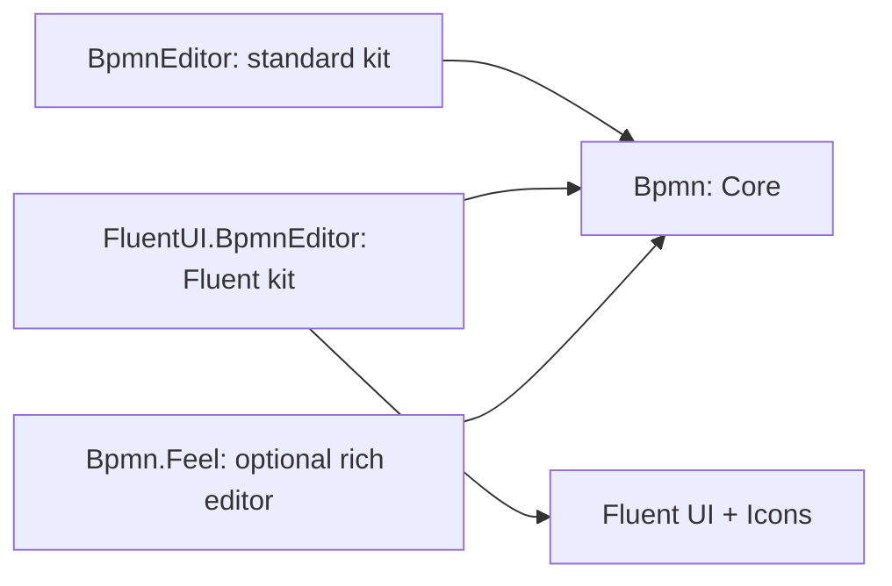
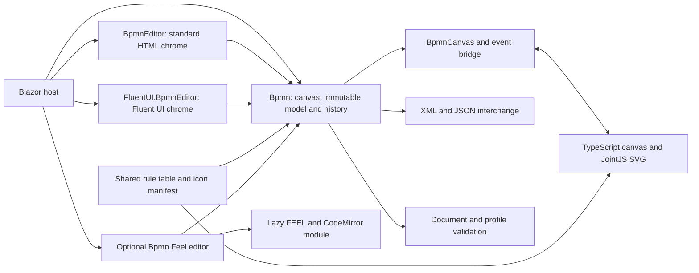
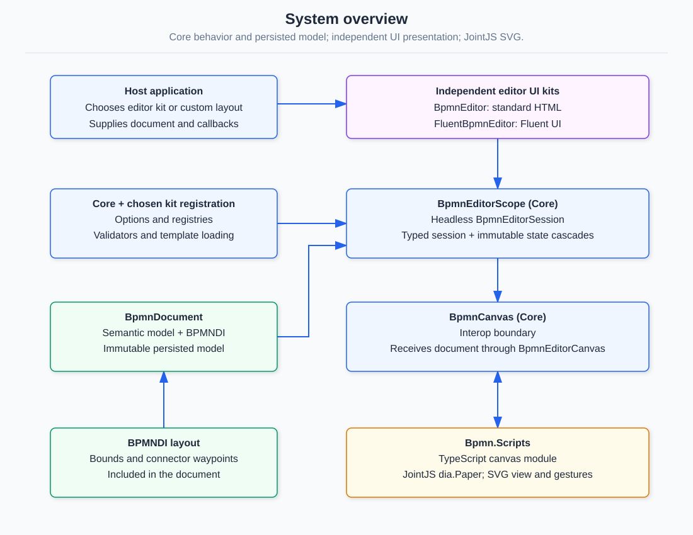
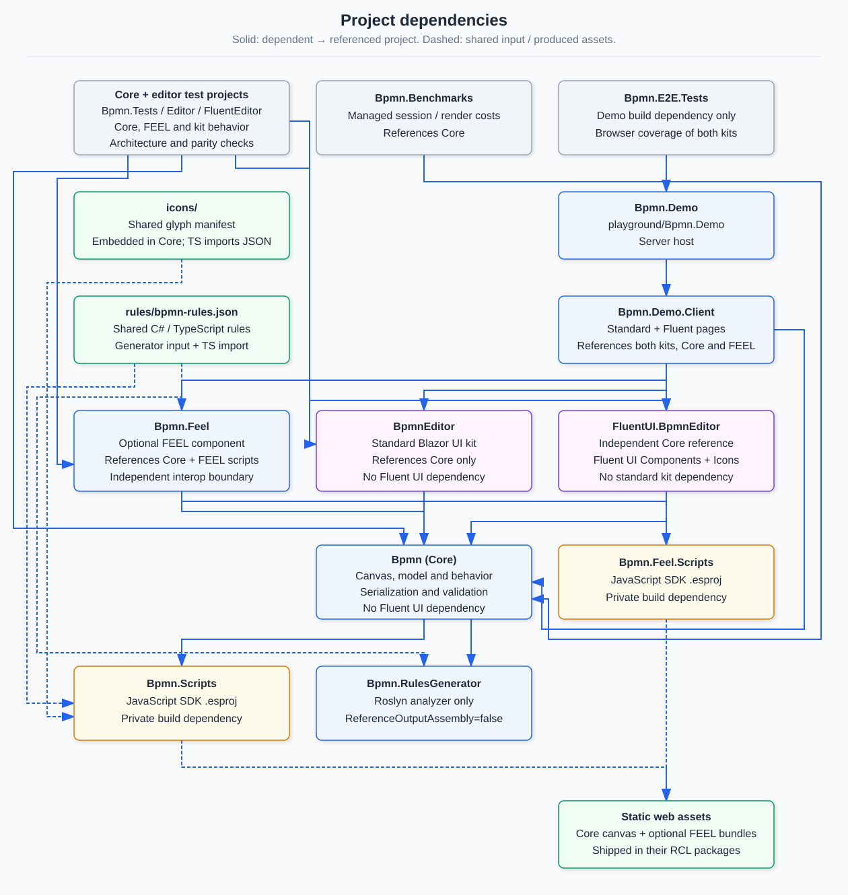

# BlazorBpmnEditor

A BPMN 2.0 diagram editor component library for Blazor. Blazor owns the chrome; a TypeScript module
owns an SVG canvas rendered by JointJS (`@joint/core`, open source only).

Built against two documents in `assets/`: a 1389-line notation and behaviour
[specification](assets/BPMN-2.0-Editor-Specification.md), and the
[implementation plan](assets/BPMN-2.0-Editor-Implementation-Plan.md) that sequences it into
milestones M0–M7.

## Packages (2.0.0)

| NuGet package | Purpose | BPMN dependency |
|---|---|---|
| [`Hasseware.AspNetCore.Components.Bpmn`](src/Bpmn/README.md) | Core model, session/state, canvas, base contracts and intrinsic overlays; no Fluent dependency | None |
| [`Hasseware.AspNetCore.Components.BpmnEditor`](src/BpmnEditor/README.md) | Standard HTML editor composition and chrome | Core only |
| [`Hasseware.FluentUI.AspNetCore.Components.BpmnEditor`](src/FluentUI.BpmnEditor/README.md) | Fluent UI v5 editor composition and chrome | Core only; also Fluent UI and Icons |
| [`Hasseware.AspNetCore.Components.Bpmn.Feel`](src/Bpmn.Feel/README.md) | Optional rich FEEL expression editor | Core only |

Package consumers need .NET 10, not Node.js. Register `AddBpmnEditor()` for the standard kit,
`AddFluentBpmnEditor()` for the Fluent kit, or `AddBpmnComponents()` for Core alone. The Fluent host
must also register `AddFluentUIComponents()` itself. Each kit's README lists its stylesheet setup.



The two kits never reference one another. Both can coexist in a host; each composition supplies
its own defaults, with host overrides taking precedence.

## Projects

| Project | What it is |
|---|---|
| [`src/Bpmn`](src/Bpmn/README.md) | Core model, headless editor, canvas and intrinsic overlays; no Fluent dependency |
| [`src/BpmnEditor`](src/BpmnEditor/README.md) | `Hasseware.AspNetCore.Components.BpmnEditor`: standard HTML composition and chrome; depends only on Core |
| [`src/FluentUI.BpmnEditor`](src/FluentUI.BpmnEditor/README.md) | Fluent UI v5 composition and chrome; independent of Standard |
| [`src/Bpmn.Scripts`](src/Bpmn.Scripts/README.md) | The TypeScript canvas, bundled by esbuild into the library's static web assets |
| [`src/Bpmn.Feel`](src/Bpmn.Feel/README.md) | Optional rich FEEL editor Razor class library |
| [`src/Bpmn.Feel.Scripts`](src/Bpmn.Feel.Scripts/README.md) | esbuild bundle of `@bpmn-io/feel-editor` and CodeMirror for the optional package |
| [`src/Bpmn.RulesGenerator`](src/Bpmn.RulesGenerator/README.md) | A Roslyn generator emitting the C# half of the shared connection-rule table |
| [`tests/Bpmn.Tests`](tests/Bpmn.Tests/README.md) | Core unit, architecture, serialization and intrinsic component tests |
| [`tests/Bpmn.Editor.Tests`](tests/Bpmn.Editor.Tests) | Standard chrome, property entry, composition and package-boundary tests |
| [`tests/Bpmn.FluentEditor.Tests`](tests/Bpmn.FluentEditor.Tests) | Fluent chrome, package-boundary and shared kit parity tests |
| [`tests/Bpmn.E2E.Tests`](tests/Bpmn.E2E.Tests/README.md) | Playwright tests against the running playground |
| [`tests/Bpmn.Benchmarks`](tests/Bpmn.Benchmarks) | BenchmarkDotNet measurements for XML I/O, edits and the accessible graph |
| [`playground/Bpmn.Demo`](playground/Bpmn.Demo/README.md) | Host app and the sample BPMN corpus |
| [`playground/Bpmn.Demo.Client`](playground/Bpmn.Demo.Client/README.md) | The WebAssembly client and the review pages |

Shared inputs live at the root: [`rules/`](rules/README.md) holds the declarative connection-rule
table both runtimes read, and [`icons/`](icons/README.md) holds the generated glyph manifest and the
vendored font it derives from.

## Features

- **BPMN notation:** activities, events, gateways, pools/lanes, data references, annotations,
  groups, and sequence/message flows, associations and data associations. Semantic meaning
  and BPMNDI geometry stay separate; imported geometry is not replaced with inferred layout.
- **Editing:** creation, selection, move/resize, reconnect and waypoint editing, clipboard,
  grouped commands and snapshot-based undo/redo. Both gesture and document layers enforce rules.
- **Validation:** document diagnostics, optional host engine profiles and element-template
  constraints; FEEL/JUEL syntax warnings are advisory, not expression execution.
- **Interchange:** BPMN XML with canonical/fidelity export and versioned JSON model interchange;
  unknown vendor extensions remain preserved rather than silently discarded.
- **Properties and templates:** opt-in Camunda 7 and Zeebe schemas/templates, grouped properties,
  template icons, and templated Blazor groups/entries with a plug-in editor registry.
- **FEEL editing:** JavaScript-free standard expression control plus an optional, lazily loaded
  rich editor with highlighting, parser lint and variable completion.
- **Accessibility:** configurable keyboard navigation, accessible graph/names and live summaries,
  associated property errors, and forced-colors support.

## Architecture

Blazor owns the immutable document, edit history, validation and property UI. The TypeScript
canvas owns live SVG rendering and interaction, then sends edit requests back to Blazor.
Shared rule and icon inputs keep both runtimes aligned. The optional FEEL package has its own
interop lifecycle; it does not add a dependency to core-only hosts.







Diagram sources and focused views:

| View | Rendered diagram | Mermaid source | Editable drawing |
|---|---|---|---|
| System overview | [SVG](assets/diagrams/system-overview.svg) | [Source](assets/diagrams/system-overview.mmd) | [Excalidraw](assets/diagrams/system-overview.excalidraw) |
| Project dependencies | [SVG](assets/diagrams/project-dependencies.svg) | [Source](assets/diagrams/project-dependencies.mmd) | [Excalidraw](assets/diagrams/project-dependencies.excalidraw) |
| Editor composition | [SVG](assets/diagrams/editor-composition.svg) | [Source](assets/diagrams/editor-composition.mmd) | [Excalidraw](assets/diagrams/editor-composition.excalidraw) |
| Managed render state | [SVG](assets/diagrams/render-state.svg) | [Source](assets/diagrams/render-state.mmd) | [Excalidraw](assets/diagrams/render-state.excalidraw) |
| Contextual-action anchors | [SVG](assets/diagrams/contextual-actions-anchor.svg) | [Source](assets/diagrams/contextual-actions-anchor.mmd) | [Excalidraw](assets/diagrams/contextual-actions-anchor.excalidraw) |
| Canvas interop | [SVG](assets/diagrams/interop.svg) | [Source](assets/diagrams/interop.mmd) | [Excalidraw](assets/diagrams/interop.excalidraw) |
| Import/export | [SVG](assets/diagrams/import-export.svg) | [Source](assets/diagrams/import-export.mmd) | [Excalidraw](assets/diagrams/import-export.excalidraw) |
| Properties/extensions | [SVG](assets/diagrams/properties-extensions.svg) | [Source](assets/diagrams/properties-extensions.mmd) | [Excalidraw](assets/diagrams/properties-extensions.excalidraw) |
| Editing commands | [SVG](assets/diagrams/editing-commands.svg) | [Source](assets/diagrams/editing-commands.mmd) | [Excalidraw](assets/diagrams/editing-commands.excalidraw) |
| Validation | [SVG](assets/diagrams/validation.svg) | [Source](assets/diagrams/validation.mmd) | [Excalidraw](assets/diagrams/validation.excalidraw) |
| Build pipeline | [SVG](assets/diagrams/build-pipeline.svg) | [Source](assets/diagrams/build-pipeline.mmd) | [Excalidraw](assets/diagrams/build-pipeline.excalidraw) |

Open editable drawings in Excalidraw using **File > Open**, or drag the `.excalidraw` file into its editor.

SVG layouts are hand-authored: edit coordinates and connector paths directly rather than regenerating
them from Mermaid or Excalidraw. Keep the slate background, pastel rounded cards, soft shadows and
colored arrows consistent across views; keep relationships aligned with the companion sources.

## Build and check

Source builds require .NET 10 and Node.js/npm. Both JavaScript SDK projects need npm
packages: `Bpmn.Scripts` for the canvas, `Bpmn.Feel.Scripts` for the optional rich editor.
Their `.esproj` builds pass the .NET configuration to npm; Debug includes source maps,
Release minifies. Package consumers do not need Node.js/npm.

```shell
cd src\Bpmn.Scripts && npm ci && npm run check && npm run build
cd ..\Bpmn.Feel.Scripts && npm ci && npm run build
cd ..\.. && dotnet build BlazorBpmnEditor.slnx -c Release
& tests\Bpmn.Tests\bin\Release\net10.0\Hasseware.AspNetCore.Components.Bpmn.Tests.exe
& tests\Bpmn.Editor.Tests\bin\Release\net10.0\Hasseware.AspNetCore.Components.BpmnEditor.Tests.exe
& tests\Bpmn.FluentEditor.Tests\bin\Release\net10.0\Hasseware.FluentUI.AspNetCore.Components.BpmnEditor.Tests.exe
dotnet run --project playground/Bpmn.Demo --urls http://localhost:5400
```

The unit suites use xUnit executable runners; `dotnet test` currently reports zero tests.

Zero warnings is the standard under `src/`, where warnings are errors and XML documentation is
required on every public member.

## Principles the code is held to

**The SVG is a view.** The semantic model and the BPMNDI layout model are the two persisted layers;
the canvas is generated from them and is never the source of truth. Geometry read from a document is
written back exactly, and unknown vendor content round-trips verbatim — see
[`docs/xml-interchange.md`](docs/xml-interchange.md).

**One canvas interop owner.** Within the core package, `BpmnCanvas` is the only type holding a JS object reference, and
`BpmnCanvasEventBridge` the only one with `[JSInvokable]` methods. Architecture tests enforce it by
scanning source, not by convention. The optional FEEL package owns a separate editor module.

**Nothing is invented.** A document that omits geometry gets a diagnostic, not synthesised bounds. A
shape whose `bpmnElement` does not resolve is dropped rather than guessed at. Everything lost or
normalised on the way in or out is reported.

**One source per shared artifact.** The rule table, the icon manifest and the sample corpus each
exist once and are read by both runtimes and by the tests.

**UI kits render; Core bases own behavior.** Standard HTML chrome lives in `BpmnEditor`, independent of Fluent UI.

## Migrating from the single 1.x package

Version 2.0.0 is a source and binary breaking change; Core cannot type-forward moved components
into packages that depend on it. Rebuild consumers against the chosen kit.

| Previous usage | Version 2.0.0 |
|---|---|
| Core package supplied `BpmnEditor`, toolbar, panels and property entries | Add the standard editor package; component namespace remains `Hasseware.AspNetCore.Components.Bpmn`. Or choose the Fluent package and `FluentBpmnEditor` / Fluent-prefixed components in `Hasseware.FluentUI.AspNetCore.Components.Bpmn` |
| `AddBpmnComponents()` enabled complete editor chrome | Call `AddBpmnEditor()` or `AddFluentBpmnEditor()`; both include Core services. Core alone remains valid for standalone canvas/headless composition |
| Core brought Fluent UI transitively | Core and Standard no longer depend on Fluent. Fluent hosts explicitly call `AddFluentUIComponents()` and supply any required providers |
| Toolbar/panels/widgets received host-wired state and command parameters | Removed parameters are replaced by session/state cascades and the matching Core bases; use slots or `BpmnOptions.Components.Use<TComponent>` for markup overrides |
| Widgets could render without their editor/canvas parent | Missing required parents now throw `InvalidOperationException`; wrap editor parts in `BpmnEditorScope`, canvas widgets inside its canvas, and property entries in `BpmnPropertyScopeProvider` |
| Named string cascades and `BpmnCanvasContext` | Removed; use typed `BpmnEditorSession`, `BpmnEditorState`, `BpmnCanvasSurface` and `BpmnPropertyScope` |
| All editor CSS came from Core's bundle | Core still auto-loads canvas CSS; add the selected kit's stylesheet links from its README |

Ready-made editor parameters and imperative commands are mostly preserved. Custom standalone
`BpmnCanvas` remains supported. Keep the entire composition in one interactive component;
cascades and fragment slots cannot cross render-mode boundaries.

## Documentation

- [Composing an editor](docs/composing-an-editor.md) — scope/canvas layout, slots, part precedence and parent contracts
- [Writing a UI kit package](docs/writing-a-ui-kit.md) — base classes, kit defaults, property editors and ownership rules
- [Localization](docs/localization.md) — resx/XLIFF workflow, cultures, diagnostics and host localizer factories

- [`docs/editing.md`](docs/editing.md) — commands, undo, what is enforced, and who owns the document
- [`docs/validation.md`](docs/validation.md) — document rules, product lint, and schema-validation limits
- [`docs/canvas-navigation.md`](docs/canvas-navigation.md) — pointer, keyboard, touch, alignment guides and accessibility
- [`docs/xml-interchange.md`](docs/xml-interchange.md) — the two export modes and what each preserves
- [`docs/json-interchange.md`](docs/json-interchange.md) — JSON envelope, versioning, limits and XML differences
- [`docs/interchange-spike.md`](docs/interchange-spike.md) — the measurement behind owning XML I/O
- [`.claude/skills/verify/SKILL.md`](.claude/skills/verify/SKILL.md) — how to build, launch and drive the app to observe a change

## Schema References

- [Camunda Element Templates](https://unpkg.com/@camunda/element-templates-json-schema/resources/schema.json)
- [Zeebe Element Templates](https://unpkg.com/@camunda/zeebe-element-templates-json-schema/resources/schema.json)

## Licence

MIT. Glyph path data is derived from [bpmn-font](https://github.com/bpmn-io/bpmn-font) under
OFL-1.1.

## Localization

Core, Standard and Fluent localize UI strings and validation display through `.resx` / XLIFF
catalogs, with satellites for 13 cultures. New translations still contain English until completed.
`BpmnDiagnosticLocalizer` formats display text without changing invariant diagnostic messages.
See [Localization](docs/localization.md) for the dotnet-eng build feed, `UpdateXlf`, culture setup,
resource ownership and replacing `IStringLocalizerFactory`.
