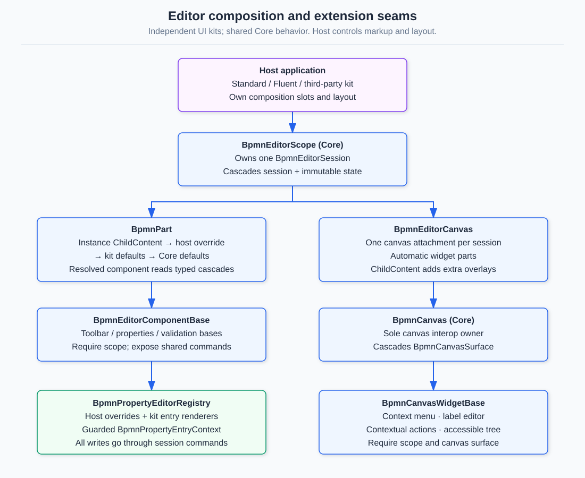

# Composing an editor

Core owns editor behavior. UI kits own markup and layout. Choose the
[standard HTML kit](../src/BpmnEditor/README.md) or
[Fluent UI kit](../src/FluentUI.BpmnEditor/README.md) for a ready-made composition, or build a
layout over Core. Both kits depend on Core, never on one another.



## Register services

For a standard editor, call `builder.Services.AddBpmnEditor()`. For a Fluent editor, call
`builder.Services.AddFluentBpmnEditor()` and register Fluent UI services in the host as described
in its package README. Both extensions call Core's `AddBpmnComponents()` and register defaults.
Core-only hosts call `AddBpmnComponents()`; only label-editor and accessible-tree parts have
Core defaults. Other unregistered parts render nothing.

Services must be registered in each renderer's service container, including both server and
client for interactive WebAssembly with prerendering. Include the chosen kit's stylesheets;
Core's canvas assets load through its JS initializer.

## Custom layout

This example uses the standard kit's registered defaults but replaces its layout. The host owns
`document`, updated by `OnDocumentChanged`. The scope itself adds no DOM.

```razor
@using Hasseware.AspNetCore.Components.Bpmn
@using Hasseware.AspNetCore.Components.Bpmn.Configuration
@using Hasseware.AspNetCore.Components.Bpmn.Model

<BpmnEditorScope @ref="scope" Document="@document" OnDocumentChanged="DocumentChanged">
    <section class="my-editor" aria-label="Process editor">
        <header><BpmnPart Part="BpmnEditorPart.Toolbar" /></header>
        <div class="my-editor__body">
            <aside aria-label="Shapes"><BpmnPart Part="BpmnEditorPart.Stencil" /></aside>
            <BpmnEditorCanvas>
                <BpmnPart Part="BpmnEditorPart.ExternalChangeOffer" />
            </BpmnEditorCanvas>
            <aside aria-label="Properties"><BpmnPart Part="BpmnEditorPart.PropertyPanel" /></aside>
        </div>
        <BpmnPart Part="BpmnEditorPart.ValidationPanel" />
        <BpmnPart Part="BpmnEditorPart.ImportOffer" />
        <BpmnPart Part="BpmnEditorPart.CalledElementPicker" />
        <BpmnPart Part="BpmnEditorPart.ShortcutHelp" />
    </section>
</BpmnEditorScope>

@code {
    private BpmnEditorScope? scope;
    private BpmnDocument? document;
    private void DocumentChanged(BpmnDocument value) => document = value;
}
```

Style `my-editor` and `my-editor__body` in the host; give the canvas a usable height and place
`.bpmn-editor__canvas` in your grid/flex layout. The custom composition owns landmarks, visibility
and read-only presentation; use `BpmnEditorState.IsReadOnly` when deciding whether to show mutation
surfaces. Built-in part bases still guard commands. The supplied kit compositions already manage
these layout decisions.

`BpmnEditorCanvas` binds the canvas to the session and automatically renders ContextMenu,
LabelEditor, ContextualActions and the accessible tree (when open) inside the canvas host.
Its `ChildContent` adds overlays; do not render those default parts again. Canvas-relative
widgets must stay inside this host, because their anchors are canvas client coordinates.

See [contextual-action anchoring](../assets/diagrams/contextual-actions-anchor.svg) for the
model-to-client coordinate flow and gesture refresh behavior.

After initialization, `scope.Session` exposes commands such as `UndoAsync()`, `RedoAsync()` and
`ValidateAsync()`. Session document/history commands work without a canvas. Canvas-only commands
are no-ops until a canvas attaches. A scope accepts at most one attached canvas.

Stencil drop and keyboard creation target `Session.ActiveDiagramId`, including diagrams opened
through drill-down. Blank-area creation uses that plane's Process or embedded Sub-Process;
hit containers still take precedence. A pending Call Activity retains its original destination
until the picker is confirmed. For direct Core creation commands, set their `DiagramId` property
to target a particular plane; omitting it preserves first-diagram behavior. Missing or incompatible
explicit destinations reject atomically. D009 still reports genuinely unreachable flow nodes;
creation does not automatically connect them.

Connector creation, contextual append, moves, resizes and connector reroute/endpoint edits
also target the diagram where the gesture occurred. Routed waypoints belong to that view;
editing one view does not copy its geometry into another view of the same connector. Both kits
use the same live Manhattan router for Sequence and Message Flows on every diagram.
Associations remain straight, and imported routes are preserved until edited.
Direct Core callers can set `DiagramId` on `CreateConnectorCommand`, `MoveShapesCommand`,
`ResizeShapeCommand`, `ReconnectConnectorCommand` and `UpdateWaypointsCommand` to scope geometry
to one plane. Omitting it retains legacy command behavior.

## Slots and application overrides

The ready-made `BpmnEditor` and `FluentBpmnEditor` compositions expose these slots:

| Slot | Effect |
|---|---|
| `ToolbarContent` | Replaces Toolbar for this editor |
| `StencilContent` | Replaces Stencil for this editor |
| `PanelContent` | Replaces PropertyPanel for this editor |
| `CanvasOverlays` | Adds content inside the canvas host |
| `Dialogs` | Adds editor-level dialogs |
| `Footer` | Adds footer content |

For example, a standard editor can embed a custom toolbar without changing application defaults:

```razor
<BpmnEditor Document="@document">
    <ToolbarContent><MyToolbar /></ToolbarContent>
    <Footer><p>Changes remain in memory until saved.</p></Footer>
</BpmnEditor>
```

`MyToolbar` must derive from `BpmnToolbarBase`; see [Writing a UI kit package](writing-a-ui-kit.md).
For the same replacement across all editors:

```csharp
using Hasseware.AspNetCore.Components.Bpmn;
using Hasseware.AspNetCore.Components.Bpmn.Configuration;

builder.Services.AddBpmnEditor(options =>
    options.Components.Use<MyToolbar>(BpmnEditorPart.Toolbar));
```

Alternatively, `builder.Services.Configure<BpmnOptions>(...)` sets the same host overrides.
`Use<TComponent>` checks the required part base and rejects incompatible/abstract types.
`options.Components.Remove(BpmnEditorPart.Toolbar)` suppresses a registered part even if a kit
registers later. Explicit slot content still wins. To replace one part in a custom composition,
put content inside `BpmnPart`; its optional `Fallback` renders only if no content or component resolves.

Resolution order:

1. Instance `RenderFragment` slot / `BpmnPart.ChildContent`.
2. Host `BpmnOptions.Components.Use<TComponent>` (or explicit `Remove`).
3. The scope's `BpmnKitDefaults`, supplied by the composition.
4. Application registry `UseDefault<TComponent>`.
5. No component (or `BpmnPart.Fallback`).

Each kit composition supplies its own defaults, so both kits can share one DI container without
registration order changing their appearance. A bare custom scope uses application defaults unless
it supplies `KitDefaults`, for example `KitDefaults="@BpmnStandardDefaults.Kit"`.

## Offering the editor to browser agents

`<BpmnWebMcp />` from the optional `Bpmn.WebMcp` package belongs inside the editor's scope and draws nothing, so the
`Dialogs` slot is where it goes; see [Offering the editor to browser agents](webmcp.md):

```razor
<BpmnEditor Document="@document">
    <Dialogs><BpmnWebMcp /></Dialogs>
</BpmnEditor>
```

Agents can only look until the host sets `AllowMutations`; then they can edit, and deleting and saving ask the user
through the editor's `AgentConfirmation` part, which both kits include.

## Typed cascades and required parents

`BpmnEditorScope` cascades a fixed `BpmnEditorSession` and a changing immutable `BpmnEditorState`.
Editor-bound parts derive from `BpmnEditorComponentBase` and require both; do not recreate the old
host-wired state/command parameters. Core's `BpmnCanvas` cascades `BpmnCanvasSurface` to its children.
Canvas widgets require this in addition to the editor context. `BpmnPropertyScopeProvider` creates
a typed `BpmnPropertyScope` for property entries; unset values inherit, and nested scopes cannot
undo a parent's read-only setting. Context constructors are internal: create contexts through the
scope/canvas/provider components, not manually.

Missing required parents throw `InvalidOperationException`, rather than silently rendering empty
or falling back to standalone parameters. A standalone `BpmnCanvas` remains supported, but is not
an editor scope and does not supply editor session/state to its descendants.

## Interactive render mode

Keep the **whole editor in one interactive component**. Put the render-mode boundary on the host
page/wrapper, not separately on scope, canvas, parts or slot content. Cascading values do not cross
static/interactive boundaries, and `RenderFragment` parameters cannot be serialized across them.
Prerendering can produce markup, but canvas interop starts only after interactive rendering.
See [Blazor cascading values](https://learn.microsoft.com/aspnet/core/blazor/components/cascading-values-and-parameters#cascading-valuesparameters-and-render-mode-boundaries).

For localized labels and host text overrides, see [Localization](localization.md).
