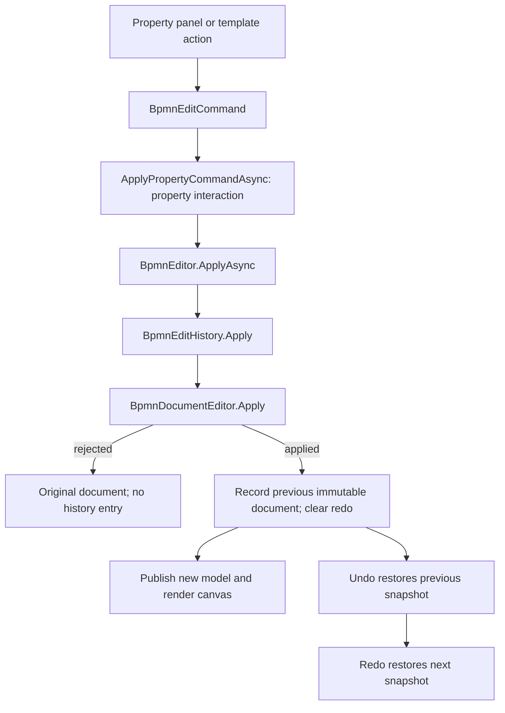

# Editing

How a change to a diagram is made, validated and recorded.

Editing features share one command and validation spine. Selection, movement, creation, deletion,
undo/redo and canvas gestures all preserve the same model boundary.

## Who owns the document

Blazor. The canvas renders a document it does not own and never changes one, so every edit crosses
interop as a **request**:

```
pointer → canvas applies optimistically → EditRequest → BpmnEditHistory.Apply → new document
```

A move is applied to the JointJS graph first and reported afterwards, because a drag that had to
round-trip for permission on every frame would lag the pointer. A delete has nothing to apply
optimistically and is only ever a request.

That split is why the canvas validates too. It owns the live geometry and must refuse a drag while
the pointer is still down; `BpmnDocumentEditor` is the model of record and must refuse a command
that arrives from a host calling the API directly. Neither side can assume the other looked — the
same argument the specification makes for configuration.

## Commands

`BpmnEditCommand` describes intent, not a mutation. `BpmnDocumentEditor.Apply` is pure: a document
and a command in, a new document out.

| Command | What it does |
|---|---|
| `MoveShapesCommand` | Sets new bounds on one or more DI shapes |
| `ResizeShapeCommand` | Resizes one shape, re-tiling the Lanes or neighbours that share its geometry |
| `PasteCommand` | Adds a clipboard fragment with fresh ids |
| `CreateArtifactCommand` | Adds a Text Annotation or a Group |
| `CreateDataReferenceCommand` | Adds a data reference, and its definition when asked |
| `ReparentElementCommand` | Moves an element into a different container or Lane |
| `ReconnectConnectorCommand` | Moves one end of a connector to a different element |
| `UpdateWaypointsCommand` | Replaces a connector's route |
| `CreateElementCommand` | Adds a Flow Node and its `BPMNShape` together |
| `CreateConnectorCommand` | Adds a connector and its `BPMNEdge` together |
| `DeleteElementsCommand` | Removes elements plus everything that cannot outlive them |
| `CompoundCommand` | Several commands as one history entry, succeeding or failing together |

**Rejection needs no rollback.** A `BpmnDocument` is immutable, so a refused command returns the
document that went in — the caller is still holding exactly what it had. `BpmnEditResult.Document`
is always the document to use next, whichever way it went, so no caller has to decide whether to
keep its old reference.

A move reports every affected shape, including the descendants of a moved container. The canvas
sends the whole set because it is what actually resolved the drag; recomputing which children moved
would be a second implementation of containment.

## Property, extension and template commands

A properties panel is another command producer, not a separate mutable model. Built-in panel
callbacks return `BpmnEditCommand` instances; the demo forwards them to
`BpmnEditor.ApplyPropertyCommandAsync`, which calls `ApplyAsync`, reports rejections and refreshes
panel/selection state. Hosts can use `ApplyAsync` directly for general command execution.
Core scalar edits use `UpdatePropertiesCommand`; id changes use `RenameElementCommand` so
references can be updated with the rename. Bulk property edits use `CompoundCommand`, making
the selection-wide edit one atomic history step.

Script Tasks expose `scriptFormat` as a free-text language name or media type and `script` as
multiline text in both built-in property panels. Both use `UpdatePropertiesCommand`, preserve
script whitespace, and support undo/redo. Other task types do not offer these fields; switching
away from Script Task clears them.

### Standard property groups

`BpmnPropertyDescriptor.Group` is a `BpmnPropertyGroupKind` classifier. The inspector sets it
from the owning [BPMN 2.0.2 semantic concept](https://www.omg.org/spec/BPMN/20100501/Semantic.xsd);
both built-in panels use `BpmnGeneralPropertiesProvider` to turn those descriptors into sections.
The default is `General`, so existing descriptor constructors and deconstruction remain unchanged:

```csharp
var descriptor = new BpmnPropertyDescriptor(
    "standardLoop.loopMaximum", "Loop maximum", BpmnPropertyKind.Text, "10")
{
    Group = BpmnPropertyGroupKind.LoopCharacteristics,
};
```

| Section / stable group id | Properties |
|---|---|
| General / `general` | Common names, documentation, unclassified host descriptors |
| Activity / `activity` | Compensation handler and Activity default flow |
| Event / `event` | Trigger and interruption |
| Script Task / `script-task` | Script format and body |
| Call Activity / `call-activity` | Called-element reference |
| Send Task / `send-task`; Receive Task / `receive-task` | Respective task's message reference |
| Gateway / `gateway` | Gateway default flow |
| Complex Gateway / `complex-gateway` | Activation condition and default flow |
| Sequence Flow / `sequence-flow` | Condition, language, projected default flag |
| Message Flow / `message-flow` | Message reference |
| Association / `association` | Direction |
| Assignment / `assignment` | Data Association from/to expressions |
| Text Annotation / `text-annotation` | Text and format |
| Group / `group` | Category reference |
| Data Object Reference / `data-object-reference` | Object reference and projected collection flag |
| Data Store Reference / `data-store-reference` | Store reference |
| Data State / `data-state` | Data reference state |
| Process / `process` | Executable, type, closed |
| Loop Characteristics / `loop-characteristics` | Loop selector, standard/multi-instance details, input/output data items |
| Complex Behavior Definition / `complex-behavior-definition` | All indexed complex behavior events and conditions |

Expression body, language, and type stay in their owner's section. A Complex Behavior Definition
belongs to multi-instance Loop Characteristics; it is not a Complex Gateway activation condition.
Repeated definitions share one section and retain numbered field labels and indexed command paths.

BPMN defines semantic ownership, not accordion layout. Panels deliberately use flat, initially
expanded sections: General first, element-specific sections next, then Loop Characteristics and
Complex Behavior Definition. Empty sections are omitted; descriptor order within each section
is retained. Group headings use `PropertyGroup.{id}` localization resources.

Grouping changes presentation only. Edits still use the descriptor's original property name.
Bulk selection keeps a shared classifier when selected descriptors agree; otherwise the common
field appears in General without losing bulk-edit support. Read-only snapshots retain classification.
Context menus remain flat. Vendor/schema/raw-extension and template groups keep their own ids,
namespaces, labels, and bindings.

Hosts can supply the classifier in custom snapshots, or use `IBpmnPropertiesProvider` and
`GroupTemplate` to rename/reorder groups or define custom sections. `BpmnGeneralPropertiesProvider`
keeps its existing name and priority; `FromDescriptor` copies classification into entry `GroupId`.
Provider-supplied labels remain host-owned rather than automatically translated.

### Extension commands

| Extension command | Use |
|---|---|
| `SetExtensionValueCommand` | Change an attribute or text at an expanded-name extension path |
| `SetLoopExtensionValueCommand` | Change vendor content beneath a multi-instance loop |
| `SetForeignAttributeCommand` | Set/remove a namespace-qualified attribute on a BPMN element |
| `AddExtensionElementCommand` / `RemoveExtensionElementCommand` | Add a subtree or remove an addressed extension node/value |
| `ReplaceExtensionCollectionCommand` | Replace collection rows while retaining unknown item content |
| `ReplaceCamundaCollectionCommand` | Edit simple Camunda rows; structured rows remain read-only and preserved |

Paths use namespace identity rather than whichever prefix a file happened to declare.
See [`ExtensionCommands`](../src/Bpmn/Editing/Extensions/ExtensionCommands.cs) and
[`BpmnExtensionNavigator`](../src/Bpmn/Editing/Extensions/BpmnExtensionNavigator.cs) for path and
row-identity semantics. Clearing a value is command-specific: foreign attributes use `null` for
removal; extension value commands also treat an empty value as removal.



Template operations use the same spine:

- `ApplyElementTemplateCommand` validates applicability, writes active defaults and template
  markers, and applies a supported element-type override in one undo step. Supplying the
  registry lets it resolve a known previous template's bindings; unknown previous template data
  is retained.
- `SetTemplatePropertyCommand` edits an active editable property and reconciles conditional
  bindings atomically.
- `UnlinkElementTemplateCommand` removes template identity markers, **keeping configured values**.
  It does not mean remove the vendor configuration.
- `RemoveElementTemplateCommand` removes that template's bindings and markers while preserving
  other extension content. `UpgradeElementTemplateCommand` retains editable non-hidden values
  whose bindings match the new template.

Template stencil creation combines creation and application in a `CompoundCommand`. A failed
application cannot leave a half-created element. Undo/redo stores document snapshots, not inverse
extension patches, so nested vendor trees and template markers return with the rest of the model.
See [`TemplateCommands`](../src/Bpmn/Editing/Templates/TemplateCommands.cs).

## What is enforced

- **DI-002 / DI-003** — bounds must be finite and have positive area.
- **DI-011** — two peer Flow Nodes may not be left overlapping, with a configurable clearance.
  Exemptions matter as much as the rule: nodes in different containers are not laid out against
  each other, a container legitimately encloses its content, and a Boundary Event is *required* to
  sit on its host's outline by DI-010. Getting those wrong makes ordinary diagrams unbuildable.
- **Deletion cascade** — Sequence Flows that lose an endpoint, Boundary Events that lose their
  host, an embedded Sub-Process's whole nested graph (§2.7), Associations and Data Associations that
  lose a side, and every DI entry whose `bpmnElement` would dangle (§10.1). The cascade iterates to
  a fixed point, because deleting a Sub-Process can orphan a Boundary Event whose flows then have
  nothing to connect.
- **Lane deletion does not cascade.** §2.8 is explicit: the Pool, the Process and the Flow Nodes
  stay, and only the Lane and its `flowNodeRefs` go. A Lane looks like a container and is not one.
- **Pool and Process deletion is refused**, with `EDIT-022`. The specification does not say whether
  a Pool takes its Process and that Process's nodes with it, and guessing at something irreversible
  is worse than saying no.

## Creation

Creation is a single transaction (§9.3): everything is validated first, then the semantic object and
its DI are built together, so a refusal leaves **neither** — not a shape with nothing to draw, and
not an element with nothing to draw it.

The stencil (`BpmnStencilPanel`) offers twelve tools: Start Event, Intermediate/Boundary Event, End
Event, Gateway, Task, Sub-Process, Call Activity, Data Object Reference, Data Store Reference,
Pool/Lane, Text Annotation, and Group. It is still computed from the active container, so an Event Sub-Process
disables its untyped Start Event, a black-box Pool offers nothing, and Flow Nodes stay out of the
Collaboration plane.

Template stencil entries require a creatable Flow Node matching the template's `appliesTo`.
`elementType.value` takes precedence; otherwise the first concrete `appliesTo` target is used.
Task, Activity and FlowNode targets may resolve to a plain Task only when that Task is applicable.
Process, connector, collaboration and root-only templates are omitted. Event templates retain their
`elementType.eventDefinition`. Creation and template application form one atomic command.

Which container that is follows the **selection** unless the host pins `ActiveContainerId`:
selecting a Pool, a Lane, a Task or a connector inside one offers what that Pool's Process accepts.
A Lane matters in particular — it covers most of a Pool's area, so on a lane diagram it is the
easiest thing to click, and it resolves through its Lane Set because a Lane classifies nodes without
owning them (§2.8).

The Intermediate/Boundary tool creates an untyped Intermediate Throw Event off an Activity; dropped
inside an Activity, it creates a Message Boundary Event attached to that Activity. BPMN permits an
untyped Intermediate Throw but requires a trigger for a Boundary Event. A Call Activity opens a
picker for a callable Process or Global Task before it is created. The Pool/Lane tool creates a Lane
when dropped anywhere inside a Pool, including on a Pool's contents; elsewhere it creates a Pool.
Ordinary embedded Sub-Processes offer only an untyped Start Event, and an Event Sub-Process shows
that tool disabled with `EV-004`.

## Pool/Lane needs a Collaboration or Pool

§1.5 defines a Lane as a subdivision of a Pool, and every geometric rule for one is written that way.
The combined Pool/Lane tool resolves to a Lane inside an existing Pool and a Pool elsewhere. It is
disabled with `CT-001` when the document has no Collaboration to hold a Pool and no Pool to subdivide.

The command still refuses an invalid Lane with `CT-012`; the disabled state is guidance, while command
validation enforces the model rule.

A file that already contains one is repaired rather than rejected. The reader gives an orphan lane set
a Participant, drawn around the lanes already there, and says so as an import diagnostic. It is the one
place the reader changes what a file stated, and it is deliberate: the alternative is a document that
is permanently invalid and cannot be edited into a valid one. Every Lane, Flow Node and waypoint is
left exactly as read; what is added is a Participant, a Collaboration to hold it, and one shape.

"Says so" means on screen, not only in a log. The import offer lists it under **Changed** — content the
reader kept but not as the file stated it — beside the existing **Not kept** row for content it could not
represent at all. They are different answers to different questions, and a structural rewrite that only
appeared in a diagnostic nobody renders would be the silent rewrite §10.6 ("report every ... normalized
item") and §6.1 exist to prevent. Connector ends moved onto their shapes' outlines on import are
reported the same way, one diagnostic per connector.

Note this is the converse of the existing rule, not a softening of it — a Pool still needs no Lane, and
deleting the last Lane still leaves a valid lane-less Pool (§2.8).

A **collapsed** Sub-Process is not somewhere to create into, even though it owns content: it renders
as an opaque leaf with no children drawn, so a new element inside it would have nowhere to appear.
Selecting one offers the palette of whatever contains it. `BpmnStencil.IsOpenContainer` is the single
answer to that question, used by both the palette and the container the selection resolves to. With nothing
selected on a Collaboration plane the palette is artifacts-only and all of them disabled, which is
what §9.1 says and also the instruction — choose a Pool to create into it. A multi-selection says
nothing unambiguous, so it says nothing.

Where a drop *lands* still beats the selection. The Pool under the pointer is a fact about the new
shape's geometry, and owning the element to a different Process would leave the DI and the semantics
disagreeing; the active container only decides when the drop landed nowhere in particular.

The non-Flow-Node tools use their own commands:

- **An artifact is not a Flow Node.** A Text Annotation or a Group takes no part in Sequence Flow
  and is not subject to DI-011 — an annotation is meant to sit beside what it annotates and a Group
  is meant to enclose things. On a Collaboration plane they belong to the Collaboration's artifact
  collection (§9.1), not to a Process.
- **A data reference points at a definition that is never drawn.** A drop creates both. §9.1's other
  option — referencing an existing definition — is in the command as an explicit either/or, so
  supplying both or neither is refused rather than guessed at: guessing is how definitions get
  duplicated, which the specification warns about by name.
A tool that cannot be used is shown **disabled with its rule code**, not hidden. The generic Pool/Lane
tool says `CT-001` when neither of its two target-dependent creations can be made.

Two gestures reach the same command:

- **Drag a tool onto the canvas.** The canvas resolves the release point — it is the only side that
  knows the paper coordinates, the zoom and which container the point fell inside — and Blazor turns
  the answer into the command. The pointer marks the new shape's **centre**, not its corner, and grid
  snapping is applied to that centre before anything else looks at it, which is the ordering §4.6
  requires.
- **Focus a tool and press Enter.** A palette that could only be dragged would be unusable without a
  pointer. With no pointer there is no release point, so the canvas offers the visible centre,
  stepped clear of whatever is already there — otherwise pressing twice would stack the second
  element on the first and DI-011 would refuse it, which is correct and useless.

Overlap with a *container* is not a collision on either path: dropping into a Pool, a Lane or a
Sub-Process is how those get filled.

## Event legality and editing policy

`BpmnElementInspector.TriggersFor(document, node)` returns BPMN 2.0.2 triggers compatible with the
candidate's current interruption state, container and Boundary host. Gallery and editor surfaces
can use it to omit impossible trigger/context cells. `SupportedTriggersFor(document, node)` returns
the structurally supported trigger set without filtering for interruption, so combined trigger and
interruption edits remain available. `IsLegalEvent(document, node)` checks the whole context, and
D020 uses the same rule for imported, assembled and edited documents.

| Context | Allowed trigger / interruption | Forbidden |
|---|---|---|
| Start Event in a top-level Process | None, Message, Timer, Conditional, Signal, Multiple, Parallel Multiple | Error, Escalation, Compensation |
| Start Event in an ordinary embedded Sub-Process | None | Every triggered Start Event |
| Start Event in an Event Sub-Process | Message, Timer, Error, Escalation, Compensation, Conditional, Signal, Multiple, Parallel Multiple | None |
| Error Start in an Event Sub-Process | Interrupting | Non-interrupting |
| Compensation Start in an Event Sub-Process | Non-interrupting | Interrupting |
| End Event in a Transaction | Cancel | — |
| End Event outside a Transaction | None, Message, Error, Escalation, Compensation, Signal, Terminate, Multiple | Cancel |
| Boundary Event on a Transaction | Cancel; Error and Cancel are interrupting | Cancel on another host; non-interrupting Error or Cancel |
| Compensation Boundary Event | Compensation; `cancelActivity` is N/A (the editor's only representable state is the default `true`) | Non-interrupting |

Other Boundary triggers may interrupt or continue. For a Boundary Multiple Event, an Error, Cancel
or Compensation definition requires the restrictive state. BPMN 2.0.2 table 10.92 defines
`cancelActivity` as N/A for Compensation Boundary Events; because the model stores this attribute
as a Boolean, the editor preserves its default `true` value and rejects the non-interrupting
(`false`) representation. These context differences follow tables 10.84–10.92, including the
ordinary Sub-Process Start Event restriction and the special Error/Compensation interruption rules.

`EditingOptions.EventEditPolicy` defaults to `BpmnEventEditPolicy.Reject`. This rejects an edit that
introduces an invalid event context, atomically and without an undo entry. Existing invalid imported
events remain reportable under D020; unrelated edits do not get blocked by defects already in the
document. A combined trigger/interruption property batch is judged by its final state, independent
of property order.

`BpmnEventEditPolicy.AutoAdjustInterrupting` is the only alternative. When the requested trigger
and context are supported but BPMN requires a different interruption value, the editor changes only
`IsInterrupting`, reports an `EDIT-084` informational diagnostic, and records both changes as one
undoable edit. Unsupported triggers or containers remain rejected; the editor never substitutes a
different trigger. Create, trigger switch and reparent commands use the same rule. Runtime config
changes take effect on the next edit without replacing the document's history.

## Drag-to-connect

A selected element carries a connector-initiation handle (`elementTools.Connect`) just outside its
right edge, where BPMN draws nothing and it cannot be mistaken for notation.

**A handle, not ports.** §4.6 forbids quantising an outline into fixed anchors, so the whole shape
body is one magnet and a connector attaches at an arbitrary point on the boundary. The body is a
magnet for *arriving*, never for starting: the paper sets `addLinkFromMagnet: false`, so a pointer
down on a shape still begins an element drag. Making the body a magnet for starting too would have
the two gestures fighting over the same pointer-down.

Which connector a pair implies is inferred, not chosen: a Text Annotation endpoint means an
Association, a data endpoint a Data Association, a Pool endpoint or a cross-Pool pair a Message Flow,
and anything else a Sequence Flow.

**Validation is live**, against the shared rule table in `rules/bpmn-rules.json` — the same table the
C# side reads, so the canvas and the document cannot drift. Every shape the rules reject is greyed
out *while the pointer is still down*, so an illegal target never looks droppable (§7), and a release
on one is refused by rule code rather than silently vanishing.

The route is two points, projected onto each shape's outline. Two is the minimum DI-001 accepts, and
the endpoints must not be the shape centres: a connector ends on its shapes' outlines (§4.6), and
centre waypoints would draw it straight through both shapes.

## Clipboard

Copy closes over what it is given rather than filtering it. A selection is whatever the user
happened to click, so the set is expanded to everything the copied elements cannot exist without —
a Boundary Event's host, an embedded Sub-Process's entire nested graph (§2.7) — and narrowed to
connectors whose **both** ends are inside it. A flow with one end outside would paste as an edge to
an element that does not exist.

Ids are regenerated at paste, not at copy, which is what makes one payload pastable repeatedly:
§2.7 says each occurrence is a distinct, unrelated set of elements even when visually identical.

References are rewritten only where both ends are inside the fragment:

| Reference | What paste does | Why |
|---|---|---|
| Sequence Flow endpoints, `attachedToRef` | Rewritten to the copies | Both ends came along |
| `calledElementRef` | **Left alone** | A Call Activity is reusable by reference (§2.7); forking what it calls would break every other Call Activity sharing that definition |
| `default` (to a Sequence Flow) | Rewritten if the flow was copied, otherwise cleared | Never left dangling, never guessed at |
| `messageRef`, `errorRef`, and the rest of the §1.0 catalog | Left alone | Global definitions the paste does not fork |
| Lane membership | Dropped | Lanes are not copyable, so a copy is in no Lane |
| Vendor extensions | Carried with their owner, contents untouched | §6.1: deep-clone with the element, never rewrite arbitrary strings |

A collapsed Sub-Process draws its interior on a **plane of its own** (§10.1), and the copy keeps
it that way: the paste puts the roots on the active plane and gives each copied interior a new
diagram. Flattening the copied DI onto one plane instead spilled a collapsed Sub-Process's whole
nested graph onto the top level, where nothing was hiding it. A nested plane's coordinates are not
offset either — it has its own space, and shifting it would move the interior relative to a
Sub-Process that has not moved.

Pools, Lanes and Processes are **not copyable**. Copying a Pool means copying a Participant and the
Process it references, which is a structural transform rather than a duplication; a Lane is not a
container at all, so "copy this Lane" has no meaning separate from copying the nodes it classifies.

A paste starts 20 units from where it was copied and steps further out until it lands clear.
Refusing a paste that overlaps its original would be correct and useless — the user asked for a copy
and has no way to say where. `Ctrl+D` duplicates without touching the clipboard, because duplicating
something should not throw away what was copied ten seconds ago.

`Ctrl+C` works in read-only. It changes nothing about the document, and §7 asks read-only to keep
inspection while losing every mutation surface; `Ctrl+X` and `Ctrl+V` are refused on both sides.

## Rectangular selection

**Shift and drag on blank paper.** A plain drag still pans, because that is the gesture this canvas
has always had and silently repurposing it would break every host that documented it.

A band selects a shape only when it contains **the whole of it**. Intersection would be friendlier
for grazing a row of Tasks, but it also selects every container the band happens to sit inside —
draw a small band in the middle of a Pool and you would have selected the Pool. Containment gives
pool-scoped selection with no special case: the Pool encloses the band rather than the other way
round. A selected container drops its own descendants from the result, so dragging the selection
does not move a child twice, once for itself and once with its parent.

## Resizing

Handles appear on the shapes that have a resize command: Pools, Lanes, expanded Sub-Processes,
Transactions, Ad-Hoc Sub-Processes, Text Annotations and Groups. Events and Gateways have fixed
notation sizes, and a resized Task is a layout choice this milestone has no command for, so neither
offers a handle rather than offering one that does nothing.

Groups can be selected by clicking on or near their dashed outline (within 6 units either side; the interior stays click-through), moved, resized and deleted. They are not
connector targets and show neither a context menu nor the quick-action strip; their transparent
interior remains available to the elements they enclose.

Text Annotations take clicks the same way: a band 6 units either side of the bracket, plus the
text itself as one block rather than glyph by glyph. The rest of the box stays click-through.

The quick-action strip follows the selected element. While a gesture moves it, or the view under
it (drag, pan, zoom), the strip is hidden. It reappears beside the element's new position once the
pointer is released and the view has settled, including after a redraw the host made.

**The canvas never resizes optimistically.** A drag draws a preview outline and reports the final
bounds; the host applies the command and sends back a document, which re-renders. Whether a Lane's
neighbour can absorb the change, or a container would strand its contents, are facts about the
document — so a resize-now-undo-later design would need a rollback path for a refusal only the host
can detect.

§1.5.3 makes a Pool's bounds and its Lanes' bounds one fact expressed twice, so one edit changes
both:

- **Resizing a Pool re-tiles its Lanes**, proportionally rather than evenly: a Pool whose Lanes were
  deliberately uneven stays uneven when it is made taller. Rounding is absorbed by the last Lane, so
  the stack always adds up to exactly the Pool.
- **Resizing a Lane takes the difference from a neighbour** — the one after it, or the one before
  when it is last. The Pool's total is held constant, because a Lane is a subdivision. A change no
  neighbour can absorb is refused with `EDIT-051` rather than leaving a stack that no longer sums to
  its Pool.
- A Lane offers no handles: it always fills its Pool, and is sized only with the splitter between it
  and the next Lane.

**Shrinking a container off its own contents is refused** (`EDIT-052`) rather than dragging the
contents inwards. Moving children to accommodate a resize would discard positions the user chose
(§11: geometry is diagnosed rather than silently rewritten). Growing is always allowed. Only content
drawn **inside the container on the same plane** counts: a collapsed Sub-Process draws nothing inside
itself, and its children live on a plane of their own with their own origin, so they can neither
block a resize nor be grown around. A Boundary Event is never
treated as strandable content: DI-010 puts it half outside whatever its host is flush against.

## Auto-expanding containers

Dragging content past the edge of its Pool or expanded Sub-Process grows the container rather than
refusing the drag or leaving the node outside the thing that owns it — unless it is dropped inside
another Pool, which transfers it there instead (see Reparenting). Grow only, never shrink —
tightening on every drag would make deliberate white space impossible to keep — and only for
containers whose content actually moved, so an unrelated Pool is never resized by a drag elsewhere.
Only the moved shapes count: an untouched shape that already sits close to an edge does not grow
the Pool when something else in it is dragged.
A Pool's Lanes are re-fitted to match without moving any boundary between them: growth across the
stacking axis stretches every Lane, and growth along it goes only to the Lane at the edge the Pool
grew past. A Lane is never grown on its own, so an auto-expansion never moves another element and
never changes which Lane any other element sits in. `EditingOptions.AutoExpandContainers` turns it
off for a host that lays out Pools itself.

An expansion is **reported** as `EDIT-053`, not applied silently. The canvas dragged the element
itself, so it treats a move result as already on screen; a grown container is geometry it knows
nothing about, and without the diagnostic the Pool stays at its old size while the document
underneath says otherwise.

**Lane membership follows the drop.** A moved flow node whose centre lands in another Lane of its
Process — judged against the Lanes after the Pool grew — joins that Lane (`EDIT-055`, which also
makes the canvas redraw). A node dropped past the Pool's edge therefore joins the edge Lane that
grew to hold it, even if it came from a middle Lane: growing its own Lane instead would push the
Lanes in between, and their content with them. Dragging a whole Pool never changes membership.

## Editing a connector

A selected connector carries five tools, all JointJS's own: bends (`Vertices`), a segment bar
(`Segments`), an arrowhead at each end, and remove. The remove button is lifted clear of the line —
on its default placement it sits *on* the connector a short way from the source, which on a short
flow puts it within thirty pixels of the segment handle, so aiming for a bend deleted the
connector.

**Reconnecting is a command, not delete-then-create.** The connector keeps its id, its name, its
condition, its extensions and its place in the document, so every reference to it stays valid — a
Gateway's `default` most obviously. Recreating would silently break all of that.

**Rerouting is geometry only.** A right-angled route the canvas sends is taken verbatim, including
bends that lie nowhere near the shortest path. DI-001's two-waypoint minimum is the only floor. The
two ends are corrected onto the outlines of the shapes they join (§4.6), and a Sequence or Message
Flow with any diagonal segment is replaced by a right-angled route between the same ends: flows are
always right-angled (see [Connector routing](routing.md)). Associations keep whatever straight route
they have. A shape that is resized carries its connector ends with it, so an end a third of the way
along a side stays a third of the way along.

### Where a connector meets a shape (§4.6)

One pipeline for all three gestures — creating a connector, reconnecting an end, dragging an
endpoint handle — because §4.6 requires exactly that, or the same connector ends up in a different
place depending on how it got there. `endpoint-anchor.ts` is that pipeline.

Grid snapping is **off** in the built-in defaults, so the playground's `/editor` page carries a
"Snap to grid" toggle: without one, the grid-enabled half of §4.6 has no surface to be tried on.

**Snap first, then project.** The order is the whole rule. Projecting and then snapping pulls the
committed point off the outline whenever the outline does not happen to cross a grid line, which
for a circle or a diamond is almost always. Snapping quantises the *pointer*, which is what the
user aims with; the projection then guarantees the result lies exactly on the boundary. Nothing
here quantises the outline into ports — every point of a circle, diamond or rounded rectangle stays
reachable, which is the other half of §4.6.

### How the gestures are heard

Two hooks, because the two kinds of gesture end differently:

- An **arrowhead** drag runs through the link view's own machinery, so the paper reports an
  ordinary `link:pointerdown`/`link:pointerup` pair.
- A **bend** drag is owned by the tool, which takes the pointer on the document and never lets the
  link view see either event. Its only outward signal is the graph batch it opens around the
  change, so that is what is listened to — and at the batch's *start*, because the tool closes its
  batches from inside its own pointer-up handler, and a listener registered then waits for the
  event already being dispatched and fires on the user's next click instead.

A single drag closes more than one batch (`vertex-add` when the segment is grabbed, `vertex-move`
while it travels), so the commit is coalesced to one per pointer gesture. Without that, one drag
recorded two commands and a single undo unwound only half of it.

A refused reconnection **says which rule stopped it**, the way a refused creation does. The end
snaps back either way; silence would read as the editor having missed the gesture. The refusal
comes from the same `validateConnection` that judges a new connector, so there is one evaluation of
the rules and one message for both.

Dragging a whole connector sideways stays off (`linkMove: false`): it would move both ends without
touching either shape, which BPMNDI can express but no BPMN reader would draw the same way.

## Moving a selection

Dragging one member of a multi-selection carries the rest. JointJS moves what is under the pointer
and its embedded cells; the selection is this editor's idea, so moving the other members of it is
too. Only the selected **roots** are translated, because JointJS already moves a container's
contents with it and translating a child as well would move it twice as far as the pointer went.

## Reparenting

A drag that ends over a different container is a reparent, not a move. Reporting it as a plain move
would change the geometry and leave the element owned by the container it visibly left.

One command, because §2.8.1 wants semantic ownership, Lane membership, Pool scope and geometry
changed together — CT-008 names a partial update as an error in its own right, and splitting it in
two would make that partial state reachable by undoing half of it.

**Lane membership is not ownership.** A Flow Node inside a Lane is owned by the Lane's Process and
merely listed in `flowNodeRefs`, so moving between Lanes of one Pool changes the membership and
leaves `containerId` alone.

Three refusals, each a silent corruption if it got through:

- **SF-007** — a move that would leave a Sequence Flow crossing a container boundary. Refused rather
  than deleting the flow: a reparent is not a delete.
- **CT-008** — a container moved inside itself or its own content.
- **CT-005** — a Boundary Event, which moves by re-attaching to a host rather than by changing
  container (§2.5 makes `attachedToRef` the authority).

Only a single element reparents per gesture. A group reparent is one command per element, each
refusable on its own, which is exactly the partial state CT-008 forbids — that waits for a compound
command to carry it.

**Dropping in another Pool transfers.** A shape whose centre is dropped inside a Pool other than its
own — a Flow Node (with its contents and Boundary Events), a Data Object or Data Store Reference, a
Text Annotation or a Group — is sent as a plain move, and the move re-owns it by that Pool's Process,
or by the innermost expanded Sub-Process under the drop point. Its source Pool does not grow to reach
it, and membership in the target's Lanes follows the drop as above. This works for a multi-selection
too, all in one edit. The connectors it takes with it are reconciled in the same edit:

- a Sequence Flow left crossing the boundary becomes a Message Flow with the same id and route —
  unless a Gateway is at either end (MF-003) or an End Event is its target (MF-006), when it is
  deleted;
- a Sequence Flow whose ends were moved together is re-owned with them;
- a Message Flow whose ends now share a Pool becomes a Sequence Flow when both ends share a
  container, and is deleted otherwise;
- an Association or Data Association left spanning two Pools is deleted;
- a Data Object goes with its reference when no other reference uses it, and is copied otherwise.

The transfer is reported as `EDIT-056`, which also makes the canvas redraw. A black-box Pool has no
Process to own anything, so a drop on one refuses the whole move with `EDIT-057`.

**Groups move freely.** A Group is an Artifact and only draws around things, so dragging one never
reparents, never changes Lane membership and is never refused for overlap; it only moves to another
Pool's Process when dropped in another Pool, and grows its own Pool when dragged past the edge.

## Undo

`BpmnEditHistory` keeps **document snapshots**, not inverse commands. The specification asks undo to
restore geometry, exact attachment coordinates, routing constraints, references and containment
*exactly*; a snapshot does that by definition, where an inverse command is a second implementation
of every edit and the one that quietly drifts. It is affordable only because the document is
immutable — an entry is a reference to a record whose unchanged collections are shared with its
neighbours.

A refused command records nothing: the undo stack should not gain an entry for something that did
not happen.

**The editor does not write back to its `Document` parameter.** It publishes through
`OnDocumentChanged` and exposes `EditedDocument`. A host that follows that event and passes the
result back in is doing the right thing, so the editor remembers what it published and does not
mistake its own output for the host opening a different file — otherwise the undo history would
clear on every single edit.

## Read-only

`IsReadOnly` must close **every** door, not just the pointer. Turning off the paper's drag handling
leaves the keyboard one open, and `Ctrl+A` then `Delete` emptied a read-only diagram until both
sides were guarded:

- The canvas does not dispatch `delete`, `undo` or `redo` when the accepted configuration says
  read-only. Selection and navigation stay — §7 requires them to.
- `BpmnEditor` refuses an edit request regardless of what the canvas sent, because it is the
  document of record. `ApplyAsync` throws rather than silently doing nothing, since a host calling
  it in read-only has a bug.

## Selection

Selection is view state: it is not part of the BPMN document and never reaches the XML. The canvas
owns it because it is driven by the pointer, and reports it so the chrome can follow.

Outlines are drawn with JointJS's own `mask` highlighter, which traces rendered geometry — an Event
comes out round, a Gateway diamond-shaped, a connector follows its route. Re-deriving each
silhouette would mean a second source of truth for every shape.

One rule worth knowing: a plain press on an element that is **already** selected keeps the whole
selection rather than collapsing to that one element. Otherwise pressing down on a member of a
multi-selection to drag the group would throw the rest away before the drag began.

## Keyboard

Added to the M3 binding vocabulary, all host-configurable:

| Keys | Action |
|---|---|
| `Ctrl + A` | Select everything |
| `Escape` | Clear the selection |
| `Delete` | Delete the selection |
| `Ctrl + Z` | Undo |
| `Ctrl + Y`, `Ctrl + Shift + Z` | Redo |

## Pointer ownership

Dragging an element is JointJS's, through `interactive: { elementMove: true }`. Link, label and
vertex interaction stay off: moving a route is a waypoint edit with its own command, and allowing
the drag before the command exists would let the user make a change nothing records.

The canvas pans only when the pointer went down on **blank paper** — not on a cell, not on the tools
layer, not on a selection outline. Capturing the pointer redirects every following `pointermove` to
the canvas element, so whatever the gesture actually began on never sees the drag. On a cell that
silently ate every element drag; on the tools layer it silently ate the connector gesture, whose
handle sits outside the shape and so is inside no cell at all.

The link a connector gesture draws is a real cell on the real graph for the duration of the drag —
that is how JointJS draws one. It is flagged (`provisional.ts`) so every part of the editor that
reacts to cells can tell it is scaffolding. Selecting it would remove the source element's tools,
including the handle the drag is being driven from, and the gesture would die on its first movement.

## Known gaps in this pass

- **Dragging a member of a multi-selection moves only that element.** JointJS's `elementMove` moves
  what is under the pointer; the selection is not yet applied as a group translation. The
  drag-origin capture already records the whole selection and its descendants in anticipation, so
  the rollback path is right — the group move itself is not built.
- Container drag *is* complete: moving a Pool moves its contents, the reported command carries every
  descendant's new bounds, and undo puts them all back.
- **Call Activities are not in the stencil.** Creating one requires choosing the global process
  definition it calls, so it needs a picker rather than a generic drop.
- **A connector cannot be drawn from a shape back to itself.** BPMN permits a Flow Node to loop to
  itself, but the source is offered as a snap target purely because the gesture starts next to it,
  so a release landing back there is almost always an abandoned drag. Refused in the gesture, not in
  the rule table — the table states the notation, not the interaction.
- **New connectors get a straight two-point route.** Orthogonal routing is M5. A bend the user
  adds is kept verbatim, but nothing routes around obstacles yet.
- **A reconnected end keeps the bends that were already there.** Only the endpoints move, which is
  right for a small adjustment and can leave an odd shape after a long one.
- **A pasted or duplicated element does not land under the pointer.** Paste offsets from where the
  fragment was copied; placing it where the mouse is needs the contextual-action surface that
  arrives with the rest of M4.
- **Cutting an element does not cut the flows that only touched it.** They are deleted by the
  normal cascade, so a paste brings the element back without them.

## Element template identity and conditions

Applied template markers resolve an exact id/version pair. Missing `modelerTemplateVersion`
means an unversioned template, not the latest registered version. Register that unversioned
identity to inspect or edit its template properties; otherwise the panel reports "Template not
found" and preserves stored data. `BpmnElementTemplateRegistry.TryGetExact(id, version)` follows
these semantics. `TryGet(id)` and `GetLatest(id)` still select the latest version for discovery;
compatible newer versions remain available through Update.

Apply and Upgrade reconcile conditional defaults before writing bindings. Inactive properties
contribute no value to dependent conditions, including chained conditions. Nonconverging conditions
refuse the edit atomically. Invalid template JSON objects, including duplicate dictionary keys,
produce `EXT-004` without preventing valid objects in the same array from loading. Legacy
`zeebe:taskDefinition:type` bindings need no `property` parameter; modern `zeebe:taskDefinition`
bindings require one.

## Seeing it run

`/editor` in the playground, which is now editable: drag a tool from the stencil onto the canvas (or
focus one and press Enter), click to select, drag the handle on a selected shape to connect, drag to
move, `Delete` to remove, `Ctrl+C`/`Ctrl+X`/`Ctrl+V`/`Ctrl+D` for the clipboard, Shift-drag on blank paper to select a
rectangle, and the handles on a selected Pool or Sub-Process to resize it. Undo and Redo are in the
toolbar. The status line on the right reports the selection, the edit and any refusal — note that
selection and edit share it, so a cut ends up showing "Nothing selected". `BpmnDocumentEditorTests` covers the command layer; the browser is the only place
the pointer path can be checked.
