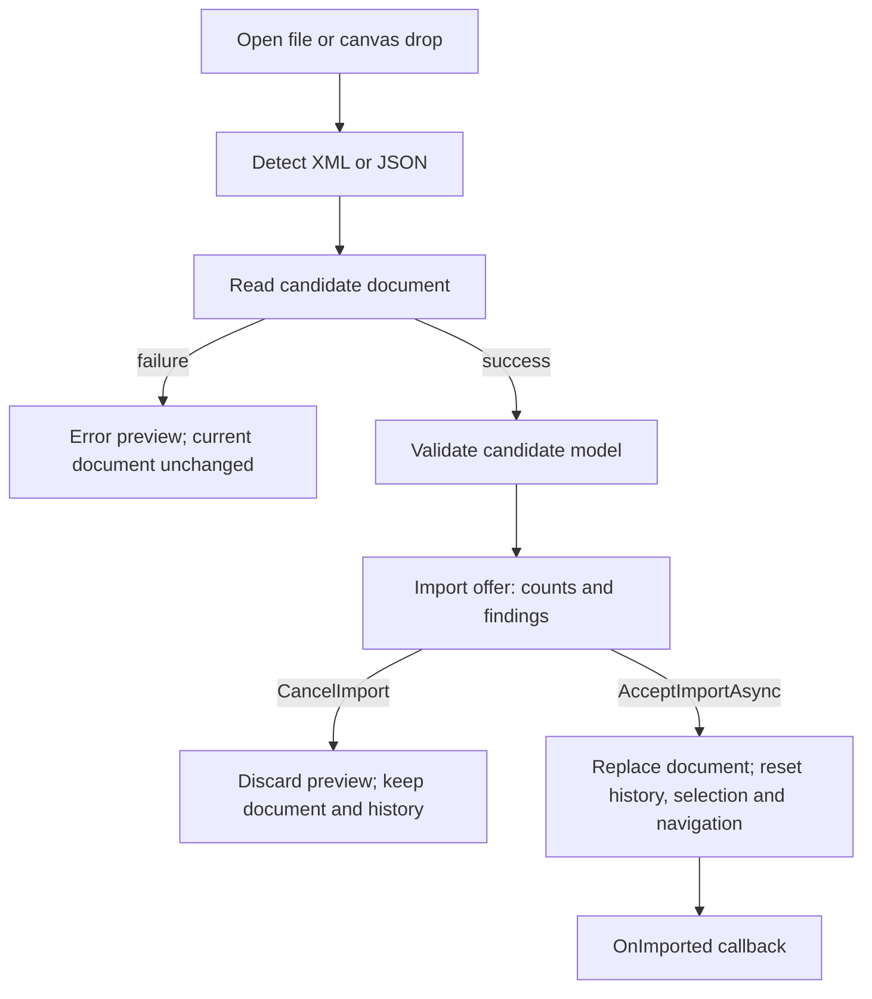

# BPMN JSON interchange

JSON is an alternative file format for the editor's semantic model, not BPMN 2.0 XML and not a
Camunda engine deployment format. Use `.json` and `application/json`; `BpmnJsonFormat` exposes
these constants alongside the format name and version. See [XML interchange](xml-interchange.md)
for canonical and fidelity XML output.

## File contract

Every file has a versioned envelope:

```json
{
  "format": "hasseware.bpmn",
  "version": "1.0",
  "document": {
    "definitions": {
      "id": "Definitions_1",
      "targetNamespace": "http://example.com"
    },
    "processes": [{ "id": "Process_1" }]
  }
}
```

This small example has no DI diagram; being readable is not a claim that a document is drawable or
passes document validation. The `document` object represents `BpmnDocument`, using camelCase
members and string enum values. Flow elements remain flat collections with container references,
not recursively nested XML elements. Empty collections, empty extras and eligible constructor
defaults are omitted on write and restored on read. Required values are still required.

Serialization uses the internal source-generated `BpmnJsonContext`, not reflection-based metadata,
so trimmed WebAssembly hosts use the same format. This context is an implementation detail; call
the readers and writers rather than serializing the model with unrelated serializer settings.

### Compatibility and input limits

- The writer emits `1.0`. The reader accepts major version **1**, including newer minor versions.
  A newer minor adds an `Info` import diagnostic; unknown properties are ignored, not retained for
  re-export. Other majors and malformed version strings are refused. The reader also accepts `1`
  as minor zero; writers always emit `major.minor`.
- The `format` string must exactly match `hasseware.bpmn`; `document` must be an object.
- Default input limit: **64 MiB of UTF-8 bytes**. String input is measured before parsing; stream
  input is checked while reading. `MaxInputBytes <= 0` disables that limit.
- Default object/array nesting limit: **256**, configurable with positive `MaxDepth`.
- Duplicate JSON properties, malformed JSON, missing required model values and **null entries in
  any document array** are rejected. The null-entry check includes nested extension children and
  catalog collections, not only top-level flow nodes.
- UTF-8 byte-order marks are accepted. Stream readers leave the supplied stream open.

The options file is named `BpmnJsonOptions.cs`, but its public types are
`BpmnJsonReadOptions` and `BpmnJsonWriteOptions`; there is no public `BpmnJsonOptions` type.

## What survives a round trip

| Content | JSON behavior |
|---|---|
| Modelled BPMN semantics, processes, collaboration, pools and lanes | Preserved |
| DI bounds, waypoints, labels and modelled style metadata | Preserved |
| Documentation, global catalog and modelled declarations | Preserved |
| Vendor `extensionElements` and foreign attributes | Preserved as ordered extension trees and `{namespaceUri}localName` attribute keys |
| Original XML comments, processing instructions, whitespace, declaration and attribute order | Not carried; these belong to the XML source, not the semantic model |
| XML content retained only by the fidelity source tree | Not carried |
| Unknown JSON properties from a newer minor version | Ignored |

`BpmnDocument.Source` is deliberately excluded. JSON therefore has **no fidelity mode**.
A JSON-opened document exports canonical XML. Asking the XML writer for fidelity output without
an XML source falls back to canonical output and reports that fallback. Choosing JSON for an
XML-opened document is consequently a model export, not a source-preserving save; retain the
original XML when source-only content matters.

## Reading and writing

```csharp
using Hasseware.AspNetCore.Components.Bpmn.Serialization;

// document is the current BpmnDocument.
string json = BpmnJsonWriter.Write(document);
string compact = BpmnJsonWriter.Write(document, BpmnJsonWriteOptions.Compact);
BpmnImportResult imported = BpmnJsonReader.Read(json);

// input and output are separate streams supplied by the host.
BpmnImportResult fromStream = await BpmnJsonReader.ReadAsync(input,
    new BpmnJsonReadOptions { MaxInputBytes = 8L * 1024 * 1024, MaxDepth = 128 });
await BpmnJsonWriter.WriteAsync(fromStream.Document, output,
    BpmnJsonWriteOptions.Compact);

string xml = BpmnXmlWriter.Write(imported.Document).Xml;
```

Both readers and writers also have synchronous stream overloads. Writes leave streams open,
produce UTF-8 JSON and end with a newline. Output is indented by default; `Compact` disables
indentation. Write options expose `MaxDepth`, not an output byte-size limit.

`Read` returns a `BpmnImportResult` and its import diagnostics; it does not replace document
validation. Use `BpmnValidator.Validate` or the preview path below to inspect model findings.
Unreadable JSON throws `BpmnJsonException`; unreadable XML throws `BpmnXmlException`. Both derive
from `BpmnImportException`, so hosts accepting either format can share failure handling:

```csharp
try
{
    BpmnImportResult result = BpmnFileFormats.Read(content, fileName);
    // Inspect result.Diagnostics before installing result.Document.
}
catch (BpmnImportException failure)
{
    // Show failure.Message; keep the existing document.
}
```

`BpmnFileFormats.Detect(fileName, content)` skips leading whitespace and BOMs: `{` means JSON,
`<` means XML, regardless of filename. Otherwise `.json` selects JSON and everything else selects
XML. `BpmnFileFormats.Read(content, fileName)` dispatches to that reader.
`BpmnFileFormats.Accept` supplies `.bpmn,.xml,.json,application/xml,text/xml,application/json`
for a file picker's `accept` attribute; it is a picker hint, not a substitute for parsing and limits.

## Preview before replacement

`BpmnEditor.PreviewImport(fileName, content)` accepts either format, as does canvas file drop.
`BpmnImportPreview.Of` can also be used without an editor. It parses the candidate, retains import
findings and runs `BpmnValidator`; parse failures become an error preview with no document.
XML schemas supplied to the preview overload apply only to XML.



`CanAccept` means a parsed document exists, **not** that validation has no errors: a broken model
can be opened for repair. Acceptance replaces the entire document and resets undo/redo, selection
and navigation; it is not an undoable edit. `CancelImport` discards only the candidate.
`OnImported` reports accepted imports separately from ordinary `OnDocumentChanged` edits.

Sources: [`Serialization`](../src/Bpmn/Serialization/),
[`BpmnImportPreview`](../src/Bpmn/Editing/BpmnImportPreview.cs), and
[`editor import lifecycle`](../src/Bpmn/Components/BpmnEditor.Import.cs).
