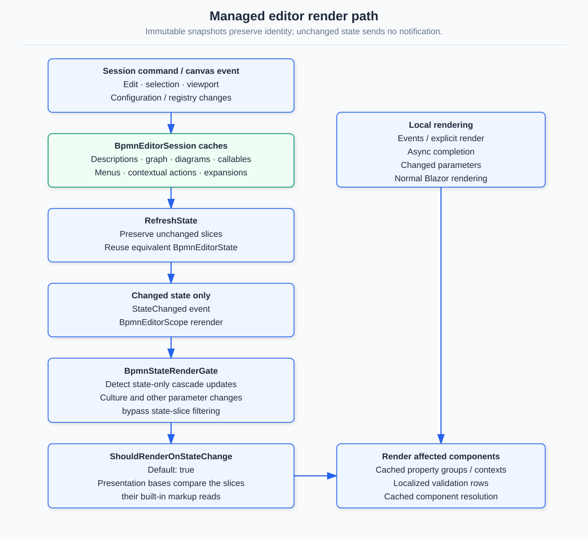

# Performance budget

 budget

The benchmark diagram is `playground/Bpmn.Demo/wwwroot/samples/large-virtualization-stress.bpmn`:
**602 shapes and 601 connectors** spanning 5,400 × 2,980 model units. It is the fixture the plan
names for M7 and the one every number below was measured on.

Measured through the demo in headless Chromium at 1440 × 900, with frame times sampled inside the
page during real gestures — a pointer drag for pan, `Ctrl`+wheel for zoom. Timing a script that
calls into JointJS directly would leave out layout, paint and compositing, which is where a diagram
this size actually spends its time.

## The budget

| | Budget | Measured |
|---|---|---|
| Pan, median frame | ≤ 16.7 ms (60 fps) | 16.7 ms |
| Pan, 95th percentile frame | ≤ 17 ms | 16.8 ms |
| Zoom, median frame | ≤ 16.7 ms | 16.7 ms |
| Zoom, 95th percentile frame | ≤ 70 ms | 66.7 ms |
| SVG nodes in the document | ≤ 2,500 | 1,593 |
| Switch a running editor to the stress diagram | ≤ 3.5 s | 3.0 s (2.6 s, 2026-10-15) |

**Pan holds 60 fps.** The 95th-percentile frame is one frame time, so the hitches are in the last
few percent.

**Zoom does not, and the budget says so.** Its top 5% of frames cost about four frame times. This
is stated rather than hidden because it is what the diagram costs today: a scale change invalidates
every mounted view at once, and that work is not divisible the way a pan's is. Raising this is the
next piece of performance work, not something the current numbers pretend is done.

## Baselines, 2026-10-15

Production build (`dotnet publish -c Release`), Chromium 153 headless at 1440 × 900, the 602-shape stress diagram, **median of three fresh browsers with the
range in brackets**, on a developer laptop that was also running other work. `perf-bench.mjs` produces every row; compare before and after on the same machine.

| | Measured |
|---|---|
| Cold start: navigation to the first drawn shape | 2.4 s (1.7 to 2.8) |
| Warm start: reload with the HTTP cache full | 1.8 s (1.2 to 1.8) |
| Switch to the stress diagram, one long task of | 2.2 s |
| SVG nodes / mounted cells after load | 1,636 / 104 |
| Pan: median, p95, worst frame | 16.7, 66, 100 ms |
| Zoom (Ctrl+wheel, 80-step sweep in and out): median, p95, worst frame | 16.7, 50, **617 ms** |
| Zoom sweep long tasks | 17 tasks, 3.5 s in total, the longest 611 ms |
| Delete one element: main thread blocked afterwards | **1.6 to 1.7 s** (the accessible tree has updated after 20 ms) |
| Undo that delete: main thread blocked | 0.5 to 0.6 s |
| The same delete with the whole diagram zoomed out | **4.4 to 5.3 s** |
| JS heap before load, after load, at the end | 8.4, 14.9, 19.4 MB |

What the table says that the earlier numbers did not:

- **An edit blocks the page for about a second and a half at the default zoom and about five seconds when the diagram is zoomed out.** The accessible tree updates within
  tens of milliseconds, so a stopwatch on "the tree changed" reads 20 ms; the canvas then rebuilds every cell from the whole document (see "Where the time goes") and the page
  does not paint again until it is done. The harness reports both: `treeMs`, and `blockedMs`, the long-task time in the 2.5 s after the edit, which is the one that matters.
- **The zoom worst frame is over half a second, not 67 ms.** The 95th percentile is the budget's measure; it hides the one frame where the zoom-out mounts every cell. The
  earlier sample alternated 20 wheel events in and out and never left the mounted window.
- **The earlier "zoom" sample did not zoom.** An unmodified wheel pans by default (`BpmnWheelMode.Pan`); only Ctrl or Cmd zooms. `perf-bench.mjs` now has both: `plainWheel`
  keeps the old sample for comparability and `zoom` is a real Ctrl+wheel sweep.
- **"First render" was not a cold start.** It timed a switch to the large diagram in an editor that was already running. Cold and warm starts are measured separately now.

### What changed, 2026-10-15

Four changes, each behaviour-neutral, measured against the build before them with the two builds served alternately on one machine (the baselines above drifted by up to
twice between sessions, so only an interleaved comparison counts). Medians of two rounds of two browsers each; where the rounds disagree, both are shown.

| | Before | After |
|---|---|---|
| Pan, 95th percentile frame | 50 ms | **17 ms** |
| Zoom, 95th percentile frame | 67 to 83 ms | **17 to 33 ms** |
| Zoom, worst frame | 670 to 720 ms | **50 to 150 ms** |
| Zoom sweep, time in long tasks | 4.1 to 4.8 s | **0.17 to 0.7 s** |
| Delete one element, main thread blocked | 1.7 s and 1.6 s | 0.9 s and 1.7 s (inconclusive) |
| The same delete zoomed out | 5.3 s and 4.4 s | 4.8 s and 2.3 s (noisy, probably better) |
| Cold start, switch to the diagram, heap | unchanged within the noise | |
| `XmlReader` read, allocated | 4.9 MB | **3.9 MB** |

- **The visibility pass asked the browser for the paper's size once per cell.** `isWithinViewport` called `paper.getArea()` for each of the 1,200 cells on every pass, and that call reads
  the computed style, which forces a style recalculation. It was the hottest function in both a delete and a zoom-out. The margin is now worked out once per pass and dropped when the
  paper's transform moves (`graph/paper-host.ts`). This is where all of the interaction gain comes from.
- **The accessible tree is kept when an edit leaves the graph unchanged.** A move, a resize or a style change rebuilds an equal graph; the session now keeps the old list so the tree sees no
  change and does not rebuild 1,200 items (`BpmnGraphNode.SameContent`, `DerivedList.Keep`). Covered by a unit test that fails if the comparison is broken. The browser harness deletes, which does
  change the tree, so this is **not measured in a browser**.
- **The reader no longer copies its own XML tree.** The tree it loads is the only reference, so it is kept as the document's source instead of duplicated (`BpmnSourceDocument.Capture(..., ownsDocument: true)`):
  a fifth less allocation on every import, with the same retained size.
- **The edit metric.** `perf-bench.mjs` reports `treeMs` and `blockedMs` for an edit, because the first measured only the first.

An edit still rebuilds every cell from the whole document, about 0.8 MB of JSON each time, and that is the remaining cost (a profile of a delete: about 35% .NET in WebAssembly, 25% canvas scripts,
the rest browser layout and paint). Changing it means telling the canvas which cells changed, which touches the interop contract; it is listed under follow-ups.

### Round 2: input, labels and mount

The same method: the build before and the build after served alternately on one machine, two rounds of two browsers each.

| | Before | After |
|---|---|---|
| Zoom, 95th percentile frame | 36 and 53 ms | **19 and 36 ms** |
| Zoom sweep, time in long tasks | 380 and 795 ms | **78 and 518 ms** |
| Cold start, warm start, diagram switch, edit | unchanged within the noise | |

- **Wheel and pinch are applied once per animation frame.** `ViewportController` accumulates pan, a product of zoom factors and the latest focus point, and applies them together on the next frame:
  pan first, then one clamped zoom, then one report. Every command (`zoomIn`, `setZoom`, `fitToContent`, a `setViewport` from .NET, the state getter) applies what is pending before it runs, so order is kept.
  The paper element's rectangle is read once per frame instead of once per event.
- **The host hears of the viewport at most every 100 ms.** The bridge used to send one interop call and one Blazor render per event (a microtask only merges events inside one task). It now throttles
  `viewportChanged` with a trailing timer, always delivering the last value, and delivers the pending one when the canvas is disposed so a rebuild restores the right view. Selection events keep the microtask.
- **Labels are memoised per cell.** The pass still labels every cell on every render (a screen reader walks the DOM, not the viewport), but it walks `getCells()` once instead of filtering twice, and reuses
  the computed string while a cell's type and name are unchanged; a freshly mounted view is still labelled because the DOM attribute is still compared.
- **First mount: the strings are built while the module imports, once per culture.** The import and the localized-strings build are independent and now overlap; the strings are built once per component and
  culture (not statically, because the localizer can be replaced by a host) from a resource-key list read once, without the second dictionary copy.

Decided against, with the reason:

- **Folding `getInitResult` into `initialize`.** It would remove one in-process call on WebAssembly and one round trip on Blazor Server, but the handle must stay a JS object reference, so the result would travel in a
  nested object reference that bUnit's loose JS mock cannot produce, or move to an instance-id contract; about eighteen test fixtures and a major contract version for a call measured in fractions of a millisecond.
- **`<link rel="modulepreload">` for the canvas module.** The module is already requested by the page's script about 70 ms in (the `.lib.module.js` initializer convention), long before the runtime and the first mount.
- **Fewer cultures or less ICU data in the playground.** The demo exists to switch between thirteen languages; the Brotli cost of all of it is 419 KB of satellite assemblies and 322 KB of ICU data.
  The three plain stylesheet links in the playground now go through `@Assets` (fingerprinted, immutably cached); on a first visit they were already fetched in parallel.

### Round 2: a canvas-only payload

Every load sent the whole `BpmnDocument`: 833,459 characters on the stress diagram, of which `flowNodes` were 369 KB (about 600 characters each), `diagrams` 292 KB and `sequenceFlows` 171 KB,
carrying script text, loop details, event definitions, documentation, vendor extension trees, DI label ids and styles and the root catalog that the canvas never reads. `CanvasDocumentPayload`
now writes the same JSON without them, **468,075 characters (44% less)**, and caches it for the document it was made from.

| | Before | After |
|---|---|---|
| Cold start | 2.8 and 2.3 s | **2.2 and 1.9 s** |
| Diagram switch, the longest task | 1.9 and 1.8 s | **1.5 and 1.1 s** |
| Delete one element, main thread blocked | 0.99 and 0.76 s | 1.04 and **0.61 s** |
| Undo it | 0.68 and 0.69 s | **0.55 and 0.44 s** |
| Same delete zoomed out | 1.5 and 1.9 s | 1.8 and 1.7 s (no change) |

- **Only what the canvas never reads is left out, and what remains is written as before, nulls included.** The canvas treats `null` and absent differently in places, so nothing is dropped for being empty;
  the one exception is a flow node's `extras`, which is sent only when it has foreign attributes (the template icon is the only reader, through `extras?.foreignAttributes`).
- **The TypeScript contract is the allow-list, and a test holds the two together.** `CanvasDocumentPayloadTests` parses `model/contracts.ts` and fails if any field it requires is missing from the payload;
  fields the canvas never reads are now optional in the contract, so `tsc` would reject a new read of one.
- A load is still O(document); the edit cost that remains is the rebuild of every cell, which the next change addresses.

### Round 2: a load reconciles instead of resetting

An edit still sends the document and re-renders it, but the canvas no longer destroys and rebuilds every cell to do it. `renderDocument` builds the cells from the document exactly as before and then
**reconciles** them with what is drawn (`reconcileCells`): a cell that is the same keeps its view, one that differs is updated in place, a new one is added, one the document no longer has is removed.
Embedding is reconciled the same way (a child already in the right parent is left alone, one in the wrong parent moves). No new interop call and no contract change.

| | Before | After |
|---|---|---|
| Delete one element zoomed out, main thread blocked | 2.0 and 1.4 s | **0.85 and 0.47 s** |
| Undo it, zoomed out | 0.41 and 0.37 s | 0.39 and 0.22 s |
| Undo at the default zoom | 0.66 and 0.36 s | **0.37 and 0.25 s** |
| Delete one element at the default zoom | 0.68 and 0.72 s | 0.98 and 0.65 s (no change) |

- **Why zoomed out gains most.** There every cell is mounted, and a reset rebuilt all of them; at the default zoom about a hundred are mounted and the cost is elsewhere (see below).
- **It cannot differ from a full render, by construction and by test.** `reconcile.test.ts` renders document A and then B onto one graph, renders B onto a fresh graph, and requires every cell's attributes and
  embedding to be equal, for no change, rename, move and resize, delete (with the connectors it takes), create, change of kind, a lane's contents changing and an unrelated document; breaking the embedding step fails it.
  Paint order is written down with gaps (`z` in steps of 1000) so that a new cell takes its place between its neighbours as a full render would, without renumbering the rest.
- **What still costs at the default zoom** is on the .NET side: an edit serializes the (now 44% smaller) document, builds the state and the accessible tree in the WebAssembly interpreter. A patch that names the
  changed cells would remove the serialization; it needs a diff in C#, a new interop call and a contract version, and is the next step if this matters.

### Where the time goes

From the code and the measurements above: the document crosses interop as 833,459 characters of JSON (about 0.8 MB, about 80 ms to serialize on first use), and every
edit that is not a plain move sends it again and resets the graph. Pan holds its budget because it touches no document.

### Published size

`node src/Bpmn.Scripts/tools/publish-size.mjs artifacts/publish-demo/wwwroot` on a Release publish of the playground: **5.3 MB with Brotli, 18 MB raw**, in 175 files.

| | files | raw KB | Brotli KB |
|---|---|---|---|
| assemblies | 65 | 9,267 | 3,133 |
| runtime (`dotnet.native.wasm`) | 1 | 2,838 | 910 |
| JavaScript | 19 | 2,578 | 591 |
| satellite assemblies (13 languages) | 52 | 1,489 | 419 |
| ICU data | 1 | 1,490 | 322 |

`Hasseware.AspNetCore.Components.Bpmn` is 884 KB with Brotli, the largest single download after the runtime; `Bpmn.Tools` is 254 KB. The canvas module is 651,029 bytes
(154 KB with Brotli) and the library CSS 12,908 bytes. `verify-bundle.mjs` now fails the build above 700,000 and 16,000 bytes.

### Managed memory

`dotnet run -c Release --project tests/Bpmn.Benchmarks -- memory` reports what stays in memory, which BenchmarkDotNet's allocation columns do not:

| | Measured |
|---|---|
| Document as read, with its source XML tree | 1.82 MB |
| The same without the source tree | 0.56 MB (the source is **70%**) |
| History of 100 move edits | 6.7 MB, about 67 KB a step |
| `XmlReader` read / canonical write | 4.9 MB / 7.4 MB allocated |

The element index adds about 0.05 MB a document and the history figure already includes it, so it is not the multiplier it looked like from reading the code. The source tree
is what a document costs.

### Known gaps found while measuring

- **Fixed: a Release publish of this repository's playground shipped a broken editor.** The JavaScript SDK sets each esproj asset's `OriginalItemSpec` from an empty item list, so MSBuild
  falls back to the project file, and the static-asset compression step then compressed the `.esproj` in place of the bundle: the `.br` and `.gz` beside `lib.module.js` were 258 and 318
  bytes of project XML, the browser's integrity check refused the module and no diagram appeared. The same defect was in the Feel and WebMcp bundles. `src/ScriptsStaticAssets.targets`,
  imported by the three projects that wrap an esproj, points each asset back at its own file before compression, and `publish-size.mjs` now fails when any precompressed file does not
  decode to the file beside it (CI publishes the playground and runs it). NuGet consumers were never affected: the package held the real files. The bundle manifest no longer carries a
  build timestamp, which made its compressed copy go stale between the two builds a publish runs.
- A Release build does not remove a source map left in `dist/` by an earlier Debug build, and `dotnet pack` then ships that 3 MB file (seen locally; a clean checkout has none).
- Nothing times the interop hop, the property panel or the stencil, and no test asserts a time; only counts are asserted (`VirtualizationBudgetTests`).

### Not done, and why

Each needs a decision or touches a contract: a per-cell patch that names the changed cells instead of sending the whole document (the canvas now reconciles instead of resetting, so a patch would save the
serialization and the state rebuild on the .NET side); a history byte budget or a lower default depth (100 steps retain 6.7 MB, so it is not urgent); a document-size cap on the stores; esbuild code splitting
(changes the module path); virtualizing the accessible tree (roving tabindex, `aria-setsize`); AOT; and folding `getInitResult` into `initialize` (see "Round 2: input, labels and mount").

## Virtualization

Only what is on screen, plus a full viewport of margin in each direction, is in the DOM. On this
diagram that is **1,593 SVG nodes instead of 8,433** — an 81% reduction — and about 240 mounted
cells instead of 1,203.

Two things were needed to make it a win rather than a loss, and both were found by measuring:

**A connector is judged by its endpoints, not by its own bounding box.** `getBBox()` on a link
computes its route. With six hundred of them, the visibility pass cost more than the drawing it was
meant to avoid: first render went from 3.4 s to 7.2 s and the worst zoom frame from 117 ms to
233 ms. Judging a link by the box spanning its two ends — inflated by the clearance an orthogonal
route takes when it steps around something — is a comparison of numbers already in the model.

**The pass runs when it can change the answer, not on every transform.** Cells are mounted for a
full viewport in each direction, and the pass re-runs once the viewport has moved half of that,
which leaves half a screen of already-built content ahead of the pan in every direction.

Against no virtualization at all, measured over three runs each: first render 3.0 s against 3.4 s,
frame times indistinguishable, DOM 81% smaller. It is a win on memory and on load, and neutral on
frames — the frame cost of this diagram is not the size of its DOM.

### What made it safe

Culling shapes is only acceptable because the SVG is no longer the accessible representation. A
screen reader walks `BpmnAccessibleTree`, which is built from the model and lists every element
whether or not the paper has drawn it. Doing this while the drawn cells were still what assistive
technology read would have hidden most of the diagram from anyone using one.

## Reproducing

```
dotnet publish playground/Bpmn.Demo -c Release -o artifacts/publish-demo
(cd artifacts/publish-demo && ASPNETCORE_ENVIRONMENT=Production dotnet Bpmn.Demo.dll --urls http://localhost:5612)
cd src/Bpmn.Scripts && npm i --no-save playwright-core
node tools/perf-bench.mjs http://localhost:5612 --runs=3        # PLAYWRIGHT_CHROMIUM=<chrome.exe> if Playwright's browser is not the default
node tools/publish-size.mjs ../../artifacts/publish-demo/wwwroot
dotnet run -c Release --project ../../tests/Bpmn.Benchmarks -- memory
```

The baselines in this page were taken with `-p:CompressionEnabled=false`, before the compression defect under "Known gaps" was fixed; compression changes the bytes sent more than the timings (one run with it measured a 2.5 s cold start, inside the 1.7 to 2.8 s range without). Frame counts vary between runs by roughly 15% and a first run can be twice a later one;
the harness reports the median and the range of every number, and a change should be judged on those, never on one run: the first culling attempt looked like a 2x
regression and the second like a win, and both readings were the same code measured once. Run nothing else on the machine while it measures.

## Micro-benchmarks

Model-level costs, with the numbers measured on the 600-shape stress fixture (one dev machine;
compare relative, not absolute):

```
cd src/Bpmn.Scripts && npm run bench                           # TS: renderDocument, scans, drop resolution
node src/Bpmn.Scripts/tools/perf-bench.mjs http://localhost:5601   # browser: first render, pan/zoom frames
dotnet run -c Release --project tests/Bpmn.Benchmarks -- --filter "*"   # C#: read, write, a11y graph, move
```

| Path | Measured |
|---|---|
| TS `renderDocument` (600 shapes) | ~8.7 ms |
| TS `getElements()` + `getBBox` scan | ~0.013 ms |
| TS `ownerUnder` / `targetAt` | ~0.025 ms |
| C# `BpmnXmlReader.Read` | ~7.5 ms, 4.8 MB |
| C# `BpmnXmlWriter.Write` (canonical) | ~15 ms, 7.5 MB |
| C# `BpmnAccessibleGraph.For` | ~0.42 ms |
| C# `MoveShapesCommand` (20 shapes) | ~0.9 ms |

Takeaway: whole-graph scans cost tens of microseconds at this size, so a shared scene index or
per-gesture caches would be speculative. The remaining cost is DOM work (zoom p95) and XML
serialization allocations.

## Interpreting benchmark results

The figures above are historical measurements, not machine-independent acceptance thresholds.
For a repeatable managed-code baseline, see [Bpmn.Benchmarks](../tests/Bpmn.Benchmarks/README.md):
it separates setup from XML read/write, accessible-graph construction and a twenty-shape command,
and records allocations with BenchmarkDotNet's memory diagnoser.

These micro-benchmarks do not measure JSON serialization, property-panel rendering, JS interop,
SVG paint or frame pacing. Run the browser harness for those canvas costs; an improvement in
managed XML allocations is not evidence of smoother zoom. Use the same fixture, configuration
and machine when comparing before/after runs.


## Managed editor state renders

`BpmnEditorComponentBase.ShouldRenderOnStateChange(previous, current)` is an opt-in
state-cascade filter; its default returns `true`. Core presentation bases compare the immutable
slices their markup consumes, shared by both kits. A filter is consulted only when a newly
assigned State is the sole changed parameter (other values retain reference identity). First
render, other parameter updates, local `StateHasChanged`, events, asynchronous completion and
culture changes still render. A derived `ShouldRender` must combine its decision with
`base.ShouldRender()`; custom markup reading additional state must widen the slice predicate,
or override it to return `true`. Toolbar/canvas child fragments and custom property templates remain conservative.

Stencil and template chooser retain the default: mutable stencil/template options and registry
members are read directly from Session, not completely represented by State. `BpmnEditorCanvas`
also tracks the session-only values its markup passes to the canvas. `BpmnPart` subscribes only
to the fixed session cascade; its DynamicComponent child receives State notifications directly
without requiring its parent to render. Component resolution caches include registry mutation
versions, not just options identity.

Property groups are cached by selected snapshots, document, read-only mode, provider identities
and UI culture. Changes to provider chains or editor-registry registrations also force a state-driven
render, even if the changed state slice is otherwise unrelated. Entry contexts, guarded callbacks and parameter dictionaries are reused while
their inputs remain unchanged. Revision keys remain intentional: they reset refused edits,
including expression editors and id renames. Validation rows/order/messages cache the report and
UI culture; widget positioning reuses styles for unchanged anchor/placement coordinates. Caches
retain only the current input set, not document/history generations.

`tests\Shared\RenderCountTests.cs` guards both kit compositions using renderer log events.
Run built Release kit test executables with `-class "*RenderCountTests" -showLiveOutput -noColor`.
Session microbenchmarks measure headless publication, not these component allocations; use
render budgets and cache identity/invalidation tests alongside the browser suites.

## After the correctness fixes

Re-measured on the same machine with two interleaved rounds of two fresh browsers, against the earlier publish `publish-c3`, which did not yet have the reconcile path: the correctness work (reconcile unembedding, the reconcile marker, the viewport flush, the canvas synchronization gate) did not give any of the gains back. Zoom p95 stays at 17.2-17.3 ms (worst frame 33 ms, no long task), a plain wheel and a pan at 17 ms; a delete on the stress diagram blocks the main thread for 287-324 ms (was 715-743), zoomed out 183-191 ms (was 481-566), and an undo 128-139 ms (was 368-381). Cold load 1.7-1.8 s, warm 1.1 s.
