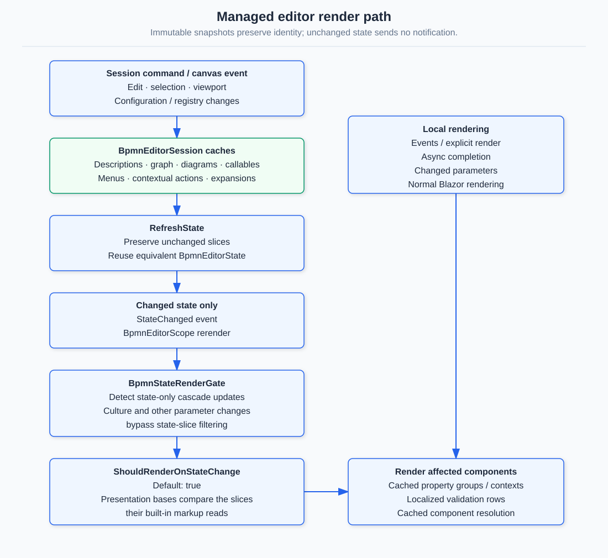

# Performance budget

 budget

The benchmark diagram is `playground/Bpmn.Demo/wwwroot/samples/large-virtualization-stress.bpmn`:
**602 shapes and 601 connectors** spanning 5,400 × 2,980 model units. It is the fixture the plan
names for M7 and the one every number below was measured on.

Measured through the demo in headless Chromium at 1440 × 900, with frame times sampled inside the
page during real gestures — a pointer drag for pan, `Ctrl`+wheel for zoom. Timing a script that
calls into JointJS directly would leave out layout, paint and compositing, which is where a diagram
this size actually spends its time.

## The budget

| | Budget | Measured |
|---|---|---|
| Pan, median frame | ≤ 16.7 ms (60 fps) | 16.7 ms |
| Pan, 95th percentile frame | ≤ 17 ms | 16.8 ms |
| Zoom, median frame | ≤ 16.7 ms | 16.7 ms |
| Zoom, 95th percentile frame | ≤ 70 ms | 66.7 ms |
| SVG nodes in the document | ≤ 2,500 | 1,593 |
| Switch a running editor to the stress diagram | ≤ 3.5 s | 3.0 s (2.6 s, 2026-10-15) |

**Pan holds 60 fps.** The 95th-percentile frame is one frame time, so the hitches are in the last
few percent.

**Zoom does not, and the budget says so.** Its top 5% of frames cost about four frame times. This
is stated rather than hidden because it is what the diagram costs today: a scale change invalidates
every mounted view at once, and that work is not divisible the way a pan's is. Raising this is the
next piece of performance work, not something the current numbers pretend is done.

## Baselines, 2026-10-15

Production build (`dotnet publish -c Release`), Chromium 153 headless at 1440 × 900, the 602-shape stress diagram, **median of three fresh browsers with the
range in brackets**, on a developer laptop that was also running other work. `perf-bench.mjs` produces every row; compare before and after on the same machine.

| | Measured |
|---|---|
| Cold start: navigation to the first drawn shape | 2.4 s (1.7 to 2.8) |
| Warm start: reload with the HTTP cache full | 1.8 s (1.2 to 1.8) |
| Switch to the stress diagram, one long task of | 2.2 s |
| SVG nodes / mounted cells after load | 1,636 / 104 |
| Pan: median, p95, worst frame | 16.7, 66, 100 ms |
| Zoom (Ctrl+wheel, 80-step sweep in and out): median, p95, worst frame | 16.7, 50, **617 ms** |
| Zoom sweep long tasks | 17 tasks, 3.5 s in total, the longest 611 ms |
| Delete one element: main thread blocked afterwards | **1.6 to 1.7 s** (the accessible tree has updated after 20 ms) |
| Undo that delete: main thread blocked | 0.5 to 0.6 s |
| The same delete with the whole diagram zoomed out | **4.4 to 5.3 s** |
| JS heap before load, after load, at the end | 8.4, 14.9, 19.4 MB |

What the table says that the earlier numbers did not:

- **An edit blocks the page for about a second and a half at the default zoom and about five seconds when the diagram is zoomed out.** The accessible tree updates within
  tens of milliseconds, so a stopwatch on "the tree changed" reads 20 ms; the canvas then rebuilds every cell from the whole document (see "Where the time goes") and the page
  does not paint again until it is done. The harness reports both: `treeMs`, and `blockedMs`, the long-task time in the 2.5 s after the edit, which is the one that matters.
- **The zoom worst frame is over half a second, not 67 ms.** The 95th percentile is the budget's measure; it hides the one frame where the zoom-out mounts every cell. The
  earlier sample alternated 20 wheel events in and out and never left the mounted window.
- **The earlier "zoom" sample did not zoom.** An unmodified wheel pans by default (`BpmnWheelMode.Pan`); only Ctrl or Cmd zooms. `perf-bench.mjs` now has both: `plainWheel`
  keeps the old sample for comparability and `zoom` is a real Ctrl+wheel sweep.
- **"First render" was not a cold start.** It timed a switch to the large diagram in an editor that was already running. Cold and warm starts are measured separately now.

### What changed, 2026-10-15

Four changes, each behaviour-neutral, measured against the build before them with the two builds served alternately on one machine (the baselines above drifted by up to
twice between sessions, so only an interleaved comparison counts). Medians of two rounds of two browsers each; where the rounds disagree, both are shown.

| | Before | After |
|---|---|---|
| Pan, 95th percentile frame | 50 ms | **17 ms** |
| Zoom, 95th percentile frame | 67 to 83 ms | **17 to 33 ms** |
| Zoom, worst frame | 670 to 720 ms | **50 to 150 ms** |
| Zoom sweep, time in long tasks | 4.1 to 4.8 s | **0.17 to 0.7 s** |
| Delete one element, main thread blocked | 1.7 s and 1.6 s | 0.9 s and 1.7 s (inconclusive) |
| The same delete zoomed out | 5.3 s and 4.4 s | 4.8 s and 2.3 s (noisy, probably better) |
| Cold start, switch to the diagram, heap | unchanged within the noise | |
| `XmlReader` read, allocated | 4.9 MB | **3.9 MB** |

- **The visibility pass asked the browser for the paper's size once per cell.** `isWithinViewport` called `paper.getArea()` for each of the 1,200 cells on every pass, and that call reads
  the computed style, which forces a style recalculation. It was the hottest function in both a delete and a zoom-out. The margin is now worked out once per pass and dropped when the
  paper's transform moves (`graph/paper-host.ts`). This is where all of the interaction gain comes from.
- **The accessible tree is kept when an edit leaves the graph unchanged.** A move, a resize or a style change rebuilds an equal graph; the session now keeps the old list so the tree sees no
  change and does not rebuild 1,200 items (`BpmnGraphNode.SameContent`, `DerivedList.Keep`). Covered by a unit test that fails if the comparison is broken. The browser harness deletes, which does
  change the tree, so this is **not measured in a browser**.
- **The reader no longer copies its own XML tree.** The tree it loads is the only reference, so it is kept as the document's source instead of duplicated (`BpmnSourceDocument.Capture(..., ownsDocument: true)`):
  a fifth less allocation on every import, with the same retained size.
- **The edit metric.** `perf-bench.mjs` reports `treeMs` and `blockedMs` for an edit, because the first measured only the first.

An edit still rebuilds every cell from the whole document, about 0.8 MB of JSON each time, and that is the remaining cost (a profile of a delete: about 35% .NET in WebAssembly, 25% canvas scripts,
the rest browser layout and paint). Changing it means telling the canvas which cells changed, which touches the interop contract; it is listed under follow-ups.

### Round 2: input, labels and mount

The same method: the build before and the build after served alternately on one machine, two rounds of two browsers each.

| | Before | After |
|---|---|---|
| Zoom, 95th percentile frame | 36 and 53 ms | **19 and 36 ms** |
| Zoom sweep, time in long tasks | 380 and 795 ms | **78 and 518 ms** |
| Cold start, warm start, diagram switch, edit | unchanged within the noise | |

- **Wheel and pinch are applied once per animation frame.** `ViewportController` accumulates pan, a product of zoom factors and the latest focus point, and applies them together on the next frame:
  pan first, then one clamped zoom, then one report. Every command (`zoomIn`, `setZoom`, `fitToContent`, a `setViewport` from .NET, the state getter) applies what is pending before it runs, so order is kept.
  The paper element's rectangle is read once per frame instead of once per event.
- **The host hears of the viewport at most every 100 ms.** The bridge used to send one interop call and one Blazor render per event (a microtask only merges events inside one task). It now throttles
  `viewportChanged` with a trailing timer, always delivering the last value, and delivers the pending one when the canvas is disposed so a rebuild restores the right view. Selection events keep the microtask.
- **Labels are memoised per cell.** The pass still labels every cell on every render (a screen reader walks the DOM, not the viewport), but it walks `getCells()` once instead of filtering twice, and reuses
  the computed string while a cell's type and name are unchanged; a freshly mounted view is still labelled because the DOM attribute is still compared.
- **First mount: the strings are built while the module imports, once per culture.** The import and the localized-strings build are independent and now overlap; the strings are built once per component and
  culture (not statically, because the localizer can be replaced by a host) from a resource-key list read once, without the second dictionary copy.

Decided against, with the reason:

- **Folding `getInitResult` into `initialize`.** It would remove one in-process call on WebAssembly and one round trip on Blazor Server, but the handle must stay a JS object reference, so the result would travel in a
  nested object reference that bUnit's loose JS mock cannot produce, or move to an instance-id contract; about eighteen test fixtures and a major contract version for a call measured in fractions of a millisecond.
- **`<link rel="modulepreload">` for the canvas module.** The module is already requested by the page's script about 70 ms in (the `.lib.module.js` initializer convention), long before the runtime and the first mount.
- **Fewer cultures or less ICU data in the playground.** The demo exists to switch between thirteen languages; the Brotli cost of all of it is 419 KB of satellite assemblies and 322 KB of ICU data.
  The three plain stylesheet links in the playground now go through `@Assets` (fingerprinted, immutably cached); on a first visit they were already fetched in parallel.

### Round 2: a canvas-only payload

Every load sent the whole `BpmnDocument`: 833,459 characters on the stress diagram, of which `flowNodes` were 369 KB (about 600 characters each), `diagrams` 292 KB and `sequenceFlows` 171 KB,
carrying script text, loop details, event definitions, documentation, vendor extension trees, DI label ids and styles and the root catalog that the canvas never reads. `CanvasDocumentPayload`
now writes the same JSON without them, **468,075 characters (44% less)**, and caches it for the document it was made from.

| | Before | After |
|---|---|---|
| Cold start | 2.8 and 2.3 s | **2.2 and 1.9 s** |
| Diagram switch, the longest task | 1.9 and 1.8 s | **1.5 and 1.1 s** |
| Delete one element, main thread blocked | 0.99 and 0.76 s | 1.04 and **0.61 s** |
| Undo it | 0.68 and 0.69 s | **0.55 and 0.44 s** |
| Same delete zoomed out | 1.5 and 1.9 s | 1.8 and 1.7 s (no change) |

- **Only what the canvas never reads is left out, and what remains is written as before, nulls included.** The canvas treats `null` and absent differently in places, so nothing is dropped for being empty;
  the one exception is a flow node's `extras`, which is sent only when it has foreign attributes (the template icon is the only reader, through `extras?.foreignAttributes`).
- **The TypeScript contract is the allow-list, and a test holds the two together.** `CanvasDocumentPayloadTests` parses `model/contracts.ts` and fails if any field it requires is missing from the payload;
  fields the canvas never reads are now optional in the contract, so `tsc` would reject a new read of one.
- A load is still O(document); the edit cost that remains is the rebuild of every cell, which the next change addresses.

### Round 2: a load reconciles instead of resetting

An edit still sends the document and re-renders it, but the canvas no longer destroys and rebuilds every cell to do it. `renderDocument` builds the cells from the document exactly as before and then
**reconciles** them with what is drawn (`reconcileCells`): a cell that is the same keeps its view, one that differs is updated in place, a new one is added, one the document no longer has is removed.
Embedding is reconciled the same way (a child already in the right parent is left alone, one in the wrong parent moves). No new interop call and no contract change.

| | Before | After |
|---|---|---|
| Delete one element zoomed out, main thread blocked | 2.0 and 1.4 s | **0.85 and 0.47 s** |
| Undo it, zoomed out | 0.41 and 0.37 s | 0.39 and 0.22 s |
| Undo at the default zoom | 0.66 and 0.36 s | **0.37 and 0.25 s** |
| Delete one element at the default zoom | 0.68 and 0.72 s | 0.98 and 0.65 s (no change) |

- **Why zoomed out gains most.** There every cell is mounted, and a reset rebuilt all of them; at the default zoom about a hundred are mounted and the cost is elsewhere (see below).
- **It cannot differ from a full render, by construction and by test.** `reconcile.test.ts` renders document A and then B onto one graph, renders B onto a fresh graph, and requires every cell's attributes and
  embedding to be equal, for no change, rename, move and resize, delete (with the connectors it takes), create, change of kind, a lane's contents changing and an unrelated document; breaking the embedding step fails it.
  Paint order is written down with gaps (`z` in steps of 1000) so that a new cell takes its place between its neighbours as a full render would, without renumbering the rest.
- **What still costs at the default zoom** is on the .NET side: an edit serializes the (now 44% smaller) document, builds the state and the accessible tree in the WebAssembly interpreter. A patch that names the
  changed cells removes the full-document serialization for eligible edits; the next round implements that path.

### Round 3: resident-document patches and incremental projection

Interop contract **2.4** adds an internal `patchDocument` call; public component APIs and persisted JSON/XML are unchanged.
The host diffs the trimmed canvas projection against the **last acknowledged resident document**, not the optimistic on-screen
document. A patch carries base/target revisions, semantic and DI upserts/removals, and array order only when survivor order plus
appended new ids cannot reproduce it. Nulls remain explicit. Lane and lane-set changes are included so ordinary edits do not
fall back merely because cleanup recreated those collections.

TypeScript stages all array changes before touching the graph. Stale revisions, invalid membership/order and a mismatched
active plane return a resync-required `null`; C# then sends the authoritative full document. Root/diagram structural changes
also retain the full-load path. A refused optimistic gesture always forces a full projection. Pure deletion retains its compact
`deleteElements` path only after the diff proves there are no survivor updates; otherwise the complete patch carries them.

Each graph now caches projection inputs per cell. Unchanged records retain their JS identity through patch application, so a
rename constructs and measures one changed shape rather than all shapes and connectors. Inputs include DI, font metrics,
boundary-host geometry and connector endpoint/flow DI. Live graph changes dirty the corresponding entries. Full loads bypass
reuse, while incremental renders still reconcile embedding and paint order. Cache entries are replaced rather than accumulating
document history, and direct deletion releases removed entries.

Paired model-only measurements from `npm --prefix src\Bpmn.Scripts run bench`, on synthetic connected diagrams with named
tasks and one connector between neighbours:

| Shapes / connectors | Full rename projection, mean | Incremental rename projection, mean |
|---|---:|---:|
| 602 / 601 | 294.3 ms | 12.0 ms |
| 2,000 / 1,999 | 592.3 ms | 27.7 ms |
| 5,000 / 4,999 | 1,155.8 ms | 113.6 ms |

These are V8/JointJS **model work**, not SVG paint, browser load times or statistically portable speed guarantees. The scaling
cases use short runs; compare paired operations, not these absolute numbers with the older shape-only cold-graph benchmark.
Whole-collection diffing, indexes, embedding, paint-order checks and reconciliation still scan O(n); only changed-record payload
and factory/label work are reduced. Tests pin a rename payload below 1,024 characters at all three sizes. The real 602-shape XML
fixture's first-node deletion diff is **443 characters** versus **504,778** for a full trimmed canvas document; the proven
removal-only fast path sends just the deletion ids and revision.

Managed edit passes also avoid eager replacement arrays/routes and repeated lookup construction. Both flow-attachment passes
remain: normalizing arbitrary input and following before/after attachment geometry are different operations. Accessible-graph
reuse keys include semantic collections plus active-plane membership/expansion, so geometry-only edits reuse the existing graph
without treating semantic or collapse changes as geometry.

| Connected shapes | Normalize unchanged, KB allocated before -> after | Follow translation, KB before -> after | Geometry-only accessible graph, KB before -> after |
|---|---:|---:|---:|
| 602 | 171.52 -> 17.42 | 159.95 -> 37.52 | 852.84 -> 4.92 |
| 2,000 | 607.27 -> 69.16 | 599.59 -> 123.62 | 2,939.73 -> 5.20 |
| 5,000 | 1,472.91 -> 165.03 | 1,381.63 -> 301.70 | 7,140.04 -> 4.27 |

Reproduce with `ManagedRenderingBenchmarks` (see `tests\Bpmn.Benchmarks\README.md`). These allocation measurements use synthetic
normalized connected documents and a warmed graph cache, not XML import or a semantic edit.

The browser harness was repaired to use the current Files/sample dialog, wait for the full accessible-tree count, acknowledge
canvas completion through its summary, and await a bounded quiet SVG period plus two animation frames. It now includes inline
rename/undo; tree-update latency alone is not treated as rendering completion.

Three fresh headless Edge browsers per build, 1440x900, .NET 10 Release demo served in Development, same 602-shape XML fixture.
The original build was built separately from unchanged source; both used the repaired harness:

| Browser observation | Before median (range), ms | After median (range), ms |
|---|---:|---:|
| Inline rename, canvas completion | 2,599 (2,324-2,624) | 1,047 (826-1,059) |
| Rename main-thread long-task time | 2,420 (2,118-2,421) | 839 (640-854) |
| Undo rename, canvas completion | 1,615 (1,464-1,747) | 1,003 (796-1,031) |
| Delete main-thread long-task time | 1,093 (1,010-1,358) | 1,009 (970-1,155) |
| Undo delete main-thread long-task time | 1,383 (1,316-1,632) | 934 (689-1,063) |

Rename is the clear improvement; the smaller deletion difference is noisy and the compact delete path already existed.
These are local sequential runs, not interleaved controlled trials. Completion includes the harness's 100 ms quiet window,
not a GPU/compositor fence or a promise that every property-panel task finished. Cold load and pan/zoom have no claimed speedup:
pan's median frame remained 16.7 ms, zoom still had mounting spikes, and selection publication can affect gesture samples.
The load DOM stayed at **2,092 SVG nodes / 104 mounted shapes**, with **602 accessible items**. Post-sweep collected JS heap was
14.8 MB before and 15.1 MB after; this short workload does not establish a long-session heap plateau. No browser errors occurred.
The current Release bundle is 683,981 bytes of JavaScript and 13,135 bytes of CSS, below the existing 700,000 / 16,000-byte budgets.

Drop-target/owner scans measured below 0.13 ms at 600 shapes in the model harness, so no speculative spatial index or overlay
rewrite was added. Remaining large-edit costs include managed semantic state/validation and full accessible-graph rebuilds,
O(n) reconciliation scans, and SVG mounting during large zoom changes.

### Round 4: semantic derivation and validation scans

This pass starts from the completed Round 3 worktree, not the pre-patch renderer. It keeps synchronous full validation,
the complete accessible tree, public APIs and the full-render fallback.

Accessible-graph construction now builds artifact attachment names only when a drawn artifact needs them, and avoids the
flow-node name table entirely when no associations exist. Depth construction shares resolved ancestor depths instead of
allocating a visited set for each node. Root/cached-parent cases are direct; unresolved chains are iterative and preserve
the previous distinct-ancestor result for cycles, including self-cycles. A 2,000-level chain requires no recursive stack.

Validation reuses ordered nodes-by-container groups for reachability and event subprocesses. Annotation connection counts
are built in one association pass rather than scanning all associations per annotation. A self-association counts once,
duplicate annotation entries retain their diagnostics, and findings remain in source order. Complete ordered diagnostic
JSON, including presentation metadata, matched the baseline on all 27 shipped BPMN samples.

`SemanticRenderingBenchmarks` adds flat, nested and annotation-heavy cases at 602, 2,000 and 5,000 **tasks**. The annotation
case adds one annotation and association per task, so 5,000 tasks means 10,000 shapes, not 5,000. Setup and the warmed
document element index are outside measurement; validation here is core-only, not host profiles or browser rendering.

Matched Release assemblies, BenchmarkDotNet in-process short jobs, three warmups, five measurement iterations and a 100 ms
iteration target, with no simultaneous browser/build workload. The final comparison ran the optimized assembly first,
then the baseline; an earlier opposite-order series also showed the large annotation-validation benefit. Short jobs still
have wide timing intervals and substantial GC/scheduler variation. Allocation differences are more repeatable than timing
for flat graphs; no general graph-construction throughput or browser-paint speedup follows from these tables.
In the final short pair, 5,000-task flat and annotation graph means actually rose from 13.48 to 24.74 ms and from 14.01 to
30.86 ms. Large-graph timing varied across runs; reduced allocations do not establish a throughput improvement there.

| Flat tasks | Accessible graph allocated before, KB/op | After, KB/op |
|---|---:|---:|
| 602 | 816.08 | 605.52 |
| 2,000 | 2,892.93 | 2,184.17 |
| 5,000 | 7,065.61 | 5,268.65 |

| Annotation-heavy tasks | Core validation mean before, ms | After, ms |
|---|---:|---:|
| 2,000 (+2,000 annotations) | 53.40 | 7.53 |
| 5,000 (+5,000 annotations) | 389.34 | 80.89 |

The grouping index has a cost: flat 5,000-task validation allocation rose from 6,013 to 6,143 KB/op (about 2%). This trades
a small linear index for removal of repeated container/annotation scans, rather than skipping validation.

Browser reconciliation also avoids allocating update wrappers and running attachment checks for unchanged reused cells.
Retained membership is tracked separately, so an all-reused render does not reset the graph; reused links still recover
when JointJS removes a replaced endpoint. Removal recovery follows the live graph's transitive connector closure:
changing a task's cell class also restores associations attached to its flows, including reused association cells.
Fresh-render parity covers this case in both full and incremental rendering.
Embedding and paint-order reconciliation remain authoritative on every render.
Model-only rename measurements were noisy (5,000 shapes: 32.6 ms before versus 27.3 ms after in one short series, with
control full-render timings also moving substantially); this is not a robust percentage speedup claim.

Isolated preparation at 5,000 connected shapes measured about 0.57 ms for the document index, 0.96 ms for the plane index,
and 0.27 ms for embedding construction. Those results do not justify a persistent index/dependency-cache rewrite.
A separate Release Chromium rename CPU profile placed 454 of 525 non-idle samples in WebAssembly and 28 in canvas JS.
Native/interpreter frames were not managed-symbol-resolved, so they cannot distinguish validation from Blazor tree rendering.
Tree-row components, accessible-tree virtualization, validation scheduling and speculative routing/overlay caches remain
deferred. The harness supports optional rename CPU profiles and selection-free pan diagnostics; profiled runs are not
mixed into ordinary latency samples.

#### End-to-end browser check

Five fresh Edge runs per version, 1440 x 900, the same 602-shape fixture and Release build served in Development.
The before version already includes Round 3. Values are median (min-max), in milliseconds; CPU-profile and isolated-pan
runs are excluded from this table.

| Operation | Before | After |
|---|---:|---:|
| Rename commit | 1,095 (1,045-1,143) | 913 (797-1,061) |
| Rename long-task time | 883 (841-919) | 734 (639-886) |
| Undo rename | 1,043 (991-1,147) | 815 (799-981) |
| Undo rename long-task time | 859 (828-960) | 637 (619-811) |
| Delete long-task time | 998 (965-1,276) | 800 (748-804) |
| Undo delete long-task time | 919 (880-1,016) | 777 (716-878) |
| Zoomed-out delete long-task time | 916 (733-1,293) | 966 (784-1,341) |

Rename commit improved about 17% and undo rename about 22% in this local sample. The zoomed-out edit cases did not show a
consistent gain, and overlapping ranges/load variability preclude a universal latency claim. Both versions mounted
104 cells / 2,092 SVG nodes at load, reached 24-602 mounted cells during the sweep and ended at 9,466 SVG nodes. End JS heap
was essentially unchanged: 15.2 MB before versus 15.1 MB after. Both five-run series recorded zero browser errors.

Default pan includes a selection transition: median frame time stayed 16.7 ms, while p95 was 16.9 ms before and 16.8 ms
after. A separate single-run `--isolate-pan` diagnostic verifies a blank hit target and clears selection before sampling;
it measured 16.7 ms median, 16.8 ms p95, 33.3 ms maximum and no long tasks. This is diagnostic evidence, not a paired pan
speedup. No speculative gesture, routing or overlay-cache rewrite was made.

Final Release canvas assets are 684,089 B JS / 13,135 B CSS, within the unchanged Round 3 limits of 700,000 / 16,000 B.

### Round 5: swimlane reading-order scaling

The next measured bottleneck was accessible-graph interleaving: every drawn pool/lane scanned every stop again.
This made semantic edits on many-lane diagrams pay roughly `swimlanes * stops`, even though the canvas reused most cells.

Interleaving now maps each membership to its earliest drawn lane and each process to its earliest drawn pool, then buckets
stops in document order. Owner selection and output are linear in memberships, swimlanes and stops; no persistent cache or
stale-document retention is added. A membership in an undrawn lane still prevents pool placement. Overlapping memberships
choose the first drawn lane in reading order, not lane-record order. Shared-process pools, artifacts, duplicate suppression,
nesting depths and unplaced suffix order retain the original behavior. With no drawn swimlanes, lane membership is not read.

`SwimlaneGraphBenchmarks` covers 602/2,000/5,000 tasks, each with 1/10/100 lanes and one pool. Total shapes include the
lanes and pool; consecutive tasks have sequence flows. The baseline already contains Round 4. Release BenchmarkDotNet
in-process jobs used four warmups, seven measurement iterations and a 250 ms target, without simultaneous builds/browser
work. The final series ran optimized, baseline, optimized again. Values below are mean milliseconds per complete managed
graph build, not browser edit or SVG-paint latency.

| Tasks | Lanes | Before | After | After repeat |
|---|---:|---:|---:|---:|
| 602 | 1 | 0.560 | 0.648 | 0.553 |
| 602 | 10 | 0.787 | 0.545 | 0.567 |
| 602 | 100 | 2.963 | 0.549 | 0.539 |
| 2,000 | 1 | 2.944 | 3.324 | 2.743 |
| 2,000 | 10 | 3.929 | 2.650 | 2.815 |
| 2,000 | 100 | 12.819 | 3.728 | 3.044 |
| 5,000 | 1 | 13.515 | 11.354 | 16.210 |
| 5,000 | 10 | 15.430 | 11.057 | 12.386 |
| 5,000 | 100 | 43.297 | 11.125 | 12.315 |

The 100-lane cases improved about 3.4-5.5x in this local comparison; single-lane timing remains noisy and is not uniformly
faster. Allocations are roughly flat, not a general memory win: 5,000 tasks/100 lanes fell from 6,721 to 6,688-6,692 KB/op,
while 2,000 tasks/100 lanes rose from 2,798 to 2,849 KB/op (about 1.8%). Ordered buckets replace the old per-member lookup
groups, rather than adding a second index on top.

Regression coverage compares all graph fields/lists and exact order against the original full-scan algorithm on every
plane in all 27 shipped samples. Additional cases cover duplicate/overlapping memberships, reversed drawn lane order,
undrawn lanes, shared-process pools, black-box pools, nested/unowned stops and artifacts. An enumeration budget guards the
no-swimlane fast path. Both kits retain the existing composition render budgets. Public APIs, localization and complete
accessible-tree output are unchanged; no browser-wide improvement is inferred from this isolated managed benchmark.

### Round 6: render-local accessible descriptions

Stage attribution found repeated localization work in the complete accessible tree. Ten selection renders of 602 items
performed 30,110 resource lookups. The tree now shares type captions and incoming/outgoing count text within one render,
reducing those lookups to 12,080 (about 60%). The scope is discarded after enumeration: a host can change translations
without changing culture, and the next render reads them again. Argument-sensitive named/connection formatting still
reaches the host localizer for every node. Humanized type fallback and element-type enum searches are now lazy, used only
when both host and neutral-English resources miss.

No persistent translation cache, per-row components, tree virtualization or deferred validation was added. Reading order,
complete offscreen accessibility, keys, focus refs, roving tabindex and both editor kits retain their existing behavior.
Public localization calls remain fresh. Regression coverage compares scoped/unscoped descriptions in English, German,
Portuguese and Japanese, including missing resources, attached artifacts and mutable same-culture host translations.

#### Managed attribution and isolated text work

Release .NET 10.0.14, BenchmarkDotNet in-process short jobs, four warmups, seven measurements and 250 ms iteration targets.
The synthetic connected diagrams contain 602/2,000/5,000 named tasks; setup and initial graph construction are outside
the name measurements. Baseline already includes Round 5. Initial stage attribution, milliseconds / allocated KB per call:

| Stage | 602 tasks | 2,000 tasks | 5,000 tasks |
|---|---:|---:|---:|
| Independent localized names | 0.472 / 714 | 1.520 / 2,382 | 4.247 / 5,968 |
| Accessible graph | 0.380 / 605 | 2.726 / 2,184 | 7.692 / 5,255 |
| Core validation | 0.690 / 724 | 2.655 / 2,163 | 10.707 / 6,123 |
| Core + empty template profile | 0.841 / 1,098 | 3.251 / 3,314 | 11.717 / 9,284 |

These are separate calls, not additive browser stage timings. The profile uses default empty template options, not applied
templates or arbitrary host validators. Warmed headless-session selection/publication costs were much smaller than edit
derivation; no new publication optimization was justified.

Matched name benchmarks ran optimized then baseline, sequentially without concurrent build/browser work, using the same
benchmark executable and a preserved core assembly. `RenderNames` selects the new render scope once per enumeration:

| Method | Tasks | Before ms / KB | After ms / KB |
|---|---:|---:|---:|
| RenderNames | 602 | 0.492 / 714 | 0.254 / 391 |
| RenderNames | 2,000 | 1.552 / 2,382 | 0.860 / 1,305 |
| RenderNames | 5,000 | 4.271 / 5,968 | 2.135 / 3,274 |
| TypeNames | 602 | 0.495 / 569 | 0.059 / 118 |
| TypeNames | 2,000 | 1.493 / 1,891 | 0.214 / 391 |
| TypeNames | 5,000 | 3.789 / 4,727 | 0.535 / 977 |

The actual tree text path allocated about 45% less. This is not a full native Blazor-render timing claim: ten bUnit selection
renders remained around 114-121 ms versus 118 ms before. The mixed benchmark's unscoped `LocalizedNames` control allocated
about 9% more after the change (780 versus 714 KB at 602 tasks; 6,515 versus 5,968 KB at 5,000). An isolated-only control
instead allocated less (639 and 5,343 KB), but overlapped other workloads, invalidating its timing. JIT/call-shape sensitivity
is a hypothesis, not an established cause; no general public single-name throughput improvement is claimed.

#### Five-run browser comparison

Fresh Edge browsers, 1440 x 900, the default 602-shape stress fixture, Release demo served in Development.
The before series completed first, then the after series; this was not interleaved. Values are median (min-max) milliseconds:

| Observation | Before | After |
|---|---:|---:|
| Rename commit | 805 (758-874) | 638 (601-754) |
| Rename long-task time | 606 (583-711) | 452 (450-578) |
| Undo rename | 757 (734-814) | 621 (591-703) |
| Undo rename long-task time | 584 (565-661) | 442 (434-543) |
| Delete long-task time | 726 (677-870) | 560 (546-568) |
| Undo delete long-task time | 689 (624-802) | 495 (486-616) |
| Zoomed-out delete long-task time | 711 (686-877) | 563 (556-569) |
| Cold start | 3,834 (3,110-4,549) | 3,451 (3,167-3,768) |
| Warm start | 2,756 (2,506-3,354) | 2,545 (2,495-2,724) |
| Switch to stress diagram | 3,648 (3,436-3,932) | 3,278 (3,190-3,347) |

Rename improved about 21% and undo rename about 18% in this local sample, not a universal latency guarantee.
Both series recorded zero browser errors and identical counts: 104 mounted cells / 2,092 SVG nodes at load,
24-602 mounted cells during the sweep and 9,466 final SVG nodes. Median JS heap after load was 14.3 versus 14.2 MB;
end heap was 15.2 MB in both. The served canvas module remained 684,089 bytes.
Pan/zoom cadence varied around 16.7-33 ms in both series; no gesture-speed or stable-60-fps improvement is claimed.

### Round 7: template-heavy edit validation

The next attribution pass separated managed patch construction/serialization from validation with actual applied templates.
Patch work was not the main target: a native 602-task rename patch took about 0.095 ms to construct and 0.0012 ms to
serialize, versus 1.62 ms for uncached full projection. At 5,000 tasks those costs were 0.84 ms, 0.0012 ms and 12.06 ms.
A 5,000-task deletion patch cost 3.46 ms to construct. These are native isolated costs, not WebAssembly or browser timings.
No new patch fast path, serializer replacement or JS index/accessibility cache was justified by that comparison.

Applied-template validation exposed a larger issue. For each templated element, the profile built a complete
`BpmnElementInspector.Describe` snapshot solely to check whether a compatible newer template exists. That snapshot searches
DI, builds/localizes property-panel descriptors and scans whole-document invariants. Repeating it for every templated
element introduces collection-wide work inside the element loop. The standalone inspection loop measured about
1.25-1.31 seconds and 38.9 MB allocated at 5,000 templated tasks.

Upgrade checks now use the same element wire-type mapping and ordered event definitions directly, sharing the existing
compatibility/version-selection logic with the public snapshot-based API. Full property-panel inspection remains unchanged
for callers that need it. Core/profile validation stays synchronous and complete; no registry, template or diagnostic
cache was introduced. Scope flattening and binding evaluation were deliberately left alone for this round.

Regression coverage compares complete ordered reports, including localization metadata, with the original full-inspection
profile. It covers plain/scoped properties, conditions, FEEL, missing/flavor-mismatched/deprecated templates, upgrades,
engine/registry mutation, unknown binding errors and document changes. Upgrade selection is also compared across every
flow-node/event-definition combination and every extended element ID in all shipped samples. A deterministic budget on
12 shapes fell from **234 reads to 12**: the single extension-marker pass remains, per-element panel scans do not.
The budget fails against the preserved baseline assembly.

#### Matched managed results

Release .NET 10.0.14, BenchmarkDotNet in-process short jobs, three warmups, five measurement iterations and a 100 ms target.
Runs were sequential, without simultaneous builds/browser work, in optimized/baseline/optimized order using one benchmark
executable and compatible core-assembly swaps. Synthetic connected diagrams apply one shared template to every task.
Plain templates have three properties: a stored name, missing required FEEL and a conditional required value. Scoped
templates add a required connector input. Both register a newer version; these cases produce real validation findings.
Baseline includes Round 6.

| Tasks | Template | Profile before ms | After ms | After repeat ms |
|---|---|---:|---:|---:|
| 602 | Plain | 61.73 | 7.78 | 15.41 |
| 602 | Scoped | 33.92 | 8.62 | 11.59 |
| 2,000 | Plain | 290.99 | 43.87 | 40.32 |
| 2,000 | Scoped | 283.58 | 48.27 | 50.17 |
| 5,000 | Plain | 1,670.02 | 197.67 | 197.66 |
| 5,000 | Scoped | 1,712.45 | 221.70 | 228.46 |

At 5,000 tasks, profile-only validation improved about 7.5-8.5x locally. Allocations fell from 75,037 to 35,600 KB/op
for plain templates (about 53%) and 109,373 to 69,936 KB/op for scoped templates (about 36%).
Combined core+profile validation at that size measured 1,652 ms before versus 206/210 ms after for plain templates,
and 2,301 ms versus 276/242 ms for scoped templates. The scoped baseline had high timing variance.

Controls matter: without applied markers, 5,000-task profile validation was 2.54 ms before versus 2.73/2.50 ms after,
with unchanged allocations around 3,158 KB. Combined validation without markers was 11.09 versus 11.14/10.51 ms.
Small-case timings and JIT allocation shapes varied between series; these short local jobs do not establish stable
latency ratios for every size. This is a template-workload improvement, not a general core-validator speedup.

#### Browser edit results and controls

Five unprofiled runs per build/workload used Release WebAssembly in Edge at 1440 x 900. The baseline includes Round 6.
The template case changes the stress fixture's 600 user tasks to service tasks and applies the demo's already-registered
`demo.camunda7.mail` version 1 template to each one using Camunda namespace attributes. IDs, names, DI and connectivity
stay unchanged. The template includes a hidden name and four scoped connector properties; absent required recipient
values produce real findings. The local fixture is supplied through the harness's `--fixture-file` response override,
not a new demo sample.

| Template workload metric | Before median ms (range) | After median ms (range) |
|---|---:|---:|
| Rename through acknowledged canvas update | 3,570 (3,341-3,706) | 2,208 (2,058-2,276) |
| Undo rename through acknowledged canvas update | 3,364 (3,312-4,279) | 2,222 (2,095-2,337) |
| Rename long-task time | 3,339 (3,155-3,524) | 1,997 (1,857-2,060) |
| Undo rename long-task time | 3,171 (3,133-4,096) | 2,040 (1,917-2,156) |
| Delete long-task time | 3,257 (3,219-3,395) | 2,170 (1,978-2,545) |
| Undo delete long-task time | 3,421 (3,156-3,546) | 2,077 (1,917-2,523) |
| Zoomed-out delete long-task time | 3,394 (3,280-4,121) | 2,252 (2,007-2,650) |
| Switch to template fixture | 7,471 (7,212-9,223) | 6,349 (5,887-7,015) |

Template-heavy rename and undo medians fell about 38% and 34%. The unmodified, no-template fixture is a negative control:
rename was 621 (608-682) versus 630 (613-689) ms and undo was 611 (593-697) versus 600 (596-632) ms.
Rename long-task time was 454 versus 467 ms, and undo 445 versus 440 ms. There is no established default-edit gain.
Default cold/reload controls were 3,662 (3,157-4,344) / 2,700 (2,632-3,512) ms before and
3,125 (3,091-4,495) / 2,519 (2,507-3,495) ms after; startup was not the selected optimization.

Within the template workload both builds had 91 mounted cells / 2,493 SVG nodes after switching, 24-602 mounted cells
during the sweep and 10,066 final SVG nodes. Median post-load heap stayed 16.0 MB and final heap was 17.5 versus 17.4 MB.
Within the default workload both builds had 104 mounted cells / 2,092 SVG nodes, the same 24-602 sweep and 9,466 final
SVG nodes; final heap stayed 15.2 MB. Every run reported zero browser errors. Both builds served a 684,089-byte canvas module.
These controls compare each workload with itself; template icons and scoped validation intentionally change its DOM/heap
relative to the default sample.

Series were consecutive, not interleaved: baseline default then template, optimized template then default.
Playwright routing disables HTTP caching, so overridden-case reloads are not cache-warm-start evidence; initial page loads
also precede selection of the template fixture. Separate rename CPU profiles were excluded from latency samples.
Release profiles expose mostly unnamed WebAssembly frames, so native attribution and exact-work tests support the diagnosis,
not method-level browser sample names. Pan/zoom remains variable: template pan long-task medians were 468 versus 469 ms,
and zoom long-task time was 522 (472-940) versus 655 (438-1,526) ms. No pan/zoom improvement is claimed.

### Round 8: cold multi-selection inspection

The next attribution pass kept the default edit workload as a control and added actual select-all with Properties open.
Before this change, selecting the default fixture's 602 shapes took a five-run median 4,925 ms cold versus 2,680 ms warm.
After edit/undo invalidated descriptions, the cold/warm medians were 4,768/2,896 ms. Warm snapshots already existed in the
session cache; these were not repeated full-inspector calls in every state refresh.

Cold snapshots did repeat model-wide work: each `BpmnElementInspector.Describe` independently checked every flow node and
every diagram's geometry before filtering invariants down to the requested element. Selection inspection now shares one
lazy invariant result within that one multi-selection read. Single-element inspection keeps its original path; warmed
snapshots do not force a new check. The scope is discarded after the read and restarts if the document or culture changes.
Per-element descriptor construction, DI precedence, extension/template builders and existing mutable-registry/cache checks
remain in their original order. There is no persistent invariant cache or replacement of full validator reports.

Complete snapshot comparisons cover shipped diagrams in editable/read-only mode, missing/duplicate IDs, multiple planes,
invalid geometry/attachments, remote changes, selection changes, edits/undo/redo/rename/delete, templates/schema options,
cultures, custom descriptor/builder calls and exceptions. A counting shape list proves that a cold 12-element selection
completes one geometry-invariant enumeration instead of twelve; a warm repeat adds none. The same test fails against the
preserved baseline assembly with 12 enumerations.

#### Managed attribution and controls

Release .NET 10.0.14, BenchmarkDotNet in-process short jobs, three warmups, five measurement iterations and a 100 ms target.
Runs were sequential, without simultaneous browser/build workloads, using the same executable and compatible core-assembly
swaps. Initial baseline/optimized runs were followed by baseline/optimized repeats and a final optimized run after tightening
delegate allocation and culture handling. `ColdSnapshots` clears only the description dictionary; fixture setup, graph
building, validation and selection publication are excluded. Both versions include the same dictionary-clear cost.

| Tasks | Selected tasks | Plain cold before ms | Optimized repeat ms | Final optimized ms |
|---|---:|---:|---:|---:|
| 602 | 100 | 3.01 | 1.99 | 2.01 |
| 2,000 | 100 | 8.60 | 4.74 | 5.12 |
| 5,000 | 100 | 18.70 | 9.82 | 10.01 |

These repeated plain-case means improve about 33-48%. Allocations change much less: 5,000 tasks / 100 selected tasks
allocate about 1,048,018 bytes before versus 1,026,569 bytes after (about 2% lower). The final warm read adds only 128 bytes
of operation-local scope/delegate overhead: 5,617 versus 5,745 bytes; its mean was 22.11 versus 22.40 microseconds.
Single-selection warm allocation remains 344 bytes without templates and 792 bytes with the scoped template.

Templated cold means for 100 selected tasks were 5.59/10.71/21.84 ms before at 602/2,000/5,000 tasks; the final optimized
run measured 4.55/8.57/12.77 ms. Timings were more variable across optimized series (for example 17.77 ms in the earlier
5,000-task optimized repeat). Warm template reads still perform the existing per-element mutable-template checks and
can allocate about 4.49 MB for 100 selected elements. The 5,000-task warm mean varied from 2.57 ms before to 4.05/3.86 ms
in optimized repeats despite essentially unchanged work/allocations. Do not treat these short mixed-call/JIT-sensitive
jobs as proof of a template warm-read gain, or of stable ratios at every size. Registry checking was not changed this round.

Accessible-tree attribution also identified remaining rendering work, but did not justify a separate rewrite.
Ten complete selection renders at 602/2,000/5,000 items measured 93/299/733 ms and about 30.7/99.5/257.4 MB total process
allocations in the final diagnostic run. Ten text-only enumerations measured 5/49/100 ms and about 3.2/10.6/26.7 MB.
These include bUnit/DOM simulation and dispatcher overhead, not browser DOM/heap allocations; earlier complete-render
samples were 83/287/430 ms. No new tree optimization, row component or persistent text cache was selected.

#### Browser results: no established end-to-end gain

Five unprofiled runs per build used Release WebAssembly in Edge at 1440 x 900 with the unmodified 602-shape sample.
`--selection` opens Properties and selects all shapes through Ctrl+A, waits for the exact panel count and canvas settling,
clears through Escape and repeats with warmed descriptions. It repeats after delete/undo and rename/undo invalidate the
document snapshots. This includes panel composition, state publication, JS selection outlines, DOM work and a fixed
settling interval, not just the managed inspector. Sequence flows are not part of this canvas select-all command.

| Metric | Before median ms (range) | After median ms (range) |
|---|---:|---:|
| Cold select-all | 4,925 (4,577-6,894) | 4,916 (4,379-6,359) |
| Cold select-all long-task time | 4,763 (4,418-6,678) | 4,765 (4,220-6,168) |
| Warm select-all | 2,680 (2,626-3,713) | 2,824 (2,661-3,179) |
| Warm select-all long-task time | 2,517 (2,427-3,546) | 2,633 (2,470-3,013) |
| Cold select-all after edits/undo | 4,768 (4,408-6,632) | 4,604 (4,275-5,383) |
| Warm select-all after edits/undo | 2,896 (2,665-3,815) | 2,893 (2,696-3,568) |
| Rename through canvas acknowledgement | 692 (658-970) | 662 (644-873) |
| Undo rename through canvas acknowledgement | 641 (622-795) | 624 (621-845) |

These overlapping, variable series do not establish an end-to-end selection or default-edit improvement. The retained win
is lower native cold-inspection work, not faster browser BPMN rendering. Warm selection still costs seconds in this
workload; batching invariant checks alone does not solve the broader property/composition cost.
No pan/zoom or startup gain is claimed. Cold/reload controls were 3,903 (3,604-5,287) / 3,221 (2,870-3,642) ms before
and 4,045 (3,751-4,986) / 3,172 (3,082-3,433) ms after. Zoom long-task time was
567 (436-1,068) versus 509 (446-2,324) ms. Panel toggling and selection-cache warming make these runs different from the
earlier harness sequence without `--selection`; compare within this round, not against Round 7 absolute latencies.

Both builds had 104 mounted cells / 2,092 SVG nodes at load, a 24-602 mounting sweep, 9,466 final SVG nodes and 16.0 MB
median final heap. Median heap immediately after load was 14.0 versus 13.8 MB. Every run reported zero browser errors,
and both served a 684,089-byte canvas module. Series were consecutive baseline then optimized, not interleaved, without
competing builds/tests. No sample-response override was used, so normal HTTP caching remained enabled.
Separate CPU-profile runs expose mostly unnamed WebAssembly interpreter frames; they were excluded from latency samples
and cannot explain the remaining managed work at method granularity.

### Round 9: browser-visible multi-selection color readouts

The next pass required a browser-visible gain rather than another native-only improvement. Temporary phase timings and
diagnostic-only tree/panel removal isolated a surprising cost: the toolbar's color readouts, including children of its
closed color popover. `SelectedColors` scanned the immutable selection for **every shape and edge**, repeatedly for each
channel and on host-driven rerenders. With 602 selected shapes, full Background enumerations took about 70-90 ms and
Border/Text enumerations about 200-250 ms each in the instrumented browser. Repeated reads accounted for roughly two
seconds per selection. State publication was about 0.1 ms, JS selection tools about 46-75 ms, and panel snapshots about
1.5-1.7 seconds cold / 85-93 ms warm. These are diagnostic phase observations, not additive exclusive timings.

Removing the tree barely changed selection latency; removing the panel removed cold inspection but left multi-second
warm selection. Those altered compositions were diagnostic controls only, never production fixes or comparison baselines.
The host callback also produces a parent status render in addition to the session cascade. That lifecycle remains intact:
this change does not suppress host callbacks, parameter processing or legitimate rerenders.

`BpmnToolbarBase.SelectedColors` now builds an **operation-local ordinal membership set only for multi-selection**.
Membership work changes from O(DI items x selected IDs) to expected O(DI items + selected IDs) per enumeration. Single
selection avoids the set, empty selection avoids DI enumeration, and every new read observes the current state. Shape
order, edge order, channel support, mixed/default values, case-insensitive color comparison and case-sensitive element
IDs are unchanged. No persistent cache, renderer/markup rewrite, deferred validation or accessibility reduction was added.

#### Browser comparison and order control

Release WebAssembly, Edge at 1440 x 900, the normal 602-shape / 601-connector sample, full accessible tree, toolbar color
controls enabled and no sample routing override. Five fresh unprofiled browsers per version first ran baseline then
optimized with `--selection`. A second five-per-version comparison reversed the build order, optimized then baseline,
using the identical `--selection --selection-controls` workload on both builds. Builds, tests and diagnostic instrumentation
were absent during timing. This is reversed-order replication, not per-run interleaving or a universal timing guarantee.

| Metric | Initial baseline median ms (range) | Initial optimized median ms (range) |
|---|---:|---:|
| Cold select-all, Properties open | 4,255 (4,165-4,521) | 2,389 (2,225-2,440) |
| Warm select-all, Properties open | 2,591 (2,486-2,821) | 657 (623-694) |
| Cold select-all after edits/undo | 4,131 (3,915-4,372) | 2,069 (2,048-2,208) |
| Warm select-all after edits/undo | 2,547 (2,543-2,569) | 604 (603-727) |

| Metric | Repeated baseline median ms (range) | Repeated optimized median ms (range) |
|---|---:|---:|
| Cold select-all, Properties open | 4,332 (4,097-4,395) | 2,381 (2,221-2,510) |
| Cold select-all long-task time | 4,177 (3,949-4,243) | 2,236 (2,063-2,341) |
| Warm select-all, Properties open | 2,559 (2,447-2,922) | 618 (603-636) |
| Warm select-all long-task time | 2,375 (2,255-2,768) | 422 (418-445) |
| Cold select-all after edits/undo | 3,987 (3,953-4,071) | 2,076 (2,041-2,165) |
| Warm select-all after edits/undo | 2,574 (2,486-2,649) | 618 (601-692) |
| Warm select-all, Properties hidden | 2,384 (2,372-2,760) | 499 (496-514) |
| Single selection, Properties open | 494 (479-499) | 514 (482-568) |
| Single selection, Properties hidden | 425 (409-497) | 426 (408-427) |
| Rename through canvas acknowledgement | 613 (603-670) | 615 (608-630) |
| Undo rename through canvas acknowledgement | 594 (579-734) | 580 (577-629) |

The retained browser gain is **44-45% lower cold select-all latency, 75-76% lower warm latency, and 79% lower warm
select-all latency with Properties hidden**. Single-selection and rename controls overlap; no gain is claimed there.
Substantial cold snapshot preparation remains. This is faster selection/render-adjacent readout work, not faster XML
loading or a claim that JointJS geometry projection changed.

Cold start/reload controls in the repeated series were 3,213 (3,056-4,534) / 2,614 (2,521-3,270) ms before and
3,122 (3,085-4,092) / 2,628 (2,503-2,910) ms after. Diagram switch was 3,243 (3,218-3,511) versus
3,371 (3,198-3,491) ms. Zoom long tasks were 370 (286-473) versus 278 (221-497) ms; ranges overlap, so no startup,
switch, pan or zoom win is claimed. Both builds mounted 104 cells / 2,092 SVG nodes at load, swept 24-602 mounted cells
and ended with 9,466 SVG nodes. Final median JS heap was 16.1 MB on both; load heap was 14.1 versus 14.0 MB. Every
successful run reported zero browser errors. Both served the identical 684,089-byte canvas module, SHA-256
`8e9ab2e5bd2f7b405c98c1134cd42d56ddb09ceb395e8cd47124bef687f0ad6f`; the optimization is managed code.

The new warm controls run **after** the original selection/edit sequence, so earlier metrics keep their workload.
They use a real pointer on a task away from connector overlap, wait for the host's selection status and canvas settling,
and keep the accessible tree enabled. An initial center click was intercepted by a connector; that failed harness run
was discarded, then both control series used the corrected click position. Timings include the settling interval and
are not pure method times.

The full-scan readout oracle covers empty/single/bulk/mixed/link selections, duplicate/missing/case-mismatched IDs, changing
documents/planes, read-only and color defaults/mixing. An empty-selection work counter fails on the preserved baseline
(16 shape-list enumerations versus zero). Both-kit host regressions preserve one parent callback/render and all 602
accessible items; editor-component budgets are 28 for single selection, 24 for all selection/edit and 18 for an unchanged
parent render. Existing state-only budgets are unchanged. Targeted results: 45 core cases, 23 color/render cases per kit
and 51 browser color/keyboard/label/virtualization/template/bulk cases passed. Broader kit-parity caption and Fluent
context-menu failures reproduced on the preserved baseline and were left unchanged.

### Round 10: batch-local selection geometry

Cold selection inspection still dominated after the color-readout fix. Separate temporary browser timings attributed
about 339 ms to document-wide DI lookup and 258 ms to active-plane DI lookup, out of 1,711 ms preparing 602 cold
snapshots. Together those searches accounted for about 35% of preparation. Input checks were about 71 ms,
properties 247 ms, snapshot remainder 266 ms, and template/localization finishing 510 ms. Warm preparation was
90-117 ms. These diagnostic observations are separate from the uninstrumented latency samples below.

Each cold descriptor previously searched all planes for the first shape and first edge, then searched the active
plane again. `BpmnInspectionGeometry` now lazily builds ordinal, first-match shape/edge dictionaries **within one
multi-selection read**. Global shape and edge matches remain independent; active shape precedence, null shape labels,
edge waypoints and missing-plane fallback are unchanged. Replacing the document resets the local dictionaries, and
changing the active diagram rebuilds the active-plane dictionaries. Session documents and DI collections remain immutable.
No context survives the read. Warm descriptors build no dictionaries; zero/single selection and public inspection retain
their original paths. Per-element hooks, mutable input checks, full snapshots, ordered synchronous diagnostics and the
complete accessible tree remain intact. No TypeScript, scheduler or public API change was needed.

#### Browser comparison and order control

Release WebAssembly, Edge at 1440 x 900, the normal 602-shape / 601-connector sample, full accessible tree and toolbar
color controls. All six series used `--selection --selection-controls --runs=5`, fresh browsers, no fixture routing
override, and no concurrent builds/tests or phase instrumentation. The first pair ran baseline then optimized;
the last pair ran optimized then baseline.

| Metric | Initial baseline median ms (range) | Initial optimized median ms (range) |
|---|---:|---:|
| Cold select-all, Properties open | 2,414 (2,361-2,609) | 1,845 (1,825-1,879) |
| Cold select-all long-task time | 2,248 (2,205-2,427) | 1,683 (1,678-1,712) |
| Warm select-all, Properties open | 645 (643-662) | 663 (611-693) |
| Cold select-all after edits/undo | 2,409 (2,207-2,477) | 1,642 (1,593-2,129) |

| Metric | Reversed baseline median ms (range) | Reversed optimized median ms (range) |
|---|---:|---:|
| Cold select-all, Properties open | 2,428 (2,394-2,482) | 1,809 (1,794-1,982) |
| Cold select-all long-task time | 2,251 (2,231-2,310) | 1,661 (1,637-1,813) |
| Warm select-all, Properties open | 662 (629-806) | 648 (642-747) |
| Cold select-all after edits/undo | 2,245 (2,175-2,546) | 1,639 (1,626-1,874) |
| Warm select-all after edits/undo | 663 (645-791) | 693 (643-862) |
| Warm select-all, Properties hidden | 566 (550-607) | 567 (534-818) |
| Single selection, Properties open | 516 (499-564) | 514 (501-518) |
| Single selection, Properties hidden | 431 (418-448) | 433 (431-435) |
| Rename through canvas acknowledgement | 642 (641-713) | 659 (644-829) |
| Undo rename through canvas acknowledgement | 627 (626-758) | 627 (621-800) |

The retained result is **24-25% lower cold select-all latency** and **27-32% lower cold latency after edits/undo**.
Warm/single selection and rename controls overlap; no improvement is claimed there. This reduces managed inspection
work required to render the selected-property surface, not JointJS projection or XML loading.

One intervening optimized series was slower across unrelated controls: cold selection 2,917 (2,147-3,310) ms, warm
994 (713-1,080), single-open 714 (669-796), rename 940 (661-1,056), and diagram switch 5,040 (3,496-5,421).
Its following baseline returned to cold 2,548 (2,376-2,847), warm 647 (626-811), single-open 516 (514-532), and
rename 658 (656-777). That pair does not establish a speedup; it prompted the final reversed-order repeat rather
than normalization or pooling incompatible timings. All series remain in the session evidence.

Final reversed cold start/reload controls were 3,654 (3,563-5,037) / 2,886 (2,835-3,695) ms before and
3,853 (3,671-5,232) / 2,968 (2,854-3,351) after. Diagram switch was 3,613 (3,411-3,815) versus
3,447 (3,222-3,750), and zoom long-task time 438 (389-969) versus 446 (414-1,103) ms. No startup, switch,
pan or zoom win is claimed. Both builds mounted 104 cells / 2,092 SVG nodes at load, swept 24-602 cells, ended with
9,466 SVG nodes, and reported zero browser errors. Final median JS heap was 16.1 versus 16.2 MB, not a memory
improvement. The served canvas module remained 684,089 bytes with SHA-256
`8e9ab2e5bd2f7b405c98c1134cd42d56ddb09ceb395e8cd47124bef687f0ad6f`.

#### Work budgets, allocation tradeoff and correctness

A 12-element regression counts **visited shape and edge items**, not just completed enumerations. Including the
invariant pass, each collection drops from 90 to 24 visits without an active plane, and from 168 to 36 with one.
Warm reads add zero visits. Singleton reads retain two first-item matches plus one invariant pass (14 visits).
The new batch budgets fail against the preserved baseline; the singleton control passes on both versions.

Existing native cold-snapshot benchmarks provide explanatory scale controls, not browser latency estimates.
Short in-process runs (two warmups, three measurements, 100 ms iterations) for 100 untemplated selected tasks gave:

| Document tasks | Baseline mean ms | Optimized mean ms | Baseline allocated KiB | Optimized allocated KiB |
|---|---:|---:|---:|---:|
| 602 | 2.11 | 1.39 | 1,001 | 1,064 |
| 2,000 | 4.94 | 3.20 | 1,002 | 1,393 |
| 5,000 | 9.94 | 6.44 | 1,003 | 1,854 |

The dictionaries exchange temporary allocation for fewer scans; they are not an unconditional native win.
Some short templated controls regressed, including 602 tasks / 100 selected (4.56 to 5.66 ms) and 2,000 / 20
(1.23 to 1.48 ms), with broad timing uncertainty. No general allocation reduction or templated/small-selection
speedup is claimed. The default complete browser workload and deterministic visit budgets are the acceptance evidence.

Serialized snapshot parity covers shipped diagrams plus duplicate DI/selection IDs, independent global shape/edge
matches, active shape/edge/null-label precedence, missing elements/planes, read-only, remote edits, undo/redo and
builder-driven document/diagram changes. Deliberately malformed DI tests isolate inspection from graph/document-validator
key rejection; those systems are not relaxed in production. Existing custom-hook order/errors, mutable registries/options
and culture-sensitive invariant tests remain in force. Targeted results: 71 core cases, both-kit property/render/color
checks (26 shared integration cases per kit), and 51 browser color/keyboard/label/virtualization/template/bulk cases passed.
An exploratory broader property-panel browser run encountered missing message-catalog Delete buttons; both plain
Send/Receive cases reproduced on the preserved baseline at `PropertyPanelTests.cs:515` and were left unchanged.

### Where the time goes

Initial loads and structural fallbacks send the trimmed full document (504,778 characters on the fixture). Eligible edits send
revisioned projection patches and preserve unchanged cells; they no longer serialize the entire document or recreate every model.
Pan touches no document, but selection publication and zoom-induced mounting still contribute main-thread work.

### Published size

`node src/Bpmn.Scripts/tools/publish-size.mjs artifacts/publish-demo/wwwroot` on a Release publish of the playground: **5.3 MB with Brotli, 18 MB raw**, in 175 files.

| | files | raw KB | Brotli KB |
|---|---|---|---|
| assemblies | 65 | 9,267 | 3,133 |
| runtime (`dotnet.native.wasm`) | 1 | 2,838 | 910 |
| JavaScript | 19 | 2,578 | 591 |
| satellite assemblies (13 languages) | 52 | 1,489 | 419 |
| ICU data | 1 | 1,490 | 322 |

`Hasseware.AspNetCore.Components.Bpmn` is 884 KB with Brotli, the largest single download after the runtime; `Bpmn.Tools` is 254 KB. The canvas module is 651,029 bytes
(154 KB with Brotli) and the library CSS 12,908 bytes. `verify-bundle.mjs` now fails the build above 700,000 and 16,000 bytes.

### Managed memory

`dotnet run -c Release --project tests/Bpmn.Benchmarks -- memory` reports what stays in memory, which BenchmarkDotNet's allocation columns do not:

| | Measured |
|---|---|
| Document as read, with its source XML tree | 1.82 MB |
| The same without the source tree | 0.56 MB (the source is **70%**) |
| History of 100 move edits | 6.7 MB, about 67 KB a step |
| `XmlReader` read / canonical write | 4.9 MB / 7.4 MB allocated |

The element index adds about 0.05 MB a document and the history figure already includes it, so it is not the multiplier it looked like from reading the code. The source tree
is what a document costs.

The stream overload of the canonical XML writer now serializes directly to the destination instead of first creating the full XML string. On the same stress fixture,
`MemoryReport` measured 5.6 MB allocated for a stream write versus 7.4 MB for the string-returning write (about 24% less); elapsed times were 92.2 ms and 86.2 ms
respectively in that run. The canonical tree and diagnostics are still built, so this reduces transient output allocation rather than retained document memory.

### Known gaps found while measuring

- **Fixed: a Release publish of this repository's playground shipped a broken editor.** The JavaScript SDK sets each esproj asset's `OriginalItemSpec` from an empty item list, so MSBuild
  falls back to the project file, and the static-asset compression step then compressed the `.esproj` in place of the bundle: the `.br` and `.gz` beside `lib.module.js` were 258 and 318
  bytes of project XML, the browser's integrity check refused the module and no diagram appeared. The same defect was in the Feel and WebMcp bundles. `src/ScriptsStaticAssets.targets`,
  imported by the three projects that wrap an esproj, points each asset back at its own file before compression, and `publish-size.mjs` now fails when any precompressed file does not
  decode to the file beside it (CI publishes the playground and runs it). NuGet consumers were never affected: the package held the real files. The bundle manifest no longer carries a
  build timestamp, which made its compressed copy go stale between the two builds a publish runs.
- A Release build does not remove a source map left in `dist/` by an earlier Debug build, and `dotnet pack` then ships that 3 MB file (seen locally; a clean checkout has none).
- Nothing times the interop hop, the property panel or the stencil, and no test asserts a time; only counts are asserted (`VirtualizationBudgetTests`).

### Not done, and why

Each needs a decision or touches a contract: a history byte budget or a lower default depth (100 steps retain 6.7 MB, so it is not urgent); a document-size cap on the stores; esbuild code splitting
(changes the module path); virtualizing the accessible tree (roving tabindex, `aria-setsize`); AOT; and folding `getInitResult` into `initialize` (see "Round 2: input, labels and mount").

## Virtualization

Only what is on screen, plus a full viewport of margin in each direction, is in the DOM. On this
diagram that is **1,593 SVG nodes instead of 8,433** — an 81% reduction — and about 240 mounted
cells instead of 1,203.

Two things were needed to make it a win rather than a loss, and both were found by measuring:

**A connector is judged by its endpoints, not by its own bounding box.** `getBBox()` on a link
computes its route. With six hundred of them, the visibility pass cost more than the drawing it was
meant to avoid: first render went from 3.4 s to 7.2 s and the worst zoom frame from 117 ms to
233 ms. Judging a link by the box spanning its two ends — inflated by the clearance an orthogonal
route takes when it steps around something — is a comparison of numbers already in the model.

**The pass runs when it can change the answer, not on every transform.** Cells are mounted for a
full viewport in each direction, and the pass re-runs once the viewport has moved half of that,
which leaves half a screen of already-built content ahead of the pan in every direction.

Against no virtualization at all, measured over three runs each: first render 3.0 s against 3.4 s,
frame times indistinguishable, DOM 81% smaller. It is a win on memory and on load, and neutral on
frames — the frame cost of this diagram is not the size of its DOM.

### What made it safe

Culling shapes is only acceptable because the SVG is no longer the accessible representation. A
screen reader walks `BpmnAccessibleTree`, which is built from the model and lists every element
whether or not the paper has drawn it. Doing this while the drawn cells were still what assistive
technology read would have hidden most of the diagram from anyone using one.

## Reproducing

```
dotnet publish playground/Bpmn.Demo -c Release -o artifacts/publish-demo
(cd artifacts/publish-demo && ASPNETCORE_ENVIRONMENT=Production dotnet Bpmn.Demo.dll --urls http://localhost:5612)
cd src/Bpmn.Scripts && npm i --no-save playwright-core
node tools/perf-bench.mjs http://localhost:5612 --runs=3        # PLAYWRIGHT_CHROMIUM=<chrome.exe> if Playwright's browser is not the default
node tools/publish-size.mjs ../../artifacts/publish-demo/wwwroot
dotnet run -c Release --project ../../tests/Bpmn.Benchmarks -- memory
```

The baselines in this page were taken with `-p:CompressionEnabled=false`, before the compression defect under "Known gaps" was fixed; compression changes the bytes sent more than the timings (one run with it measured a 2.5 s cold start, inside the 1.7 to 2.8 s range without). Frame counts vary between runs by roughly 15% and a first run can be twice a later one;
the harness reports the median and the range of every number, and a change should be judged on those, never on one run: the first culling attempt looked like a 2x
regression and the second like a win, and both readings were the same code measured once. Run nothing else on the machine while it measures.

## Micro-benchmarks

Model-level costs, with the numbers measured on the 600-shape stress fixture (one dev machine;
compare relative, not absolute):

```
cd src/Bpmn.Scripts && npm run bench                           # TS: renderDocument, scans, drop resolution
node src/Bpmn.Scripts/tools/perf-bench.mjs http://localhost:5601   # browser: first render, pan/zoom frames
dotnet run -c Release --project tests/Bpmn.Benchmarks -- --filter "*"   # C#: read, write, a11y graph, move
```

| Path | Measured |
|---|---|
| TS `renderDocument` (600 shapes) | ~8.7 ms |
| TS `getElements()` + `getBBox` scan | ~0.013 ms |
| TS `ownerUnder` / `targetAt` | ~0.025 ms |
| C# `BpmnXmlReader.Read` | ~7.5 ms, 4.8 MB |
| C# `BpmnXmlWriter.Write` (canonical) | ~15 ms, 7.5 MB |
| C# `BpmnAccessibleGraph.For` | ~0.42 ms |
| C# `MoveShapesCommand` (20 shapes) | ~0.9 ms |

Takeaway: whole-graph scans cost tens of microseconds at this size, so a shared scene index or
per-gesture caches would be speculative. The remaining cost is DOM work (zoom p95) and XML
serialization allocations.

## Interpreting benchmark results

The figures above are historical measurements, not machine-independent acceptance thresholds.
For a repeatable managed-code baseline, see [Bpmn.Benchmarks](../tests/Bpmn.Benchmarks/README.md):
it separates setup from XML read/write, accessible-graph construction and a twenty-shape command,
and records allocations with BenchmarkDotNet's memory diagnoser.

These micro-benchmarks do not measure JSON serialization, property-panel rendering, JS interop,
SVG paint or frame pacing. Run the browser harness for those canvas costs; an improvement in
managed XML allocations is not evidence of smoother zoom. Use the same fixture, configuration
and machine when comparing before/after runs.


## Managed editor state renders

`BpmnEditorComponentBase.ShouldRenderOnStateChange(previous, current)` is an opt-in
state-cascade filter; its default returns `true`. Core presentation bases compare the immutable
slices their markup consumes, shared by both kits. A filter is consulted only when a newly
assigned State is the sole changed parameter (other values retain reference identity). First
render, other parameter updates, local `StateHasChanged`, events, asynchronous completion and
culture changes still render. A derived `ShouldRender` must combine its decision with
`base.ShouldRender()`; custom markup reading additional state must widen the slice predicate,
or override it to return `true`. Toolbar/canvas child fragments and custom property templates remain conservative.

Stencil and template chooser retain the default: mutable stencil/template options and registry
members are read directly from Session, not completely represented by State. `BpmnEditorCanvas`
also tracks the session-only values its markup passes to the canvas. `BpmnPart` subscribes only
to the fixed session cascade; its DynamicComponent child receives State notifications directly
without requiring its parent to render. Component resolution caches include registry mutation
versions, not just options identity.

Property groups are cached by selected snapshots, document, read-only mode, provider identities
and UI culture. Changes to provider chains or editor-registry registrations also force a state-driven
render, even if the changed state slice is otherwise unrelated. Entry contexts, guarded callbacks and parameter dictionaries are reused while
their inputs remain unchanged. Revision keys remain intentional: they reset refused edits,
including expression editors and id renames. Validation rows/order/messages cache the report and
UI culture; widget positioning reuses styles for unchanged anchor/placement coordinates. Caches
retain only the current input set, not document/history generations.

`tests\Shared\RenderCountTests.cs` guards both kit compositions using renderer log events.
Run built Release kit test executables with `-class "*RenderCountTests" -showLiveOutput -noColor`.
Session microbenchmarks measure headless publication, not these component allocations; use
render budgets and cache identity/invalidation tests alongside the browser suites.

## After the correctness fixes

Re-measured on the same machine with two interleaved rounds of two fresh browsers, against the earlier publish `publish-c3`, which did not yet have the reconcile path: the correctness work (reconcile unembedding, the reconcile marker, the viewport flush, the canvas synchronization gate) did not give any of the gains back. Zoom p95 stays at 17.2-17.3 ms (worst frame 33 ms, no long task), a plain wheel and a pan at 17 ms; a delete on the stress diagram blocks the main thread for 287-324 ms (was 715-743), zoomed out 183-191 ms (was 481-566), and an undo 128-139 ms (was 368-381). Cold load 1.7-1.8 s, warm 1.1 s.

## Deletion fast path

On the 602-shape stress diagram, a host-confirmed delete now sends only its deletion closure to the canvas and removes those cells in one graph batch; the resident semantic model, lane membership, and DI planes are updated without rebuilding cell projections. Lane deletion still uses the full renderer because it changes layout; Pool and Process deletion remain refused by the editor. The direct path also falls back if a removal would detach an unlisted connector or embedded survivor.

Measured with `perf-bench.mjs` in Edge on the same machine: delete main-thread blocking fell from 3,133 ms (2,402–3,133; 2 runs) to 721 ms (673–765; 3 runs) at the default zoom, and from 2,625 ms (2,415–2,625) to 653 ms (580–751) zoomed out — reductions of about 77% and 75%. Compare these before/after figures with each other; browser setup differs from earlier samples above. Undo still uses the full document render and measured 1,050 ms at default zoom and 858 ms zoomed out. The fast path avoids serializing and reconstructing the full canvas projection for a deletion; these browser runs do not isolate managed allocation counts.
