# Connector routing

Sequence and Message Flows use `bpmnOrthogonal`, an editor wrapper around the **JointJS core
Manhattan router**. The wrapper aligns the result to outline anchors and declutters it against
nearby drawn connectors. Associations and Data Associations use normal straight segments.
JointJS+ is not a dependency; the editor does not substitute its commercial router.

What follows is what that decision buys, what it costs, and where the boundary is.

## Flows are always right-angled

A Sequence Flow or Message Flow is drawn with right angles **everywhere**: at rest, while a shape is
moved or resized, while one of its ends is dragged, and while one of its runs is slid. There is
no state of the editor in which one is diagonal. Associations and Data Associations are the one
exception and stay straight (table below).

It holds at two levels, because neither is enough alone.

**On the canvas, while a gesture runs** (`editing/live-routing.ts`). For the length of a gesture,
every flow attached to what is moving is handed to the JointJS Manhattan router with its stored
bends cleared. JointJS then re-routes it by itself whenever an end or an obstacle changes, which is
every frame of a drag, so the line the user sees is a fresh route around the neighbours rather than
the old one nudged. What is routed:

| Gesture | What happens to the attached flows |
|---|---|
| Moving an element | Re-routed by the router on every frame. |
| Moving a group, or a Pool with its contents | A flow with **both** ends among the moving shapes keeps its route and is carried by the offset the ends have moved; every other attached flow is re-routed. A flow whose ends stop moving together (alignment snapping can nudge one member) is handed to the router for the rest of the gesture. |
| Resizing a shape | The shape is briefly given its new size, its flows are routed against it (ends follow the shape proportionally), and everything is put back; the routes travel with the resize command. |
| Dragging an end | That flow is re-routed from the new end, which follows the shape's outline. |
| Sliding a run | The grabbed run moves sideways and the rest of the route stays where it is, so a free drag cannot make a diagonal. Not routed; see "Sliding a run" below. |

What is drawn during the gesture is what is stored: the routed points are read off the flow at the
end and sent with the edit, so releasing changes nothing. A refused gesture restores the old bends.
Bends the user placed (by sliding a run) on a flow that is re-routed are replaced; undo is the way back.

**In the document, always** (`ConnectorEndpoints.Normalize`). After import and after every applied
command, a Sequence or Message Flow with any segment that is not axial is replaced by the simplest
right-angled route between the same two ends: one elbow when the ends leave and enter along
different axes, otherwise a Z through the middle of the gap. That route is not obstacle-aware; it
exists so the document never holds a diagonal flow, whoever produced it (a file, a host calling the
editor directly, a route the canvas did not compute). Routes the canvas sends are already
right-angled and pass through untouched. On import each replaced route is reported per connector.

Section 4.6 (ends on the outline) and section 10.6 (report every normalised item) are the spec
basis; the specification does not itself say flows must be right-angled, so this is a product rule.
The `Straight` routing mode therefore no longer applies to flows; it is kept in the options for
compatibility and affects nothing the router draws.

## What a move does not do

A move does not route a flow that is **not attached** to anything that moved. An imported diagram
keeps its geometry until something connected to it changes (its only correction is the import
normalisation above).

## What is routed, and what is not

| Connector | Router | Why |
|---|---|---|
| Sequence Flow | Manhattan (orthogonal) | BPMN draws process flow with right angles. |
| Message Flow | Manhattan (orthogonal) | Same. |
| Association | None (straight) | A loose tie to an annotation. Right angles make it read as process flow, which is the one thing it is not. |
| Data Association | None (straight) | Same. |

`RoutingOptions.Mode` remains in the configuration contract for compatibility, but `routeFor`
does not consult it: Sequence and Message Flows stay orthogonal even when it is `Straight`.
Association kinds use normal routing regardless of this setting.

## The Pool's orientation

`FollowPoolOrientation` restricts which edges a route may leave and enter by: the left and right
edges in a horizontal Pool, the top and bottom in a vertical one. Section 1.5.3 asks auto-routing to
branch on `isHorizontal`, and this is what makes a new connector read the way its Pool does instead
of leaving through the top of a shape because that happened to be one step shorter.

It has to be a restriction. This was first written as a preference — all four directions, dominant
axis first, on the belief that the router searches in that order. It does not: JointJS seeds every
listed direction into one open set at equal cost and only ever asks whether a direction is in the
list. Listing all four in any order is the same as listing all four, so the option did nothing at all
until the set was narrowed. Both ends of the axis stay available, because a connector that doubles
back to an earlier Task has to be able to leave by the side it came from.

A Process with no Pool has no declared orientation and is routed left to right, which is the same
default section 10.4 gives a Pool that omits the attribute.

## Endpoints versus bends

Two rules meet when a connector is drawn, and they disagree.

The Manhattan router computes its bends from the anchors JointJS picked. Section 4.6 says a
connector ends at the pointer's position, snapped to the grid and then projected onto the shape's
outline. Only one of those is in the specification, so the editor keeps section 4.6's ends and the
router's interior — and then squares up the first and last segments against the new ends, because
substituting the ends without moving the end bends leaves two diagonal segments in an orthogonal
route (`routing/align.ts`).

The interior of the route is never touched by that correction. It is the router's.

## Parallel connectors

Two connectors between the same pair of shapes are separated by shifting the **corridor** their
interiors run along.

Not by moving their endpoints. Section 4.6 puts an attachment on the shape's outline and nowhere
else, so an orthogonal route between two shapes has exactly one degree of freedom left: where its
middle runs. Moving the ends instead — which is what this did first — pushes them off the outline,
the renderer's anchor pulls them back somewhere else, and the squared-up bends no longer meet them.
The result is a connector with two diagonal segments and a five-pixel separation that reads as no
separation at all.

Only the segments that touch neither endpoint move, each perpendicular to itself, which leaves every
segment on the axis it was already on. The offsets alternate sides and grow outward (`+1, -1, +2,
-2, …`), so adding a connector never moves the ones already drawn — which matters, because moving
them would mean rewriting waypoints the document already states.

Beyond six connectors between one pair the spread stops growing.

**A straight route cannot be separated.** Two shapes that face each other across open space are
joined by two attachment points and a line, with no interior to shift — so a second connector
between them draws on top of the first. That is a real limitation of separating through route
offsets, and the alternative (bending a route that has no reason to bend) would be worse.

## Connectors never share a line

Separate from the pair rule above, and for any two connectors: no interior segment of a flow may lie
on top of a segment of another (`routing/declutter.ts`). It runs inside a router of ours
(`routing/live-router.ts`) that calls the Manhattan router and then steps clashing interior segments
to the nearest free corridor, so it holds on every frame of a drag, not only at release. The result is
what gets stored.

- A route keeps its ends and stays orthogonal; a segment is only moved perpendicular to itself, and
  not if that would fold a neighbouring segment back over itself.
- Connectors that are themselves being routed live only avoid ones earlier in the graph, so two that
  move together do not chase each other's previous frame.
- Connectors at rest are not moved when something else comes to lie on them, only the one being
  edited is.
- A route with no interior segment (a straight line or one elbow) cannot step aside.

## Ends, faces and loops

What the router is told about the two ends, because the defaults draw connectors across themselves
(`routing/live-router.ts`):

- **An end leaves by the face it is on.** The Pool's axis decides the configured directions, which
  suits an end on a side face and not one on the top or bottom: leaving "sideways" from there runs
  along the outline or through the shape. The face is read from which way the attachment lies from
  the shape's centre, scaled by its box, so a Gateway's or Event's outline has faces too.
- **Padding never exceeds half the gap** between the two shapes. Padding that meets in the middle
  makes the direct route count as blocked, and the router then detours through the shape it left.
  If a route still passes through its own end shapes it is retried with no padding.
- **A flow from a shape to itself** is drawn around the outside, `padding` off the outline: a
  bracket on one face, a corner between adjacent faces, over the top between opposite ones. A loop
  that an import stored across its own body is re-routed when its shape moves; any other loop is
  carried as it is.
- **Containers carry their flows.** A flow between two children of a Pool or Sub-Process is carried
  by the offset its ends have moved, once the whole `translate` batch has closed. Carried on the
  parent's own move event it was a step early, before the children had moved, and drew diagonally.
- **A loose end is reached by one elbow.** While an end is dragged through empty space there is no
  box to approach, and the router hooks: out past the pointer and back in. The pointer is joined to
  the shape's face by a single elbow instead, when it is on the side the flow leaves by.
- **Faces are read from the element's own box.** JointJS's end box is the whole view, label
  included, so for a Gateway or an Event an attachment on the outline is nowhere near a face of it.
- **Every frame is squared up** to the ends, as it is at rest, so there is no diagonal to correct.

Connectors that are attached at one point arrive by the same last few units. That is where they meet,
not one lying on the other, and is the one overlap the rules above allow.

## Rounded corners

Flows are *drawn* with rounded corners (`CONNECTOR_CORNER_RADIUS`, the `bpmnRounded` connector in `routing/rounded-path.ts`).
This is drawing only: waypoints stay the right-angled corners, so the document, BPMNDI and export are
unchanged. Code that needs a route reads the view's `route`, never the path, whose corners are curves.

A corner cannot be rounded on a segment shorter than the radius, so a step of a pixel or two between
two long runs (common in files drawn elsewhere: the Pizza Store has several) would draw as a kink.
A run of short segments, up to five units in all, between two long runs that head the same way is
drawn as one gentle S instead. The ends are untouched.

## Sliding a run

A connector has no bend handles and no segment handle: nothing is drawn on it but the two end handles
and the remove button. Instead the line itself is the handle. Pressing on **any point** of a
Sequence or Message Flow and dragging takes hold of the run under the pointer and slides it sideways,
perpendicular to itself (`editing/segment-drag.ts`, `routing/slide.ts`). The cursor over the line
points the way the run under it would go, which is how the line says it can be taken. A press that
does not travel (3 pixels) is only a selection. Associations are straight by notation and are not slid.

What a slide holds to, on every frame:

- **The ends stay put.** The first and last runs cannot move, because their ends are on the shapes'
  outlines (section 4.6). They leave along themselves for a short stub, step sideways, and carry on
  beside where they were: the same stub-and-jog `declutter` uses to step a connector off another. A
  straight two-point flow slid sideways becomes a stepped one with both ends where they were.
- **Right angles.** Only the grabbed run moves, and it moves along the axis perpendicular to itself,
  so every other segment stays on the axis it was on. A run slid past the end of its neighbour
  collapses it (`dropRepeats`) instead of doubling back over it.
- **No overlap.** The route never lies along itself, along another connector, or through its own end
  shapes. A drag that would is stopped against what is in the way, at the nearest legal offset, rather
  than refused or let through. Crossing over another line is fine; lying along one is not. Only what
  the slide *adds* is held to this: a route imported lying on another connector can still be slid
  off it.
- **Grid.** The run's new position snaps to the grid like everything else.

Nothing is committed while the pointer is down. The line's vertices are set freely so it looks live,
and the document hears once, on release: one `reroute`, one undo step, stored as the flow's waypoints
(so it survives reload). Escape puts the line back. **A slid route lasts until something re-routes
it:** moving or resizing a shape the flow is attached to hands it to the router again, which replaces
the slid bends (undo is the way back).

Dragging an **end** is the other way to change a connector, and it holds the same rules as everything else:

- the route is right-angled on every frame, and is squared up to the ends again when the end is
  dropped;
- a drop the rules refuse puts both ends back exactly as they were, anchors included. It used to leave
  the dragged anchor in place with the old route restored, which drew a diagonal;
- sliding an end along its own shape is a change even when the flow has no bends before or after, so
  it is compared on the whole route, ends included;
- a shape inside a container wins the drop over the container: the Task and the Pool around it both
  contain the pointer, and JointJS breaks that tie by visiting order, which chose the Pool.

## Limitations

These are the bounds the implementation plan asks to have documented. None of them can corrupt
semantics or DI: a route the router gets wrong is a route that looks worse than it should, and the
user can slide it.

- **Dense obstacle avoidance is bounded by the Manhattan router.** In a crowded plane it will route
  through or very close to shapes it cannot find a way around within its search limits. It never
  fails — it falls back to a direct orthogonal path — so a connector always has a valid route, but
  in a dense diagram that route may cross a shape.
- **Only the two endpoints are obstacle-aware.** The router avoids the source and target; other
  shapes are avoided opportunistically rather than guaranteed.
- **Imported geometry is not touched.** A file that draws two flows on one line, or a loop across its own shape, keeps them until something connected moves.
- **A shape dragged on top of another** leaves no route that avoids overlap; none is attempted.
- **Pair separation is applied at creation;** the general overlap rule above covers later moves for the connector being edited.  Two connectors that become parallel later —
  because a shape was moved and both were re-routed — are not pulled apart retroactively.
- **Parallel separation needs a corridor.** Two connectors whose route is a straight line between
  two facing shapes overlap exactly; there is no interior segment to offset. See above.
- **The preview guesses Sequence Flow.** While a connector is being dragged its kind is not yet
  known, because the kind is decided by the pair and the target is not known until release. The
  preview therefore routes orthogonally; a gesture that turns out to produce an Association commits
  straight, and the preview will have shown right angles for a line that is not drawn with them.
- **Reparenting does not route.** A reparent is answered with a document, and the flows keep the
  route they had (made right-angled by the document rule) until something moves.
- **The document fallback is not obstacle-aware.** A flow the canvas did not route (an import with a
  diagonal segment, a direct call to the editor) gets the simplest right-angled route, which can
  cross a shape; moving the shape or either end routes it properly.
- **Routing is a cost per moving flow.** Only the flows attached to what is moving are routed, each
  frame, by the router's search; in a very dense plane raise `step` to keep frames cheap.

## Where the seam is

`src/Bpmn.Scripts/src/routing/` is the whole router surface:

- `router.ts` — which router a connector kind gets, and its arguments. Nothing outside this folder
  names a JointJS router.
- `align.ts` — holding a routed polyline to the endpoints section 4.6 chose.
- `parallel.ts` — separating connectors that share a pair.

The implementation plan asks for "a stable internal `Router` abstraction so an alternative router
implementation could be substituted later without changing commands, BPMNDI waypoints, or public
interop contracts". That holds as long as the rest of the editor asks for *a route* rather than for
the Manhattan router by name, which is what `routeFor` exists to enforce.

## Routing pipeline and stored geometry

```mermaid
flowchart LR
    Gesture["Connected shape or endpoint moves"] --> Choice["routeFor: connector kind and Pool axis"]
    Choice --> Wrapper["bpmnOrthogonal: Manhattan or loop/loose-end route"]
    Wrapper --> Align["Align bends to outline anchors"]
    Align --> Clear["Declutter against nearby drawn routes"]
    Clear --> Commit["Capture waypoints at gesture end"]
    Commit --> Command["Apply edit command"]
    Command --> Normalize["ConnectorEndpoints.Normalize"]
    Normalize --> DI["Store DI waypoints; undo keeps snapshots"]
```

This is the live **Sequence/Message Flow** path, not an import rerouting pass. Imported and
host-supplied routes pass through model normalization without the canvas's obstacle-aware router.
While routing multiple links, a live link avoids earlier live links in graph order rather than
having both links chase each other's previous frame. `parallelSeparation` controls the wrapper's
connector decluttering; the wrapper itself runs on each live router invocation.

Implementation: [`router.ts`](../src/Bpmn.Scripts/src/routing/router.ts),
[`live-router.ts`](../src/Bpmn.Scripts/src/routing/live-router.ts), and
[`live-routing.ts`](../src/Bpmn.Scripts/src/editing/live-routing.ts).
