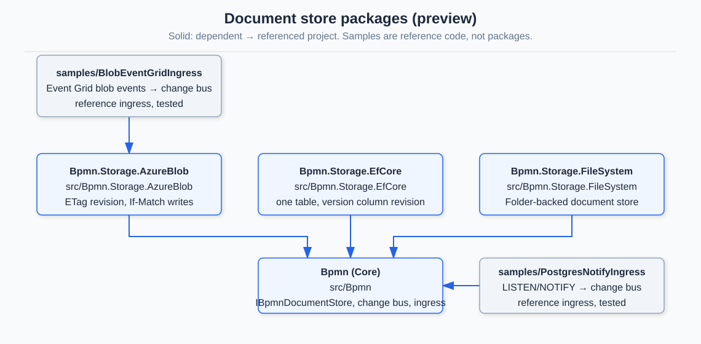

# Storage backends: Azure Blob and EF Core (preview)

Documents are kept by an `IBpmnDocumentStore`. Core ships an in-memory store, `Bpmn.Storage.FileSystem` keeps a folder of files, and two packages keep
documents in a service you probably already run. Every store passes the same contract suite
(`Hasseware.AspNetCore.Components.Bpmn.Storage.Testing`), so an editor, the MCP server and the live-update transports behave the same over any of them. Storage
itself is described in [document-storage.md](document-storage.md); how an editor hears about a change is in [live-updates.md](live-updates.md).



| Package | Keeps documents in | Revision | Concurrency |
|---|---|---|---|
| `…Storage.FileSystem` | a folder | a hash of the file length and write time | a lock plus a check |
| `…Storage.AzureBlob` | a blob container | the blob's ETag | `If-Match` / `If-None-Match: *`, decided by the service |
| `…Storage.EfCore` | one table of any EF Core database | a version number the store keeps | `UPDATE … WHERE Version = @held`, decided by the database |

## What a revision is, and why it matters

A revision is an opaque string that changes whenever the stored content does. A save carries the revision it was based on and succeeds only if it is still
current; otherwise the store reports a conflict and nothing is written. That check is what keeps two writers from overwriting each other, and it is why
no store reads first and writes afterwards. Treat revisions as opaque: compare them for equality only.

## Azure Blob

```csharp
builder.Services.AddSingleton(_ => new BlobServiceClient(new Uri("https://myaccount.blob.core.windows.net"), new DefaultAzureCredential()));
builder.Services.AddBpmnAzureBlobDocumentStore(
    provider => provider.GetRequiredService<BlobServiceClient>().GetBlobContainerClient("diagrams"), prefix: "prod");
```

- Layout: `<prefix>/<path>` for the default space, `<prefix>/~tenants/<tenant>/<path>` for a tenant.
- **Credentials.** Use a managed identity scoped to one container: `Storage Blob Data Contributor` for a host that writes, `Storage Blob Data Reader` for a read-only one.
  Connection strings and keys belong in host configuration and are never returned by a tool or logged.
- **Recovery.** Turn on soft delete and blob versioning on the container; deleting a document through the store is not undo.
- **Listing** is bounded by `MaxListEntries` (100,000) because folders are built from the flat blob list.

## EF Core

```csharp
protected override void OnModelCreating(ModelBuilder modelBuilder) =>
    modelBuilder.ApplyBpmnDocuments(pathCollation: "Latin1_General_100_BIN2");

builder.Services.AddDbContextFactory<AppDbContext>(options => options.UseSqlServer(connectionString));
builder.Services.AddBpmnEfCoreDocumentStore<AppDbContext>();
```

- One table, key `(Tenant, Path)`. Add it with a migration like any other.
- **Collation.** Folder queries compare the path ordinally (a range from `a/b/` to `a/b0`, never `LIKE`). SQLite and PostgreSQL's `C` collation do that by default; **on SQL
  Server pass an ordinal (`BIN2`) collation**, or documents whose names differ only in case or accents may sort into the wrong folder.
- **Listing** reads paths, sizes and times only and is bounded by `MaxListEntries` (100,000).
- The store is provider-agnostic; the repository's tests run it against SQLite, and the same suite runs against SQL Server when `BPMN_SQLSERVER_CONNECTION` is set.

## Writes that bypass the store

A store tells the change bus about each write that goes through it. The notice is best-effort: if the bus fails after a write succeeded, the write still succeeds and the failure is swallowed, because a notification that cannot be sent must not turn a saved document into an error. Editors then find out at their next read or save. A write that does not (a portal upload, a script, another application) is invisible to editors until
they read again, and they will still be protected at save time by the revision check. To warn them sooner, forward the backend's own change signal with
`BpmnDocumentChangeIngress`: it turns "key, revision, deleted or not" into a bus change and drops a repeat of the revision it announced last, because backends deliver at least once.

| Backend | Signal | Sample |
|---|---|---|
| Azure Blob | Event Grid `BlobCreated` / `BlobDeleted` (the event carries the ETag, which is the revision) | [`samples/BlobEventGridIngress`](../samples/BlobEventGridIngress) |
| PostgreSQL | `LISTEN` / `NOTIFY` from a trigger | [`samples/PostgresNotifyIngress`](../samples/PostgresNotifyIngress) |
| SQL Server and others | pull-based (Change Tracking, CDC) or none; poll in your own service and call the ingress | none |

The samples are reference code, not packages: they build with the solution and their parsing and endpoint are tested, but a real host owns authentication, hosting and the broker.
With more than one instance, the bus itself must span instances (a broker-backed `IBpmnDocumentChangeBus`); the in-process bus reaches only its own process.

## Testing without the service

- Azure: implement `IBpmnBlobContainer` (six small operations) and give it to `AzureBlobBpmnDocumentStore`; the repository's fake has real ETag semantics. Set
  `BPMN_AZURITE_CONNECTION` to run the same suite against Azurite.
- EF Core: a SQLite file database per test.
- Your own store: inherit `BpmnDocumentStoreContractTests`.
