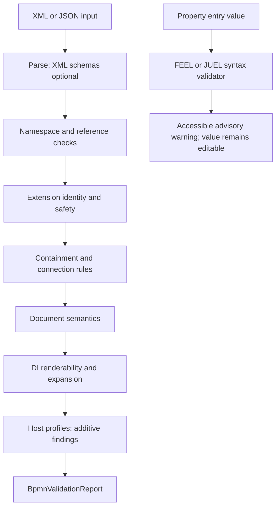

# Document validation

The document-scoped half of the rule table. The canvas judges a gesture as it happens, against the
same `rules/bpmn-rules.json`; a rule like "every node is reachable from a Start Event" is not about
a gesture and cannot be answered while one is in flight. Those rules belong here, and they run over
the model rather than the SVG — because the model is what gets exported.

## What it guarantees

Three outcomes, as §5.5 requires: **exportable**, **exportable with warnings**, or **not
exportable**. An error blocks save and export; a warning is advisory. `BpmnValidationReport`
answers all three through `IsExportable` and the two counts, and never through a boolean — a
document with warnings is a document you can still work in.

Nothing returns early. §5.5: "retain all issues rather than stopping after the first failure". A
document that fails the reference layer is still walked for containment and DI, because someone
fixing a document wants the whole list, and a half-reported one reads as though the editor gave up.

## Where the rules live

Severity and wording come from the generated `BpmnRules` catalog, which the source generator builds
from `rules/bpmn-rules.json` — the same file the TypeScript side reads. A validator carrying its own
copy of either would be a second definition of each rule, and the one that drifts.

The **rule id is the contract**. §5.3 exists so a finding can be referred to from a tooltip, a test
and a document without depending on its wording; the message may be reworded freely, the id may not.

## The layers

Run in §5.5's order:

| Layer | Rules |
|---|---|
| Reference / index | D017, D018, D023 |
| Extension identity | EXT-001 |
| Containment | D007, D019, SF-007 |
| Notation / connection | D001–D006, D008, D011, D013, D014, SF-017, SF-018, MF-003, MF-006, MF-007, MF-008 |
| Namespace / references | D017, D018, D021, D023 |
| Document semantics | D009, D010, D012, D020, plus the model's own invariants |
| DI / renderability | D015, D022 |

Well-formed XML is required by the reader. XSD validation is optional: `BpmnXmlReader.Read` accepts
an already-loaded `XmlSchemaSet` and reports its findings as `SchemaError` import diagnostics.
`BpmnImportResult.SchemaValidationStatus` distinguishes `NotRun` (no non-empty schema set was
supplied), `Passed`, and `Failed`; an empty set never implies successful validation. The reader never
resolves `schemaLocation`, fetches a schema, or bundles OMG schemas. D021 independently checks
target namespace and QName consistency on the semantic model.

### Validation boundaries

The import reader, document validator and property-entry syntax validator have different jobs.
Optional XML schema checks run only against schemas the host already supplied; expression warnings
are entry feedback, not an additional export-blocking document layer.



## Expression syntax validation

`IBpmnExpressionValidator.Validate(BpmnExpressionLanguage language, string expression)` is a
replaceable managed syntax-validation service. `AddBpmnComponents()` registers
`BpmnExpressionValidator` with `TryAddSingleton`; standalone built-in entries fall back to the
same implementation when no service is registered.

- `Feel` accepts an optional leading `=`. `Juel` checks `${...}` and `#{...}` fragments inside
  composite strings and accepts literal text. `None` performs no expression check.
- Validation never evaluates expressions and does not resolve variables, types or engine
  functions. Syntax acceptance is not a guarantee an execution engine will accept or run a value.
- The default implementation returns the **first diagnostic** or an empty list. Diagnostic
  `Offset` and `Length` are UTF-16 code units in the original supplied value, including prefixes.
- Recursive parser nesting is capped at **128**; excessive nesting produces a diagnostic rather
  than unbounded recursion. This cap is separate from JSON's 256-level input limit.

```csharp
using Hasseware.AspNetCore.Components.Bpmn.Validation;

IBpmnExpressionValidator validator = new BpmnExpressionValidator();
var feelFindings = validator.Validate(BpmnExpressionLanguage.Feel, "= amount > 100");
var juelFindings = validator.Validate(BpmnExpressionLanguage.Juel, "Assigned to ${user.name}");
```

Property metadata chooses the language through `BpmnPropertyEntry.ExpressionLanguage`; list
columns also carry `ExpressionLanguage`, passed to their row entries. FEEL-capable entries can
infer `Feel` from optional/required FEEL metadata. Optional FEEL values without `=` are literals
and skip FEEL validation; static values skip it too.

Built-in text, multiline and FEEL entries display the first syntax warning with `aria-invalid`
and `aria-describedby` pointing to its message. Text/multiline entries preserve existing binding
errors rather than replacing them; FEEL entries can expose both a binding error and a syntax
warning. These warnings are **advisory**: submission remains enabled and invalid syntax can be saved into the
model while being edited. They do not change `BpmnValidationReport.IsExportable`.

The Camunda 7 schema provider marks expression-bearing attributes as JUEL, including
`delegateExpression`, `expression`, `topic`, `assignee`, `candidateUsers`, `candidateGroups`,
`dueDate`, `followUpDate`, `priority`, `formKey`, `calledElementVersion`,
`calledElementVersionTag` and `calledElementTenantId`. Relevant extension text/attributes such as
`sourceExpression` and `businessKey` receive JUEL metadata too. Templates and schema-backed
providers choose FEEL or JUEL according to their binding metadata; not every string field is an
expression.

Implementation: [`Validation`](../src/Bpmn/Validation/),
[`entry validation`](../src/Bpmn/Components/Properties/BpmnExpressionEntryValidation.cs), and
[`Camunda 7 schema groups`](../src/Bpmn/Components/Properties/BpmnCamunda7SchemaGroups.cs).

## Judgement calls

**EXT-001 is a warning, and the document stays exportable.** Extension content in no namespace has
no expanded-name identity (§6.1.2), so nothing can claim it and two vendors' `properties` elements
cannot be told apart. But it round-trips perfectly well, and refusing to export a document over
content the editor was never going to interpret would be the editor overreaching. It is reported
because it is worth knowing, not because it is broken.


**D004 is product lint, not a BPMN conformance rule.** It requires either one default flow or an
explicit `conditionExpression` on each non-default branch of an Exclusive/Inclusive split. A flow
name is presentation text, not a machine-readable condition, and does not satisfy the lint. BPMN
supports non-executable processes, so D004 does not claim that an unconditioned split is invalid
under the specification; it flags a decision that may be ambiguous to an executing engine. This
product policy is currently an error and therefore blocks export until resolved.

**D009 is a warning.** A diagram under construction is full of orphans and dead ends, and an editor
that called them errors would refuse to let anyone build one.

**D009 follows a Boundary Event's escape path.** A node reached only through a Boundary Event's own
outgoing flow is reachable; treating attachment as a graph edge is what makes that true.

## What the fixtures say

Eight of the tested fixtures validate completely clean. The others produce the findings below,
confirmed against their XML:

| Fixture | Finding | The defect |
|---|---|---|
| `pizza-store.bpmn` | D006, MF-008 | `pizza received` is an `intermediateThrowEvent` on the catching end of both an Event-Based Gateway branch and a Message Flow. |
| `order-process.bpmn` | D004 | The "Yes"/"No" branch names are labels, not `conditionExpression` values, and neither branch is default. |
| `smart-parking.bpmn` | D004, MF-008 | One Exclusive split has two branches that are anonymous *and* unconditioned; `Recieve availability information` is another throw Event being sent to. |
| `self-serve-restaurant.bpmn` | D017 | A `sequenceFlow` whose `targetRef` is a Text Annotation (DA-003: that is an Association's job). |
| `recruitment-and-selection.bpmn` | D017 | A `sequenceFlow` whose `sourceRef` is a Data Object Reference (DA-004: data is not control flow). |

They are pinned by rule id in `FixtureValidationTests` rather than corrected in the fixtures. A
sample that is wrong in a realistic way is worth more than one that has been tidied, and a rule that
stops reporting one of these has regressed.

## Cost

Linear. Every rule that asks "what arrives at this node" would otherwise walk the flow collection to
find out, which turns a linear document into a quadratic validation; the lookups are built once per
run. The 602-shape fixture validates in well under a frame, which is what lets the editor re-run on
every edit rather than behind a button.

`BpmnEditor.Validation` caches against the document instance. The model is immutable, so a document
that is the same reference cannot have changed — the cache is exact rather than a guess.

## Not yet implemented

- **D016** — Complex Gateway `activationCondition` lint. The expression is now retained, editable,
  and serializable, but the validator does not yet warn when a multi-incoming Complex Gateway lacks
  one.
- **EXT-002** — inconsistent namespace prefix mapping. Unreachable from the model, by design: the
  reader normalises prefixes away at import, keying foreign attributes by `{uri}localName` and
  storing an extension's namespace as its URI, because a prefix is arbitrary and a document may
  rebind it (§10.6). The writer declares whatever prefix it needs. So an inconsistent mapping
  cannot survive into a document the validator sees, and a rule that fires on nothing is worse than
  an absent one. If a fidelity mode ever preserves the original prefixes, this rule becomes
  checkable and should be added then.
- **EXT-003 to EXT-008** — malformed XML, adapter rejection, unresolved extension references, core
  overrides, suppressed decorations, blocked schema access. Every one of them is about a registered
  extension adapter or the reader, not about the finished model. EXT-003 in particular is the
  reader's: a document that did not parse never reaches here.
- **§5.5 schema layer** — the reader can validate against an explicitly supplied, preloaded schema
  set. The library does not ship the OMG XSD chain and does not fetch schemas, so default reads do
  not claim full XSD conformance.

§5.5 step 7, the extension and profile layer, is no longer deferred. It runs two things:

- **EXT-010** quarantines active markup found in preserved extension content — a `script`, `iframe`
  or `foreignObject` in the HTML or SVG namespaces, an `on*` handler inside either, or a
  `javascript:`, `vbscript:` or `data:text/html` URL anywhere. The content is still preserved
  exactly, because §6.1 requires it to round-trip untouched; the document is reported
  non-exportable instead. Scoped narrowly on purpose: a vendor's own `script` element is not
  executable and quarantining by local name would make most real documents unusable.
- **Host profiles** (`IBpmnProfileValidator`) add rules that belong to an execution engine rather
  than to BPMN. They may only add: ids outside the `PROF-001`..`PROF-199` range §5.4 reserves are
  refused, and a profile that throws is reported without taking the core findings down with it.
  §5.5 requires this layer to run "without weakening core errors", and a profile that could silence
  the core would be a setting that turns validation off.
- **Script Tasks** are checked by `BpmnScriptTaskProfile`, registered by `AddBpmnComponents()`.
  It reads a task's `scriptFormat` and `script` and reports `PROF-111` (no format), `PROF-112`
  (format not in `BpmnScriptOptions.AllowedFormats`), `PROF-113` (no script), `PROF-114` (script over
  `MaxScriptLength`, which is not parsed), `PROF-115` (no validator for the format), `PROF-116` (a
  syntax error, with line and column), `PROF-117` (a language validator failed) and `PROF-118`
  (brackets nested deeper than `MaxNestingDepth`, which is not parsed). Syntax is
  delegated to whichever `IBpmnScriptValidator` owns the format, compared ignoring case; the first
  one registered for a format wins, so a host can override a package's default. The core knows no
  language. Opt-in packages supply them: `Bpmn.Scripting.CSharp` (Roslyn), `Bpmn.Scripting.JavaScript`
  (Acornima) and `Bpmn.Scripting.Lua` (Loretta), registered with `AddBpmnCSharpScripting()`,
  `AddBpmnJavaScriptScripting()` and `AddBpmnLuaScripting()`. A validator only parses: a script is
  code from whoever wrote the document, so nothing here compiles-and-loads or runs it, and names and
  types are left for the engine to resolve. Length and nesting are capped before any parser runs,
  because a parser's cost grows with nesting rather than length: a few thousand open parentheses
  overflow the stack of a Lua parser and keep Roslyn busy for seconds. Scripts over 1,000 characters
  are also parsed on a thread with a large stack (falling back to a smaller one on a host short of
  address space), so a chain of operators the bracket count cannot see still cannot end the process.
  A browser has no such thread, so in Blazor WebAssembly the length and nesting limits are the whole
  defence; that case is not tested. Missing format, empty script and unvalidated format
  default to warning, warning and info, a validator that fails to warning, and the host can change each.
