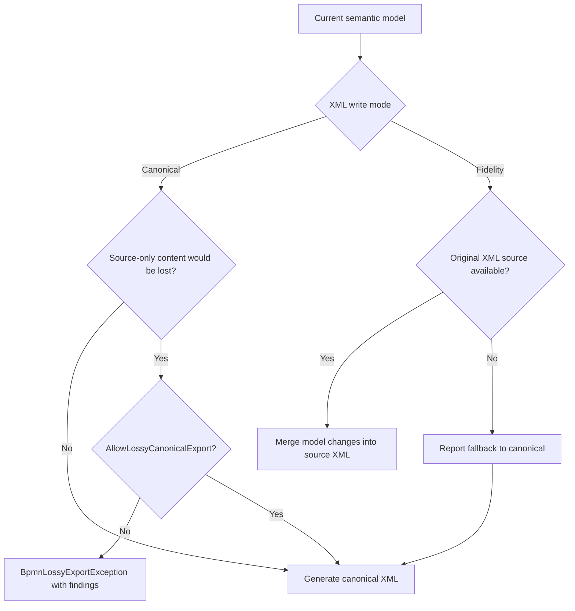

# BPMN XML interchange

How this library reads and writes BPMN 2.0 XML, and what each export mode guarantees.

Specification section 10.6 requires two export modes and requires each save command to document
which one it uses. This is that document.

For the versioned model-based JSON alternative, see [JSON interchange](json-interchange.md).
JSON does not retain the XML source tree: a JSON-opened document can produce canonical XML,
but cannot restore the formatting or source-only content of its earlier XML file.

## The two modes

| | `BpmnWriteMode.Canonical` | `BpmnWriteMode.Fidelity` |
|---|---|---|
| How it works | Regenerates the whole document from the semantic model | Edits the XML the document was read from |
| Deterministic | Yes — same model, same bytes, on any machine | Yes, but the bytes depend on the source file too |
| Needs a source | No | Yes; falls back to canonical and says so |
| Comments, processing instructions | **Dropped** | Preserved |
| Original whitespace and attribute layout | Reformatted | Preserved |
| Unknown attributes on known elements | Preserved (they are in the model) | Preserved |
| Elements the reader never modelled | **Export refused by default** if any will be dropped; explicit opt-in writes canonical output and reports losses | Preserved |
| Ids on elements the model stores without one | **Dropped** | Preserved |
| Use it for | A new document, an export, a test oracle | Saving a file the editor did not create |

Both modes preserve, in full:

- DI geometry, as the model holds it — bounds and waypoints are written back as the doubles the model
  has, with no rounding and no rerouting. The one exception is **connector ends**: on import each is
  moved onto the outline of the shape it joins (section 4.6), and the reader reports every connector
  it moved (section 10.6), so the model, and therefore a fidelity save, carries the moved coordinates.
  See [Connector ends on import](#connector-ends-on-import).
- `extensionElements` content, verbatim, including nested elements, namespace-qualified attributes
  and text (section 10.5).
- Namespace-qualified attributes on otherwise-known elements, such as `zeebe:modelerTemplate` on a
  plain `serviceTask`.
- The global definition catalog from section 1.0 — messages, signals, errors, escalations, item
  definitions, data stores, categories, resources, interfaces and global tasks — so every reference
  still resolves after an export.
- Document-level `import` and `extension` declarations, and the namespace prefixes the document was
  written with.
- Out-of-scope Choreography and Conversation content (section 8) and unknown vendor root elements,
  kept verbatim rather than deleted.
- BPMNDI `di:extension` content and `BPMNLabelStyle` definitions.

## BPMN in Color

The editor reads, writes, and renders the [BPMN MIWG BPMN in Color extension](https://github.com/bpmn-miwg/bpmn-in-color).
Its namespace is `http://www.omg.org/spec/BPMN/non-normative/color/1.0`; the prefix is arbitrary.

| DI element | Attribute | Rendering |
|---|---|---|
| `BPMNShape` | `color:background-color` | Shape fill, including swimlane headers |
| `BPMNShape` | `color:border-color` | Outline and notation glyphs |
| `BPMNEdge` | `color:border-color` | Connector line and markers |
| `BPMNLabel` | `color:color` | Internal or external label text |

Values are opaque six-digit hex triplets (`#RRGGBB`), case-insensitive. Shorthand, alpha, named colors,
gradients, and shadows are not MIWG colors. Invalid or inapplicable imported attributes are preserved
and reported as degraded, never inserted into SVG/CSS. Missing colors use the current theme; authored
colors override ordinary light/dark themes. OS forced-colors mode uses system colors instead.

For compatibility, shape `bioc:fill` and shape/edge `bioc:stroke` are also read from
`http://bpmn.io/schema/bpmn/biocolor/1.0`. A valid MIWG value wins over a valid alias. Invalid values
fall through to a valid alias or the theme. The same opaque hex-triplet restriction applies to aliases.

Colors stay in DI `Extras.ForeignAttributes`, including label extras, so unrelated extensions and
invalid source values survive both export modes. The model exposes validated `BackgroundColor`,
`BorderColor`, and label `Color` accessors, and the lean canvas payload sends only resolved values.
An unedited export does not manufacture MIWG colors from aliases or theme defaults. Color edits write
MIWG attributes and remove the corresponding alias; reset removes both. Color-only labels without
bounds remain valid and preserve their extensions. Color edits do not move shapes or reroute edges.

## How fidelity mode decides what to touch

The canonical writer builds the document the model describes. The fidelity writer then merges that
onto a copy of the original, under one rule:

> An element the writer knows how to produce is the model's to update or delete. Anything else was
> never read into the model, so it is not the model's to change.

`BpmnXmlNames.OwnedElements` is that list. Everything outside it — `ioSpecification`, `property`,
`resourceRole`, vendor elements, comments, processing instructions — is left exactly where it was.
Adding a name to that list without teaching the writer to produce it would make a save delete it.

Two consequences worth knowing:

- **Attributes are asymmetric.** Attributes the canonical tree declares are overwritten; attributes
  only the source has are kept. The editor cannot express "remove this attribute", and keeping an
  unknown one is recoverable where deleting it is not.
- **`incoming` and `outgoing` are not owned.** They restate what `sequenceFlow` already says and the
  model does not store them, so fidelity mode refreshes them in place where the document already had
  them, and never adds them to a file that did without them.

Content is compared before it is rewritten, so a save that changes nothing changes no bytes. Across
the fourteen sample documents, a fidelity export of an unedited file differs from the original by
the following number of lines (`diff`, ignoring line endings):

| Fixture | Fidelity | Canonical |
|---|---:|---:|
| `linked-processes.bpmn` | 0 | 34 |
| `vendor-extensions.bpmn` | 0 | 25 |
| `zeebe-extensions.bpmn` | 0 | 2 |
| `nested-subprocesses.bpmn` | 4 | 294 |
| `global-catalog.bpmn` | 6 | 20 |
| `recruitment-and-selection.bpmn` | 6 | 192 |
| `order-process.bpmn` | 7 | 40 |
| `self-serve-restaurant.bpmn` | 8 | 180 |
| `zeebe-process.bpmn` | 8 | 18 |
| `simple-process.bpmn` | 10 | 26 |
| `collaboration.bpmn` | 18 | 49 |
| `pizza-store.bpmn` | 18 | 117 |
| `smart-parking.bpmn` | 58 | 243 |
| `large-virtualization-stress.bpmn` | 1202 | 6620 |

The rows with 0 or a handful of lines are files whose connector ends were already on their shapes'
outlines. The larger fidelity figures (`collaboration`, `pizza-store`, `smart-parking` and above all
`large-virtualization-stress`, which used to be 0) are connector ends moved on import: they are the
cost of the normalisation described next, not drift in the writer.

## Connector ends on import

A connector end that is not on the outline of its shape is never what anyone meant: it comes from a
tool with a different idea of the outline, a shape that was resized under it, or a route written by
hand. So the reader moves it (`ConnectorEndpoints.Normalize`) and the editor does the same after every
edit, so the document says what the canvas draws.

- **The ends move, and a diagonal flow is made right-angled.** The interior of a route is left
  exactly as read, apart from the one bend beside an end that has to move with it to keep a straight
  segment straight. A Sequence or Message Flow with any segment that is not axial is replaced by the
  simplest right-angled route between its ends (see [Connector routing](routing.md)); Associations
  and Data Associations are never reshaped and keep their straight lines.
- **Projection only.** Each end goes to the nearest point of the outline, never to a magnet, so a
  second pass over the result changes nothing.
- **An end that could not belong to its shape** (farther from it than the shape is large, as when
  every waypoint is at the origin) leaves the outline on the line towards the other end instead.
- **It is reported, per connector** (section 10.6: "every dropped, quarantined, normalized ... item").
  Each such connector gets a `Degraded` diagnostic naming it and how far its end moved (or saying
  its route was replaced by a right-angled one), which the import offer lists under **Changed**. A connector already reported for having no usable route is
  not reported a second time.

The specification does not require this on import: section 4.6's outline rule covers gestures, and
section 11 says imported collisions are "diagnosed rather than silently rewritten". Rewriting is
allowed here only because it is reported.

The fidelity differences are all cosmetic and come from three sources: a trailing newline the
original lacked, `&#39;` written as a literal apostrophe, and — in `order-process.bpmn` and
`zeebe-process.bpmn` — the root element's attributes reflowed onto one line.

That last one is a limitation of LINQ to XML, which does not retain whitespace inside a start tag.
It affects the root element only, and only in files that wrote one attribute per line.

Canonical differences are much larger, and deliberately so: that mode regenerates the file. It
still preserves flow element order within the `flowElement*` slot rather than grouping by element
kind, so the diff reflects real formatting and the omitted `incoming`/`outgoing` children rather
than reshuffled content. When an imported document contains content that canonical output would
drop, the writer throws `BpmnLossyExportException` by default and includes the dropped-content
diagnostics. A caller may set `AllowLossyCanonicalExport` only after deciding to accept that loss;
the returned export result still contains the diagnostics. Newly-created documents have no source
content to compare, so canonical output remains available without opting in.

## Known normalisations

Neither mode loses meaning, but a diff will show these:

- `&#39;` in an attribute value is written as a literal apostrophe. Attribute values are delimited
  with `"`, so both forms parse to the same string.
- Canonical mode writes a `UTF-8` declaration and a trailing newline. Fidelity mode reproduces the
  source's declaration verbatim, or omits it if the source had none, and still normalises the
  trailing newline.
- Canonical mode declares only the namespaces the output actually uses, so a document that declared
  a namespace it never referenced loses that declaration.

Every export returns a `BpmnExportResult` whose `Diagnostics` list is the manifest section 10.6
asks for: what was dropped, what was normalised, and which mode actually ran.

For modeled text-valued XML elements, fidelity mode updates text when the semantic model changed.
If editing text replaces nested source markup the export reports a `Normalized` diagnostic; an
unchanged value retains the original markup. This includes formal-expression bodies, whose edited
content follows the editor's plain-text behavior.

## What is not here

The writer does not validate schema or semantics. Section 10.3 puts the
`BPMN20.xsd` → `BPMNDI.xsd` → `DI.xsd`/`DC.xsd` chain and the section 5 semantic validators after
serialization, as separate passes. The reader can validate against a caller-supplied, already-loaded
`XmlSchemaSet`; it does not bundle OMG schemas or resolve `schemaLocation`. Default reads therefore
check XML well-formedness and editor semantics, not complete BPMN XSD conformance. Folding validation
into the writer would mean a document that fails a rule cannot be saved at all, which is the wrong
answer while it is being edited.

## Seeing it run

`/interchange` in the playground reads any sample, writes it in both modes, reads the result back
and reports what survived, alongside each mode's diagnostics and output. `RoundTripTests` asserts
the same properties over all fourteen fixtures in both modes.
