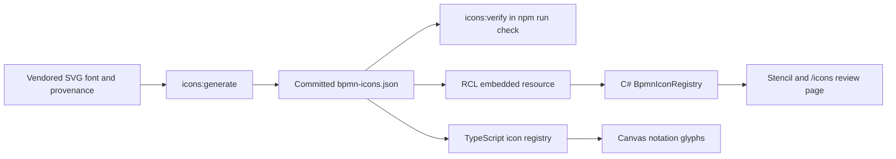

# Shared BPMN icon manifest

`bpmn-icons.json` is the single source of BPMN notation glyphs, consumed identically by the
TypeScript canvas and the C# stencil so the two cannot drift (implementation plan §2).

It is **generated and committed**. Nothing here is a runtime or package dependency: the published
component ships path data and a licence attribution only, and a consuming application needs no
webfont, no bpmn-io package and no network access (specification §4.5).

## Attribution

Icons are derived from [bpmn-font](https://github.com/bpmn-io/bpmn-font) 0.13.0,
© Camunda Services GmbH, under the **SIL Open Font License 1.1**. The full licence text is
vendored at `.source/LICENSE` and must ship with any redistribution.

## Layout

| Path | What it is |
|---|---|
| `.source/bpmn.svg` | Pinned copy of the upstream `dist/font/bpmn.svg`. Vendored, never fetched at build time. |
| `.source/SOURCE.json` | Provenance: package version, tarball and file SHA-256, licence, retrieval date. |
| `.source/LICENSE` | The OFL 1.1 text as published upstream. |
| `bpmn-icons.json` | The generated manifest. Do not edit by hand. |

## Regenerating

```bash
cd src/Bpmn.Scripts
npm run icons:generate   # rewrite icons/bpmn-icons.json
npm run icons:verify     # assert it matches the font and that every assignment resolves
```

`icons:verify` runs as part of `npm run check` and therefore in CI, so a manifest that drifts from
the vendored font fails the build rather than shipping.

## What the generator does

1. Reads the SVG font, whose glyphs are **Y-up about the baseline**, and reflects and scales each
   one into a `0 0 24 24` box. The transform is baked into the path data so a consumer can drop
   the path into any SVG without knowing where it came from.
2. For gateways and event triggers, **strips the outer ring or diamond**, keeping only the inner
   symbol. bpmn-font ships complete pictograms — `gateway-xor` is a diamond *and* an X — but
   specification §4.1/§4.2 require the editor to own that outer geometry, because ring thickness
   and dash pattern encode event context. Icons that went through this carry `isInnerSymbol: true`.
3. Emits the semantic **assignments**: which glyph renders which gateway type, event
   context/trigger pair, task subtype and activity marker.

### About the extraction

Outer geometry is identified by two properties together, because neither alone suffices:

- **Radius** — the tightest ring contour in this font sits at 0.564 of the glyph radius, while the
  widest symbol reaches 0.485 (the Event-Based Gateway's outer circle, with a Terminate Event's
  filled disc just behind at 0.441). The boundary is set between them.
- **Circularity** — a ring is a contour of near-constant radius. This is what stops a Terminate
  Event's disc and an Event-Based Gateway's circles, which are symbols that happen to be circular,
  from being classified on radius alone, and what identifies each short arc of a dashed ring.

The two populations are only about 0.08 apart, so this is calibrated to one pinned font version.
The generator refuses to emit anything that lands near the boundary, naming the glyph and telling
you to re-measure:

```bash
node tools/generate-icons.mjs --inspect gateway-eventbased
```

**A font version bump must be reviewed visually.** Regenerate, then open `/icons` in the
playground, which renders every glyph from the manifest through the C# registry.

## Generation and consumption flow



The RCL embeds the manifest; the TypeScript registry imports the same JSON into the canvas bundle.
Regeneration is a source-maintenance step, not a network fetch during an application render.

## Element-template icons are separate

A template's `icon` is not a new notation glyph and does not belong in `bpmn-icons.json`.
Applying a template persists `modelerTemplateIcon` as a Camunda 7 or Zeebe foreign attribute.
The canvas reads it and renders an SVG `image`, replacing the task/activity type glyph or event
trigger glyph. Event rings and activity geometry still come from the editor's notation shapes;
the stencil also renders safe template icons.

Only inline `data:image/png`, `jpeg`, `gif`, `webp` and `svg+xml` values are accepted, with a
**64 Ki-character** length cap. Remote URLs and other schemes are ignored rather than fetched.
Camunda 8 attributes take precedence over Camunda 7 when both contain drawable icons. Icon
attributes remain model data and survive XML/JSON interchange even when not drawable.

Policy implementations: [`template-icon.ts`](../src/Bpmn.Scripts/src/shapes/template-icon.ts) and
[`BpmnTemplateIcons`](../src/Bpmn/Model/Extensions/Templates/BpmnTemplateIcons.cs).
