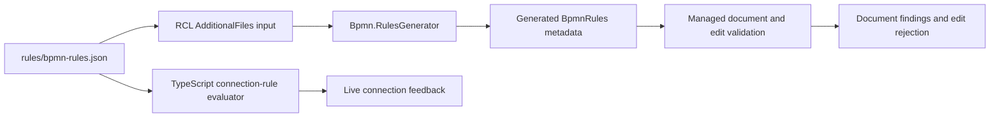

# Shared BPMN connection-rule table

`bpmn-rules.json` is the single source of truth for connection-validation rule IDs, consumed identically by:

- **TypeScript** — live, drag-time validation while connecting two elements on the canvas, in
  `src/Bpmn.Scripts/src/rules/`: `predicate.ts` interprets the expression tree, `endpoint-facts.ts`
  derives the fields a predicate reads from a cell, and `connection-rules.ts` evaluates every live
  rule for a candidate pair. `test/rules/connection-rules.test.ts` runs against **this table**
  rather than a fixture, so a rule whose predicate the evaluator cannot interpret fails the build
  the moment it is added.
- **C#** — a Roslyn incremental source generator (`src/Bpmn.RulesGenerator`) that emits a typed
  `BpmnRules` catalog (id/scope/connectorKind/message/severity per rule) from the same file, so the
  rule catalog is never hand-duplicated.
- **C#, live rules** — `BpmnConnectionRules` (`src/Bpmn/Validation`) evaluates the `live` rules from
  the same table, embedded in Core, for callers that connect elements without the canvas, such as
  agent tools. It is a port of the TypeScript evaluator, not a second rule set.

`connection-cases.json` holds connection cases with their exact expected rule ids and inferred
connector kind. Both runtimes evaluate every case — `test/rules/connection-cases.test.ts` in
TypeScript and `ConnectionRulesTests` in `tests/Bpmn.Tests` — so a rule that fires in one runtime
and not the other fails at least one suite. A deliberate change to a rule updates the affected
cases in the same change.

The split follows the architecture: TypeScript evaluates `scope: "live"` rules during a
connection gesture, because a drag has to be judged at pointer speed. C# evaluates
`scope: "document"` rules (specification sections 5.2-5.5) and surfaces them through
`BpmnValidationPanel`, because it owns the document lifecycle and the semantic model of record.
The generator emits metadata only — it does **not** evaluate predicates — so that C#-side code
referencing a rule ID, message or severity never hand-duplicates it.

Each rule's `predicate` is a small declarative expression tree (`op`/`field`/`value`/`args`), not
free-form code, specifically so it can be interpreted identically by both runtimes. The
predicate evaluates to **true when the rule is violated** (i.e. the connection should be
rejected).

A rule with **`"native": true`** has no `predicate` at all — its `scope` is always `"document"`,
and its real logic lives in hand-written procedural code instead
of the declarative evaluator, because whole-diagram reasoning (counting sibling edges, BFS
reachability, uniqueness across the whole document) doesn't fit a single-connector predicate.
The table entry still exists so its id/message/severity are never hand-duplicated — exactly the
"any predicate too complex for the declarative format is implemented natively on both sides under
the same rule ID" escape hatch the architecture doc always anticipated.

## Generation and runtime consumption

Update the shared table when changing ids, severity or wording, then build the RCL to regenerate
its catalog. Implement native document checks in `src/Bpmn/Validation` rather than adding a
predicate that only the TypeScript interpreter can evaluate. Keep both layers' tests in step:
`src/Bpmn.Scripts/test/rules/connection-rules.test.ts` exercises live predicates;
`tests/Bpmn.Tests/Validation` checks model-level rules.

Run the canvas checks from `src\Bpmn.Scripts` with `npm run check`; run managed tests from the
repository root with `dotnet run --project tests\Bpmn.Tests`. See
[Document validation](../docs/validation.md) for rule ordering and advisory expression syntax checks.
