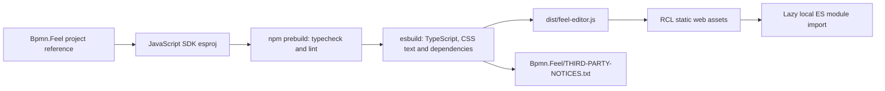

# Bpmn.Feel.Scripts

JavaScript SDK project for the optional [rich FEEL editor RCL](../Bpmn.Feel/README.md).
`src/index.ts` wraps `@bpmn-io/feel-editor` and CodeMirror behind a `create` function and
an editor handle for value, variables, read-only state, accessible attributes and disposal.
It reports commits and parser lint to `BpmnFeelCodeEditor`; it does not own BPMN documents
or execute expressions. Core-only hosts do not download this bundle.

## Commands

Run from `src\Bpmn.Feel.Scripts` with Node.js/npm installed:

```shell
npm ci
npm run typecheck
npm run lint
npm run build -- --build-mode=Debug
npm run build -- --build-mode=Release
npm run clean
```

| Script | Purpose |
|---|---|
| `typecheck` | `tsc -p tsconfig.json` |
| `lint` | ESLint with zero warnings allowed |
| `prebuild` | Typecheck and lint before every npm build |
| `build` | Run `esbuild.config.mjs`, then generate third-party notices |
| `clean` | Remove generated `dist` recursively; keep committed notices |

There is no `check` or test script in this package. Debug is the default when no build mode
is passed; only `--build-mode=Release` enables minification and disables source maps.
The ESM bundle targets ES2022 and is written to `dist\feel-editor.js`.
`src/feel-editor.css` is bundled as text and injected when the module loads, so hosts need
no stylesheet tag. Imports resolve locally into the bundle, with no CDN script fetch.

## .NET and static web asset wiring

`Hasseware.AspNetCore.Components.Bpmn.Feel.Scripts.esproj` declares:

- `DebugAssetsDirectory`: `dist\`.
- `StaticWebAssetSourceId`: `Hasseware.AspNetCore.Components.Bpmn.Feel`.
- `BuildCommand`: `npm run build -- --build-mode=$(Configuration)`.
- `CleanCommand`: `npm run clean`; the script project itself is not packable.

`Hasseware.AspNetCore.Components.Bpmn.Feel.csproj` references this project with
`PrivateAssets="All"`. The JavaScript SDK exposes the generated assets to the RCL; the
browser imports `_content/Hasseware.AspNetCore.Components.Bpmn.Feel/feel-editor.js`.
The RCL's `VerifyFeelEditorBundle` target fails its build when the output is missing.
Source builds require Node.js/npm; NuGet consumers do not.



## Licensing and generated notices

The package manifest declares MIT. `@bpmn-io/feel-editor` and CodeMirror are MIT licensed;
see the generated notice file for every bundled dependency and its full license text.
esbuild retains inline legal comments and produces a metafile. The build walks that
metafile's bundled npm packages, adds the internally bundled `semver` license, and writes
`..\Bpmn.Feel\THIRD-PARTY-NOTICES.txt` with package versions, repositories and license texts.
A vendored notice under `licenses/` covers `@bpmn-io/semver-compat`; missing licenses for
other bundled packages fail generation. The RCL packs the notice file under `licenses`.
Review notice changes after dependency updates; `npm run clean` deliberately leaves it intact.
