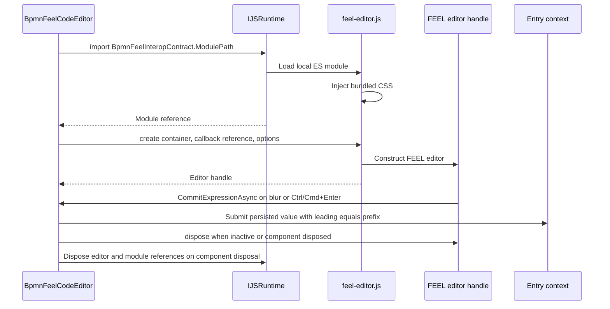

# Rich FEEL editor (optional)

Install `Hasseware.AspNetCore.Components.Bpmn.Feel` alongside the core BPMN package:

```csharp
using Hasseware.AspNetCore.Components.Bpmn;
using Hasseware.AspNetCore.Components.Bpmn.Feel;

builder.Services.AddBpmnComponents().AddBpmnFeelEditor();
```

Register in both server and client when using interactive WebAssembly with prerendering.
No extra stylesheet link is required. The ES module and its styles load lazily when an
editable FEEL expression first appears; core-only applications download none of this bundle.
Explicit editor keys and predicate overrides retain precedence.

Optional properties retain the kind editor in literal mode. The `fx` toggle adds/removes
only the leading `=`. Expressions hide that prefix while editing and restore it on commit.
Empty expressions persist as null. Read-only entries show raw values in a readonly textarea.
Changes commit on blur or Ctrl/Cmd+Enter, not on each keystroke. Revision, source, entry and
selection changes reset local state. Parser diagnostics are advisory, never authoritative
validation. `Context.Variables` supplies nested variable completion hints.

A textarea remains usable during prerendering, while loading, or if JavaScript fails.
The rich editor uses the host's `--bpmn-*` surface/selection tokens and supports forced colors.

## Registry integration

`AddBpmnFeelEditor()` is an `IServiceCollection` extension. It configures `BpmnOptions` by
calling `options.Properties.Editors.AddFeelEditor<BpmnFeelCodeEditor>()`; no custom panel
or JavaScript registration is required. This replaces only the default editor for Required
and Optional FEEL entries, not every text field.

Hosts can instead register their own component with `AddFeelEditor<TComponent>()`, or use
`AddEditor<TComponent>(kind)`, `AddEditor<TComponent>(editorKey)` or a predicate in
`AddBpmnComponents(options => ...)`. Components must implement `IComponent` and accept a
`BpmnPropertyEntryContext` parameter named `Context`. Registry precedence is explicit key,
last matching predicate, FEEL default, kind override, then built-in fallback. A panel-level
`EntryTemplate` bypasses registry rendering. Route changes through context callbacks and
respect read-only/revision state; see the [core integration guide](../Bpmn/README.md#custom-blazor-editors).

## Lazy module lifecycle

`BpmnFeelCodeEditor` initializes after rendering only when an editable FEEL expression is
active. It imports the module through `BpmnFeelInteropContract.ModulePath`:
`./_content/Hasseware.AspNetCore.Components.Bpmn.Feel/feel-editor.js`. Module evaluation
injects the bundled CSS; `create` returns the editor handle. Literal/read-only states need
no rich instance. A failed import leaves the textarea fallback available.



Revision/generation checks reject stale callbacks after a source or selection change.
Value, variable hints, read-only state and accessible attributes synchronize through the
handle without committing every keystroke. Disposal cancels pending initialization and
releases JS/.NET references; a browser-side observer also destroys an editor removed from
the DOM before .NET disposal reaches it. Syntax warnings combine managed validation with
upstream lint and remain advisory.

## Build

`Hasseware.AspNetCore.Components.Bpmn.Feel.csproj` references the sibling JavaScript SDK `.esproj` in `Bpmn.Feel.Scripts`.
`dotnet build` runs its npm build (strict typecheck and zero-warning lint) and ships
`dist\feel-editor.js` as `_content/Hasseware.AspNetCore.Components.Bpmn.Feel/feel-editor.js`.
Debug builds include source maps; Release builds minify. Build requires Node.js/npm;
consuming the NuGet package does not. For a standalone bundle build, run `npm ci`, then
`npm run build -- --build-mode=Debug` in `src\Bpmn.Feel.Scripts` (or use `Release`).
`npm run clean` removes `dist`. Root `.gitignore` excludes that generated directory.
The ESM bundle includes upstream FEEL tooling and CodeMirror. No CDN or remote script is used.

The [script project README](../Bpmn.Feel.Scripts/README.md) documents build commands, static web
asset wiring and notice generation.

## Third-party notices

`@bpmn-io/feel-editor` 2.8.0 and CodeMirror 6 are MIT licensed. Bundled dependencies retain
inline legal comments; full third-party license texts are included in `THIRD-PARTY-NOTICES.txt`
and packaged under `licenses`. The npm build regenerates this committed file in `Bpmn.Feel`;
cleaning script output does not remove it. See that file for bpmn.io, Camunda, CodeMirror and Lezer notices.

## Guides

- [Composing an editor](https://github.com/hasseware/BlazorBpmnEditor/blob/main/docs/composing-an-editor.md)
- [Writing a UI kit package](https://github.com/hasseware/BlazorBpmnEditor/blob/main/docs/writing-a-ui-kit.md)
- [Localization](https://github.com/hasseware/BlazorBpmnEditor/blob/main/docs/localization.md)

See the [2.0 migration notes](https://github.com/hasseware/BlazorBpmnEditor/blob/main/README.md#migrating-from-the-single-1x-package)
when upgrading from the single package.
