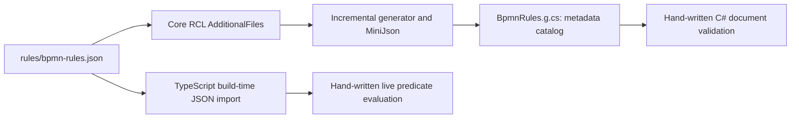

# Bpmn.RulesGenerator

A Roslyn incremental source generator that turns [`rules/bpmn-rules.json`](../../rules/README.md)
into a typed `BpmnRules` catalog for the C# side of the editor.

It is referenced as an **analyzer only** — `OutputItemType="Analyzer"`,
`ReferenceOutputAssembly="false"` — so it never becomes a runtime dependency of the shipped
library.

## Why a generator

The same rule table drives two runtimes. TypeScript evaluates `scope: "live"` rules during a
connection drag, because a gesture has to be judged at pointer speed. C# evaluates
`scope: "document"` rules and surfaces them through the validation panel, because it owns the
document lifecycle and the semantic model.

Both need each rule's id, message and severity. Hand-copying them into C# constants is how the two
sides drift, and a rule code that means one thing in a tooltip and another in a report is worse
than no rule code. So the C# half is generated from the same file the TypeScript half reads.

**The generator emits metadata, not logic.** It does not evaluate predicates. Rule evaluation is
hand-written on both sides; the generator only guarantees that the identifiers, messages and
severities cannot diverge.

## Generation flow

The core RCL includes `rules/bpmn-rules.json` as an `AdditionalFiles` input and references
this project as an analyzer. The generator selects that filename, parses its `rules` array,
and adds `BpmnRules.g.cs` to the consuming compilation. Each `BpmnRuleInfo` carries id,
scope, connector kind, severity and message; `BpmnRules.All` preserves declaration order.
Hyphens are removed from rule ids to form C# field names. No input means no generated
catalog; an invalid root/table shape reports compiler error `BPMNRULES001`.



The TypeScript import lives in `Bpmn.Scripts/src/rules/connection-rules.ts`; esbuild embeds
that same table in the canvas bundle. Change shared messages/severities in the JSON, not
in generated C# or the bundled JS. A table change requires rebuilding both sides.
See the [project-dependency diagram](../../assets/diagrams/project-dependencies.svg)
([Mermaid source](../../assets/diagrams/project-dependencies.mmd)).

## Files

| File | What it does |
|---|---|
| `BpmnRulesGenerator.cs` | The incremental generator: reads the `AdditionalFiles` entry, emits the catalog |
| `MiniJson.cs` | A small JSON reader |

`MiniJson` exists because the project targets `netstandard2.0` — required for analyzers, since they
load into the compiler's own runtime — where `System.Text.Json` is not available without dragging a
package reference into every consumer's analyzer load path.

## Working on it

```shell
dotnet build src/Bpmn.RulesGenerator
```

Generator output lands in the *consuming* project's compilation, so the useful loop is building
`src/Bpmn` and inspecting the generated file through the IDE's analyzer output, or setting
`EmitCompilerGeneratedFiles`.

XML documentation generation is off for this project. Generators emit their own doc comments into
consumer code; requiring them on the generator's internals as well is noise.
