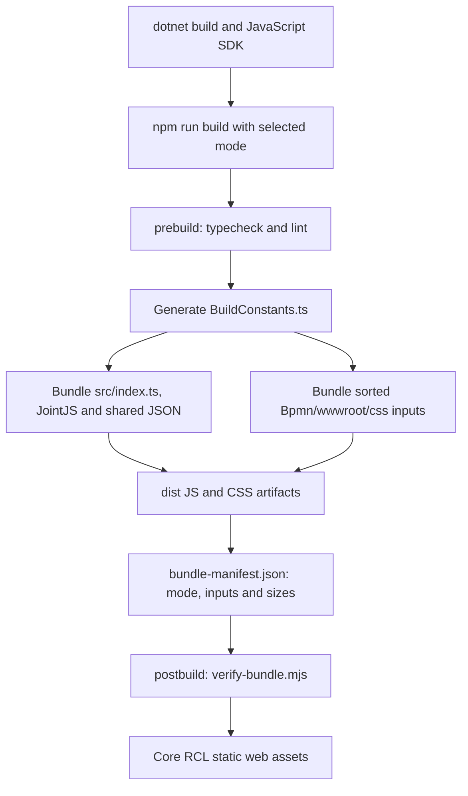

# Bpmn.Scripts

The canvas half of the editor: a TypeScript module that owns the JointJS paper and everything drawn
on it. Built by esbuild into a single ESM bundle plus a CSS bundle, which the
`Hasseware.AspNetCore.Components.Bpmn` project consumes as static web assets.

This is an `.esproj`, so `dotnet build` on the library drives `npm run build` here automatically.

## Commands

```shell
npm ci
npm run check        # typecheck + lint + icon verification + unit tests — the gate
npm run build        # esbuild: JS bundle, CSS bundle, manifest, then verify-bundle
npm run test:watch   # Vitest in watch mode
npm run icons:generate   # regenerate icons/bpmn-icons.json from the vendored font
```

`prebuild` runs `typecheck` and `lint`, because esbuild does neither — it only transpiles, so a
type error would otherwise ship.

## Layout

| Folder | What it owns |
|---|---|
| `src/index.ts` | Module entry point: `initialize` returns the canvas handle; Debug hooks support browser tests |
| `src/canvas/canvas-handle.ts` | Interop handle for lifecycle, document/diagram, viewport, selection, creation helpers, label editing and execution-state calls |
| `src/config/` | Validates and accepts the host configuration before creating JointJS objects |
| `src/interop/` | Versioned payload types and the event bridge — one method per event, 1:1 with a `[JSInvokable]` |
| `src/canvas/` | Per-instance orchestration and the instance registry keyed by id |
| `src/graph/` | Containment hierarchy and the document renderer |
| `src/shapes/` | One JointJS cell class per BPMN element family, plus the `cellNamespace` registry |
| `src/markers/`, `src/icons/` | §4 marker geometry and the shared glyph manifest |
| `src/labels/` | Font metrics, word wrapping and label layout |
| `src/geometry/` | §4 notation constants and outline projection |
| `src/viewport/` | Zoom, pan, fit, wheel handling and touch gesture geometry |
| `src/input/` | Keyboard shortcut matching and dispatch, from host-configured bindings |
| `src/editing/` | Selection and outlines, element-drag commit and the DI-011 check, stencil-drop resolution, drag-to-connect, rectangular selection, resize handles, the §4.6 endpoint pipeline, and the connector tools |
| `src/rules/` | The live half of the shared `rules/bpmn-rules.json` table: the predicate evaluator, endpoint facts, and per-connection validation |
| `src/routing/` | Router selection, live orthogonal routes, connector paths and route geometry helpers |
| `src/execution/` | Transient execution highlights and badges; never persisted into document/history |
| `src/snapping/` | Peer alignment guides: the candidate geometry and the SVG guide layer |
| `src/a11y/` | Per-cell accessible names and the canvas live summary |
| `src/model/` | The TypeScript mirror of the C# semantic model |

## Bundle and manifest flow

The `.esproj` passes `$(Configuration)` to `npm run build`. npm lifecycle hooks run
`prebuild` before esbuild and `postbuild` afterward. The JS entry point pulls together the
canvas modules, JointJS OSS and shared rule/icon JSON. A separate generated CSS entry
collects sorted styles from `Bpmn/wwwroot/css`; esbuild emits one CSS bundle and removes
the intermediate entry. `bundle-manifest.json` records build mode, timestamp, CSS inputs
and byte counts from both esbuild metafiles; it is an artifact inventory, not a runtime API.



`dist` contains `Hasseware.AspNetCore.Components.Bpmn.lib.module.js`,
`Hasseware.AspNetCore.Components.Bpmn.bundle.scp.css`, the manifest and Debug JS source maps.
`StaticWebAssetSourceId` is `Hasseware.AspNetCore.Components.Bpmn`; the core RCL references
the `.esproj` with `PrivateAssets="All"` and checks all three main artifacts exist.
`npm run build -- --build-mode=Release` minifies; omitted/other modes select Debug.
`npm run clean` removes `dist`, not the tracked `BuildConstants.ts`.
See the [build-pipeline diagram](../../assets/diagrams/build-pipeline.svg)
([Mermaid source](../../assets/diagrams/build-pipeline.mmd)).

## Constraints the tooling enforces

- **JointJS OSS only.** An ESLint `no-restricted-imports` rule bans `@joint/plus`, and
  `scripts/verify-bundle.mjs` greps the built bundle for it. The licence boundary is not left to
  reviewer memory.
- **Strict TypeScript**, including `exactOptionalPropertyTypes`, `noUncheckedIndexedAccess` and
  `verbatimModuleSyntax`. `T | null` is used rather than `T?` where the distinction matters.
- **The bundle must be real.** `verify-bundle.mjs` fails the build if the output is missing, under
  50,000 bytes, missing its exports, or missing the CSS bundle or manifest — a silently failing npm build
  would otherwise ship an empty file.
- **`src/BuildConstants.ts` is generated** by the build and flips between `Debug` and `Release`. It
  is tracked, so expect it to show as modified after a build.

## Tests

Vitest, in `test/`, mirroring `src/`. They cover pure logic: word wrapping, outline projection,
marker composition, the interop lifecycle, and `cell.toJSON()` file snapshots per shape family.

Anything that needs a real `dia.Paper` lives in `tests/Bpmn.E2E.Tests` instead — JointJS's ESM
circular imports break paper construction under Vite's SSR transform, and working around that in
the unit runner would be testing the runner.

## Icons

`icons/bpmn-icons.json` at the repo root is generated from the pinned, vendored bpmn-font by
`tools/generate-icons.mjs`, which extracts the *inner* symbol from each complete pictogram. Both
this bundle and the C# registry read that one file. `npm run icons:verify` fails if the committed
manifest has drifted from the font.
