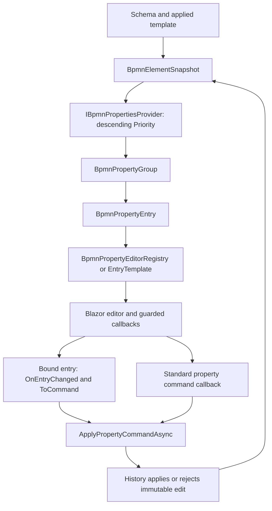
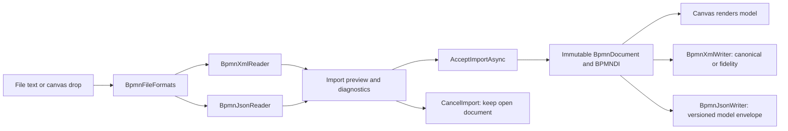
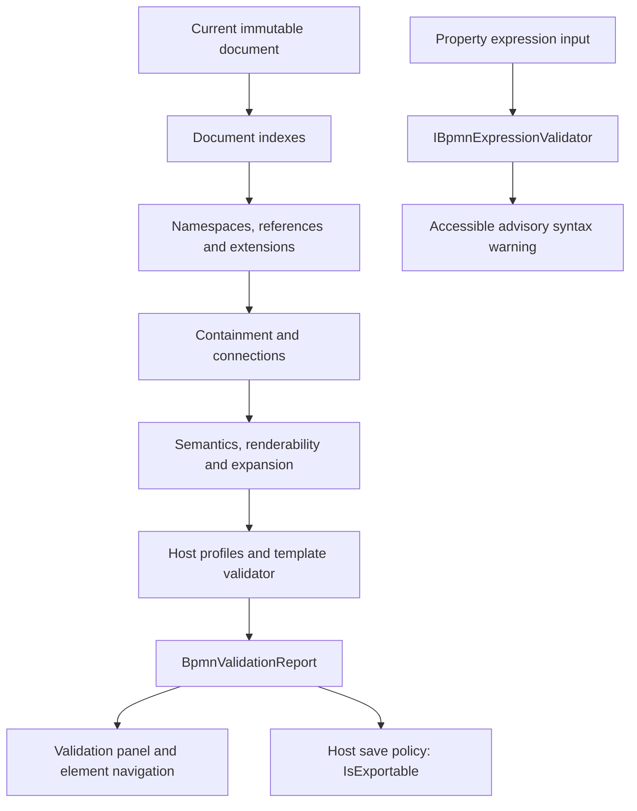

# Hasseware.AspNetCore.Components.Bpmn

Core BPMN 2.0 model, headless editor and canvas components for Blazor. The canvas is SVG rendered
by [JointJS](https://www.jointjs.com/) (the open-source `@joint/core` only) through a single
TypeScript interop module.

## Install

```shell
dotnet add package Hasseware.AspNetCore.Components.Bpmn
```

```csharp
builder.Services.AddBpmnComponents();
```

```razor
@using Hasseware.AspNetCore.Components.Bpmn

<BpmnCanvas Document="@document" />
```

No `<script>` or `<link>` tags are needed. The JavaScript and CSS ship as static web assets and
load through a Blazor JS initializer.

## Editor sessions and custom composition

The [standard editor package](../BpmnEditor/README.md) supplies `BpmnEditor`, toolbar, stencil,
property entries, menus and dialogs. Install it and call `AddBpmnEditor()` for a complete plain
HTML editor; no Fluent UI dependency remains in Core or Standard. Moving these concrete types
out of Core is a breaking package change; their namespaces remain unchanged.

The [Fluent UI editor package](../FluentUI.BpmnEditor/README.md) supplies the independent
`FluentBpmnEditor` composition. Call `AddFluentBpmnEditor()` plus the host-owned
`AddFluentUIComponents()` registration; neither UI kit depends on the other.

Core alone registers only the intrinsic accessible tree and label editor. Its `Session` exposes
editor logic without coupling commands to a layout.

For a custom layout, use `BpmnEditorScope` and one `BpmnEditorCanvas`:

```razor
<BpmnEditorScope @ref="scope" Document="@document" OnDocumentChanged="DocumentChanged">
    <div class="my-editor">
        <BpmnEditorCanvas />
    </div>
</BpmnEditorScope>
```

The scope adds no DOM. It resolves configuration, owns its `BpmnEditorSession` and cascades that
session as fixed plus the current `BpmnEditorState` as non-fixed. Read `scope.Session` after
initialization for commands such as `ApplyAsync`, `UndoAsync`, `RedoAsync`, `SetSelectionAsync`,
`PreviewImport`, `AcceptImportAsync`, `ValidateAsync` and `GoToDiagramAsync`. Commands that edit,
validate or navigate the document work without an attached canvas. Canvas-only operations such
as viewport changes are no-ops until a canvas attaches.

Every state change replaces `Session.State` and raises `StateChanged`. State holds document,
history availability, selection, clipboard, import preview, navigation, execution and separate
`Overlays` slices for context menu, label edit, contextual actions and accessible tree. Collection
snapshots stay stable across later changes; custom children consume these typed cascades.

`BpmnEditorCanvas` requires a scope and rejects a second canvas attached to the same session.
Its optional `ChildContent` renders additional overlays inside the canvas host, preserving
canvas-relative coordinates. Standalone `BpmnCanvas` remains supported. Built-in widgets read
their `Overlays` slice from the cascaded `BpmnEditorState` and send commands to the cascaded
`BpmnEditorSession` (`InvokeMenuCommandAsync`, `CommitLabelEditAsync`,
`InvokeContextualActionAsync`, ...). `BpmnCanvas` also cascades a fixed `BpmnCanvasSurface`
to its child content, so an overlay can tell it is inside a canvas host.

Property surfaces cascade a `BpmnPropertyScope` (CSS block, multiline rows, editor registry,
read-only, document, revision) to their entry editors. Create one with
`<BpmnPropertyScopeProvider>`; unset values inherit from an enclosing scope. Panel content
inside an editor reads `Document`/`DrawnDocument` and `IsReadOnly` from `BpmnEditorState`.

## What is in here

| Folder | What it owns |
|---|---|
| `Components/` | `BpmnCanvas` (interop boundary), session/scope, typed contexts, widget bases, part registry, intrinsic overlays |
| `Model/` | The semantic model of record — a §6-shaped immutable object graph, plus `Model/Di/` for BPMNDI layout and `Model/Extensions/` for preserved vendor content |
| `Editing/` | Edit commands, the pure document editor, snapshot-based undo history, id generation, the per-container stencil, the clipboard, and Pool/Lane tiling |
| `Serialization/` | BPMN XML and versioned JSON readers/writers, format detection and import/export diagnostics |
| `Icons/` | The shared glyph manifest, read from an embedded resource |
| `Configuration/` | The immutable, versioned `EditorConfig` snapshot handed across interop |
| `Interop/` | Versioned payload contracts and the contract-version constant |

## Rules worth knowing before changing anything

**`BpmnCanvas` owns canvas JavaScript interop within this package.** It is the sole owner of the
`IJSObjectReference` and the `DotNetObjectReference`; `BpmnCanvasEventBridge` is the sole holder of
`[JSInvokable]` methods, and does nothing but re-raise typed events. `BpmnEditor` performs no
interop at all. Architecture tests in `tests/Bpmn.Tests/Architecture/` enforce this by scanning the
source, because it is the kind of boundary that erodes one convenient call at a time.

**Navigation and accessibility are configured, not assumed.** Keyboard bindings, wheel behaviour,
touch and alignment guides all come from the configuration snapshot; the canvas binds no keys of its
own. See [`docs/canvas-navigation.md`](../../docs/canvas-navigation.md).

**Every edit is a request.** The canvas renders a document it does not own, so a drag or a
delete crosses interop as an `EditRequest` that Blazor applies. Rejection needs no rollback
because the document is immutable. See [`docs/editing.md`](../../docs/editing.md).

**The SVG is a view, never the source of truth.** The semantic model and the BPMNDI layout model
are the two persisted layers. Geometry read from a document is written back exactly — no rounding,
no rerouting — and unknown vendor content round-trips verbatim. See
[`docs/xml-interchange.md`](../../docs/xml-interchange.md).

## Components are always `.razor` + `.razor.cs`

Components separate headless behavior into Core bases; UI kits provide Razor markup.

## Build

The TypeScript bundle is produced by the sibling `Bpmn.Scripts` JavaScript SDK `.esproj`
and consumed as a static web asset. `dotnet build` runs its npm build with the selected
configuration (Debug includes source maps; Release minifies) and fails fast if output is missing.
Node.js/npm are required when building from source, not when consuming the NuGet package.
For a standalone bundle build:

```shell
cd ../Bpmn.Scripts && npm ci && npm run build -- --build-mode=Debug
```

The optional `Bpmn.Feel` package follows the same pattern with `Bpmn.Feel.Scripts`;
see its README for FEEL bundle and license output.

Warnings are errors in this project and XML documentation is required on every public member.

## Overriding parts

Every piece of chrome the editor draws is a *part*, resolved by `BpmnPart` from `BpmnOptions.Components`.
Resolution order: composition slot (`ToolbarContent`, `StencilContent`, `PanelContent`, `Footer`,
`CanvasOverlays`, `Dialogs`) > host options (`Use`) > the composition's own kit defaults > registry
defaults (`UseDefault`) > nothing. Each composition (`BpmnEditor`, `FluentBpmnEditor`) supplies its kit
defaults, so both kits coexist in one container and a host `Use<>` still overrides either.

| Part | Required base class |
|---|---|
| `Toolbar` | `BpmnToolbarBase` |
| `Stencil` | `BpmnStencilPanelBase` |
| `PropertyPanel` | `BpmnPropertyPanelBase` |
| `ValidationPanel` | `BpmnValidationPanelBase` |
| `DiagramNavigator` | `BpmnDiagramNavigatorBase` |
| `ContextMenu` | `BpmnContextMenuBase` |
| `ContextualActions` | `BpmnContextualActionsBase` |
| `LabelEditor` | `BpmnLabelEditorBase` |
| `AccessibleTree` | `BpmnAccessibleTreeBase` |
| `ImportOffer` | `BpmnImportOfferBase` |
| `CalledElementPicker` | `BpmnCalledElementPickerBase` |
| `ShortcutHelp` | `BpmnShortcutHelpBase` |

```csharp
services.Configure<BpmnOptions>(o =>
{
    o.Components.Use<MyContextMenu>(BpmnEditorPart.ContextMenu);   // wins over any default
    o.Components.Remove(BpmnEditorPart.ShortcutHelp);              // render nothing
});
```

`Use` throws `ArgumentException` when the type does not derive from the part's base. `UseDefault` only
sets a part nobody configured, so a UI kit's registration never overrides the host, in either order.
`CanvasOverlays` and `Dialogs` add to the defaults. Inside a custom layout, render a part with
`<BpmnPart Part="BpmnEditorPart.Toolbar" />`; it must sit inside the editor scope. Toolbar and
PropertyPanel have no Core default: configure them, supply a slot, or call `AddBpmnEditor()`
for both standard defaults. Property entry editors follow the
same rule through `BpmnPropertyEditorRegistry` (`UseDefaultEditor`); `AddFeelEditor<T>()` keeps working.
## Extensions & element templates

Vendor support is opt-in. Register local moddle schemas and template JSON through
`AddBpmnComponents` (namespaces `Configuration`, `Model.Extensions.Schema`,
`Model.Extensions.Templates` and `Editing` under `Hasseware.AspNetCore.Components.Bpmn`):

```csharp
services.AddBpmnComponents(options =>
{
    options.Extensions.AddZeebe().AddCamunda7();
    options.Extensions.AddSchema(BpmnExtensionSchemaLoader.Load(customModdleJson));
    options.Extensions.AlwaysOfferRegisteredSchemas = false;

    var loaded = options.Templates.AddTemplates(templateJson); // string or Stream, not a file path
    // Inspect loaded.Errors or options.Templates.LoadErrors (EXT-004).
    options.Templates.Engines["camunda"] = "8.6.0";
    options.Templates.HonorEntriesVisible = true;
    options.Templates.ShowInStencil = true;
});
```

`AlwaysOfferRegisteredSchemas` defaults to true. Set false in mixed-engine hosts to show
schema groups only when the document declares their namespace or the selected element uses it.
Custom schema registration supplies metadata; add an `IBpmnExtensionGroupBuilder` to
`options.Extensions.GroupBuilders` for custom snapshot groups. `LabelProvider` customizes schema
labels. Unknown extension XML and foreign attributes remain preserved and inspectable.

`Engines` filters compatible template choices, updates and stencil entries using semantic-version
ranges. An empty dictionary applies no engine filter. `HonorEntriesVisible` defaults to false;
opt in to template hiding of standard entries. Hidden template properties are never rendered.
The built-in stencil's collapsible **Templates** section defaults on (`ShowInStencil`), offers the
latest compatible nondeprecated version per id, groups by category, and searches names,
descriptions and categories. Click, Enter/Space or drag creates the base type and applies defaults
in one undo step. `elementType.value` selects the base type; otherwise the first concrete
`appliesTo` type is used, falling back to Task for abstract types. Container rules still apply.
The demo embeds HTTP, notification and Camunda 7 mail templates in `wwwroot\templates`.

### Property providers and rendering

The panel consumes snapshots, not mutable documents. `ExtensionGroups`, `TemplateId` and
`TemplateVersion` carry schema/template state. `IBpmnPropertiesProvider.GetGroups` receives the
snapshot and previous groups; providers run in descending `Priority`: General (1000), element
templates (900), schemas (500), raw extensions (100). Template groups precede schema groups;
claimed fields are excluded, unrelated extension content stays editable. Vendor groups have
namespace badges; multi-selection retains common standard properties only.

Add providers through `options.Properties.Providers` or DI. The panel's `Providers` parameter
replaces the entire chain instead of augmenting it. Rendering overrides:

- `GroupTemplate`: `RenderFragment<BpmnPropertyGroupContext>`. Context exposes `Group`, visible
  `Entries`, resolved `EntryTemplate`, and `IsReadOnly`.
- `EntryTemplate`: `RenderFragment<BpmnPropertyEntryContext>`, overriding editor registry dispatch.
  Context exposes `Entry`, guarded `OnValueChanged` / `OnRowsChanged`, `IsReadOnly`, `Revision`, selected `ElementId`, and FEEL `Variables`.
  Validation text lives in `context.Entry.Error`; expression mode is `context.Entry.Feel`.
- `EmptyTemplate`: untyped `RenderFragment` for empty selection or no editable properties.

A custom group can retain the panel's callbacks by rendering each entry through its context:

```razor
<GroupTemplate Context="group">
    <section aria-label="@group.Group.Label">
        <h3>@group.Group.Label</h3>
        @foreach (var entry in group.Entries)
        {
            @group.EntryTemplate(new BpmnPropertyEntryContext(entry, default, default, group.IsReadOnly, 0))
        }
    </section>
</GroupTemplate>
```

The snippet belongs inside `BpmnPropertyPanel`; its resolved entry renderer supplies the actual
callbacks and current revision. For a completely custom entry renderer, invoke
`context.OnValueChanged.InvokeAsync(value)` or submit the whole list through `OnRowsChanged`;
respect `IsReadOnly` and key stateful controls by `Revision` so refused edits reset their value.

### Property pipeline

Schema metadata and the applied template reach the panel through `BpmnElementSnapshot`.
Providers compose ordered `BpmnPropertyGroup` collections; entries carry value, binding,
visibility, error and expression metadata. `GroupTemplate` and `EntryTemplate` can replace
presentation without replacing the command/history boundary. Otherwise the panel dispatches
an entry through `BpmnPropertyEditorRegistry` to a Blazor component.



For standalone panels, hosts must route the callbacks; rendering an entry does not mutate
its document. Binding factories translate extension/template values into commands, while the
editor applies those commands through history. See the
[property/extension diagram](../../assets/diagrams/properties-extensions.svg)
([Mermaid source](../../assets/diagrams/properties-extensions.mmd)) and
[editing-command diagram](../../assets/diagrams/editing-commands.svg)
([source](../../assets/diagrams/editing-commands.mmd)).

### Built-in FEEL editor

For syntax highlighting, parser diagnostics and variable completion, opt into the separate
[Hasseware.AspNetCore.Components.Bpmn.Feel package](../Bpmn.Feel/README.md) with
`services.AddBpmnComponents().AddBpmnFeelEditor()`. Its bundle loads lazily; the core has no dependency on the rich FEEL bundle.

`BpmnFeelEntry` handles required and optional FEEL properties without JavaScript dependencies.
Required expressions always use a monospace textarea with a FEEL badge. Optional expressions
have an accessible `fx` toggle; literal mode retains the normal editor for the property kind.
The editor hides the leading `=` and restores it on commit; toggling off removes only that prefix.
Static/None modes use the normal kind editor. Read-only expressions show the raw persisted value.
Bracket/string warnings are advisory, not a full FEEL parser; server validation remains authoritative.
Edits commit on change, not each keystroke, and refused edits reset through `Revision`.
Zeebe job type/retries, called process ID, multi-instance input collection/output element, and
IO mapping source cells expose optional FEEL metadata. Camunda 7 fields remain unchanged.

Replace the FEEL default with `options.Properties.Editors.AddFeelEditor<MyFeelEditor>()`.
Explicit editor keys and matching predicates still take precedence.

`AddBpmnComponents()` registers `IBpmnFeelVariableProvider` with a document-wide default that
collects distinct, sorted Zeebe input/output targets and result-variable names (not job definitions).
Register your own provider before `AddBpmnComponents()` to supply scoped or typed hints.
`BpmnFeelVariable` supports `Name`, `Detail`, `Info`, and nested `Entries`. Each entry context
receives `ElementId` and `Variables`; the built-in editor does not offer completion.
The panel resolves hints on selection or document changes, not per entry. Inside `BpmnEditor`,
the document is cascaded automatically; standalone panels can set `Document`. Without a provider
or document, variable hints are empty.

### Custom Blazor editors

`options.Properties.Editors.AddEditor<TComponent>` accepts a kind, an explicit key, or a predicate:

```csharp
options.Properties.Editors
    .AddEditor<MyTextEditor>(BpmnPropertyEntryKind.Text)
    .AddEditor<MyFeelEditor>("feel")
    .AddEditor<MyFeelEditor>(entry => entry.Feel != BpmnFeelMode.None);
```

Resolution order: `entry.EditorKey`, last matching predicate, FEEL default (Required/Optional),
kind, built-in default. Kind overrides do not replace the FEEL default. Predicates
can inspect `entry.Binding` for vendor-specific routing. Components render through
`DynamicComponent` and must accept a `[Parameter] BpmnPropertyEntryContext Context`.
For example, `MyFeelEditor.razor` can host a richer FEEL widget behind this callback contract:

```razor
@using Hasseware.AspNetCore.Components.Bpmn
<label>
    @Context.Entry.Label
    <input value="@Context.Entry.Value" disabled="@(Context.IsReadOnly || Context.Entry.IsReadOnly)"
           placeholder="@Context.Entry.Placeholder" @key="Context.Revision"
           @onchange="@(args => Context.OnValueChanged.InvokeAsync(args.Value?.ToString()))" />
</label>
@if (Context.Entry.Error is { } error)
{
    <span role="alert">@error</span>
}
```

Keep the parameter in `MyFeelEditor.razor.cs`, matching the component code-behind convention:

```csharp
public partial class MyFeelEditor
{
    [Parameter, EditorRequired]
    public BpmnPropertyEntryContext Context { get; set; } = default!;
}
```

This is a host editor integration point, not a FEEL parser or execution engine.

### Commands, validation and paste

For a panel in an editor's custom side slot, pass `OnPropertyChanged` and `OnTemplateCommand`
to `BpmnEditor.ApplyPropertyCommandAsync` to preserve history. Apply, unlink (retain bindings),
remove (remove bindings), and compatible update are available through the template chooser.
`BpmnTemplateChooser` also works standalone with an element snapshot, `BpmnTemplateOptions`,
and `OnCommand`. Read-only cascades block edits and template actions.

Bound entries raise `OnEntryChanged`. Route them through:

```csharp
var command = BpmnPropertyEntryCommands.ToCommand(edit.ElementId, edit.Entry, edit.Value,
    edit.Rows, options.Properties.BindingCommandFactories);
if (command is not null)
    await editor.ApplyPropertyCommandAsync(command);
```

Implement `IBpmnBindingCommandFactory` (`BindingType`, `Create`) and add it to
`options.Properties.BindingCommandFactories` for custom bindings. The template factory is
registered by default; standard extension/attribute/list bindings have built-in routing.
`SetTemplatePropertyCommand` reconciles conditions and defaults atomically. Property keys are
an id or `#n` index; Camunda 7 scoped keys use `scope:<type>[:<id>]/<id or #n>`.

The editor runs `BpmnElementTemplateValidator` alongside host DI `IBpmnProfileValidator`s:
PROF-101 constraints, PROF-102 required FEEL, PROF-103 missing template, PROF-104 deprecated
version, PROF-105 compatible upgrade. Standalone validation can pass this validator explicitly
to `BpmnValidator.Validate`. Required FEEL validation checks the `=` prefix, not expression syntax.

Paste regenerates active `generatedValue: uuid` properties in the same history step, after core
id/reference remapping, while preserving unrelated Extras and foreign attributes. Standalone
histories should add `new BpmnTemplatePasteTransform(options.Templates.Registry)` to
`EditingOptions.PasteTransforms`. Hosts can implement `IBpmnPasteTransform`; a refused transform
rolls back the whole paste.

### Trust boundaries

Schemas/templates are local data: no automatic network fetch of `$schema`, documentation or
icon URLs, no execution of expressions/scripts. Chooser, stencil and canvas icons render only
inline `data:image/` URIs (png, jpeg, gif, webp, svg+xml; at most 64 KiB, checked by
`BpmnTemplateIcons.IsSafe` and its TypeScript twin); remote URLs fall back to normal notation.
JSON loaders cap UTF-8 input at 4 MiB and nesting at 64; malformed templates return EXT-004. Treat inline icon content
and custom components as host-managed data, never inject template strings as raw HTML/SVG.
Embedded Zeebe/Camunda descriptors carry their MIT attribution.

### Template icons on the canvas

An Activity or Event whose `zeebe:modelerTemplateIcon` (or `camunda:modelerTemplateIcon`)
attribute holds a safe data URI draws that icon, 18 px, in place of its type glyph — top-left
for Activities, centred for Events — as Camunda Modeler does. The glyph is hidden with the
`bpmn-template-replaced` class rather than removed, so under `forced-colors` it comes back and
the authored image steps aside. Icons are drawn as authored; a host with monochrome icons can
recolour them for a dark theme through `--bpmn-template-icon-filter` (e.g.
`invert(1) hue-rotate(180deg)`). Unlinking or removing the template restores the glyph.

## Import, export and document ownership

`PreviewImport(fileName, xml)` accepts either format despite the historical parameter name.
`BpmnFileFormats` detects content first, then the extension; the preview holds the parsed
model and diagnostics without changing the open document. `CancelImport()` discards it.
`AcceptImportAsync()` replaces the document, clears history/selection/navigation and raises
`OnImported`. Import is not an undoable edit of the previous file.



XML fidelity mode merges model edits onto the preserved source XML; canonical mode rebuilds
XML and reports normalization/loss. With no XML source, fidelity falls back to canonical
and reports that choice. Canonical export refuses dropped content by default unless
`AllowLossyCanonicalExport` is enabled. Writers are serialization APIs, not document-rule
gates: hosts decide when to enforce `BpmnValidationReport.IsExportable` before saving.

See [XML interchange](../../docs/xml-interchange.md),
[JSON interchange](../../docs/json-interchange.md), and the
[import/export diagram](../../assets/diagrams/import-export.svg)
([Mermaid source](../../assets/diagrams/import-export.mmd)).

## JSON import & export

Besides BPMN 2.0 XML, a document can be saved and opened as JSON. The file is a versioned
envelope around the semantic model, using the same camelCase member names as the canvas interop:

```json
{
  "format": "hasseware.bpmn",
  "version": "1.0",
  "document": {
    "definitions": { "id": "Definitions_1", "targetNamespace": "http://example.com" },
    "processes": [ { "id": "Process_1" } ],
    "flowNodes": [ { "id": "Start_1", "type": "startEvent", "containerId": "Process_1" } ],
    "diagrams": [ ... ]
  }
}
```

Everything the XML reader keeps survives a JSON round trip: semantics, collaborations, pools and
lanes, several processes, DI bounds, waypoints and labels, documentation, and vendor content —
`extensionElements` as ordered trees and foreign attributes keyed `{namespaceUri}localName`
(Camunda, Zeebe and unknown namespaces alike). Empty lists, empty extras and arguments at their
default are left out on write and restored on read.

```csharp
string json = BpmnJsonWriter.Write(document);                      // indented
await BpmnJsonWriter.WriteAsync(document, stream, BpmnJsonWriteOptions.Compact);

BpmnImportResult result = BpmnJsonReader.Read(json);
BpmnImportResult fromFile = await BpmnJsonReader.ReadAsync(stream);

// Either format, detected from the content ('{' or '<'), then the file name.
BpmnImportResult any = BpmnFileFormats.Read(text, fileName);
```

- **Versioning.** A reader accepts any minor version of its major version (a newer minor adds an
  `Info` diagnostic and its unknown properties are ignored) and refuses any other major version.
  `BpmnJsonFormat` exposes the name, version, extension and media type.
- **Errors.** Malformed input, a wrong `format`, an unsupported `version`, a missing required
  member or a `null` list entry throw `BpmnJsonException`. It and `BpmnXmlException` share the
  base `BpmnImportException`, so one `catch` covers both formats.
- **Limits.** `BpmnJsonReadOptions.MaxInputBytes` (64 MiB by default, enforced while a stream
  is read) and `MaxDepth` (256) bound what a reader will parse.
- **Trimming.** Serialization uses source-generated metadata only, so it is safe in trimmed
  WebAssembly hosts.
- **Editor.** `BpmnEditor.PreviewImport` and a file dropped on the canvas accept `.bpmn`, `.xml`
  and `.json`; `BpmnFileFormats.Accept` is a ready-made `accept` filter for an `InputFile`.

JSON has no fidelity mode: it carries the model, not the original XML text, so comments,
attribute order and formatting of the source file are not kept, and a JSON-opened document
exports canonical XML.

## Server-side FEEL and JUEL syntax validation

`AddBpmnComponents()` registers `IBpmnExpressionValidator` using `TryAddSingleton`.
The default `BpmnExpressionValidator` is pure C#: no JavaScript, expression evaluation,
network calls, or engine dependency. Use it directly with `Validate(language, value)`;
results contain a message and UTF-16 `Offset`/`Length` into the supplied value, including
any FEEL `=` prefix or JUEL composite-string prefix. An empty result means syntax is valid.
The validator reports the first syntax error and limits recursive nesting to 128 levels.

FEEL supports literals and temporal `@"..."` literals, names (including spaced names),
paths and filters, arithmetic and comparisons, `between`/`in`, Boolean operators,
`if`/`then`/`else`, `for`/`some`/`every`, functions and named arguments, lists, contexts,
ranges, unary-test alternatives, and escaped strings. FEEL persistence remains unchanged:
expressions use a leading `=`; optional literal values are not parsed.
JUEL supports mixed literal text and `${...}`/`#{...}` expressions, escaped delimiters
(e.g. `\${literal}`), EL operators, ternaries, member/index access, function/method calls,
and string, numeric, Boolean, and null literals. Plain JUEL text is valid.

Schema and template entries expose `ExpressionLanguage` alongside existing `Feel` mode.
Camunda 7 expression fields and input/output collection values receive JUEL metadata;
Zeebe FEEL fields retain their FEEL mode. Standard condition and loop expressions use
FEEL when prefixed with `=`, otherwise JUEL composite syntax. Text controls validate on
input; both built-in and optional rich FEEL editors show server syntax warnings (rich
editor also retains upstream client lint). Errors include accessible control associations.
Warnings never block commits; existing binding/template errors remain authoritative.

To integrate an engine-backed validator, implement
`Hasseware.AspNetCore.Components.Bpmn.Validation.IBpmnExpressionValidator` and register
it before `AddBpmnComponents()` (or replace its service registration afterward). Its
synchronous `Validate` contract receives the language and persisted value, and returns
`BpmnExpressionDiagnostic` records. Built-in editors consume the same service; custom
editors can call it too. Choose a suitable service lifetime for your host/engine.

Validation is syntactic and advisory, not engine execution or type checking. The default
implementation does not resolve variables, function signatures, temporal values, or
engine-specific extensions (e.g. external FEEL functions). Structured Camunda XML values
shown as preserved read-only JSON are not recursively validated. Server-side Blazor runs
the managed validator on the server; WebAssembly runs the same managed code in the browser.


## Document validation pipeline

`BpmnValidator.Validate` builds document indexes once and accumulates findings across all
core layers, then appends host profile findings. Profiles cannot remove or downgrade core
errors. `BpmnEditor` includes `BpmnElementTemplateValidator` alongside DI-registered
`IBpmnProfileValidator` implementations. `ValidateOnChange` defaults to true; its report is
cached by immutable document reference. With automatic validation disabled, call
`ValidateAsync()` explicitly; `OnValidated` reports the new result. `GoToAsync(diagnostic)`
selects the diagnostic's element when it has an id and the canvas is available.



Import/schema diagnostics, document-rule findings and expression-editor warnings serve
separate purposes. XML schema checking needs a host-supplied `XmlSchemaSet`; readers never
fetch schemas. Expression warnings do not block commits or become core rule errors.
See [validation details](../../docs/validation.md) and the
[validation diagram](../../assets/diagrams/validation.svg)
([Mermaid source](../../assets/diagrams/validation.mmd)).

## Localization

`BpmnStrings` backs built-in component labels and semantic display captions: stencil groups,
entries and disabled reasons, property labels and options, type choices, navigation and
accessible graph summaries. `BpmnDisplayLocalizer` exposes the same display helpers to hosts.
Element snapshots, context-menu commands and default contextual actions are localized at source
with the host `IStringLocalizer<BpmnStrings>` (or the current UI culture's resources for direct
`BpmnElementInspector.Describe` calls); names, values and wire identifiers stay invariant.
Document names, reference values, template captions and host overrides are not translated.
Default schema labels are localized at presentation time; a host `IBpmnPropertyLabelProvider`
continues to own its captions.

`BpmnCanvasStrings` backs generated canvas accessibility summaries and type captions, expand
controls, execution badges/statuses and live connection tooltip text. Document/engine names and
rule, diagnostic and log payload values remain invariant. UI culture and `IStringLocalizer`
select resources; missing translations fall back to the neutral English resources.

After resource edits, run the project's `UpdateXlf` target to update all 13 supported cultures
without replacing existing translations.

## Licence

MIT. Glyph path data is derived from [bpmn-font](https://github.com/bpmn-io/bpmn-font) under
OFL-1.1; the attribution travels with the generated manifest.

## Guides

- [Composing an editor](https://github.com/hasseware/BlazorBpmnEditor/blob/main/docs/composing-an-editor.md)
- [Writing a UI kit package](https://github.com/hasseware/BlazorBpmnEditor/blob/main/docs/writing-a-ui-kit.md)
- [Localization](https://github.com/hasseware/BlazorBpmnEditor/blob/main/docs/localization.md)

See the [2.0 migration notes](https://github.com/hasseware/BlazorBpmnEditor/blob/main/README.md#migrating-from-the-single-1x-package)
when upgrading from the single package.
